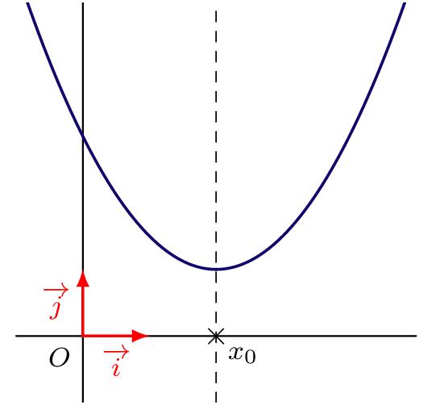
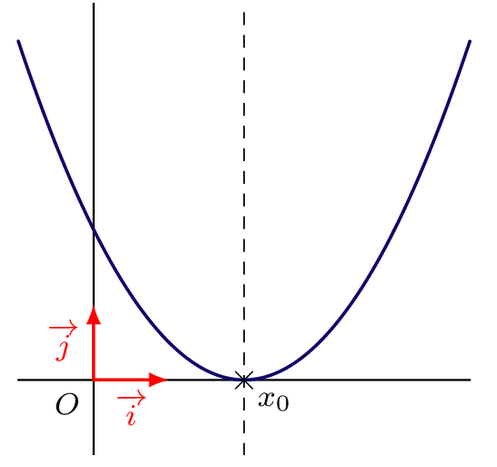
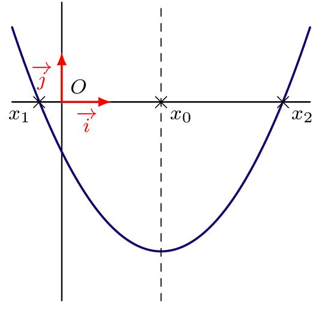
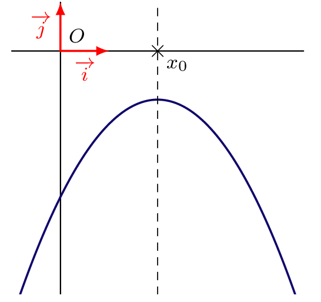
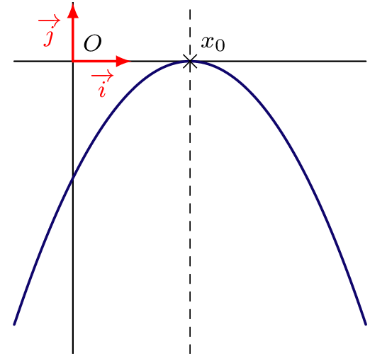
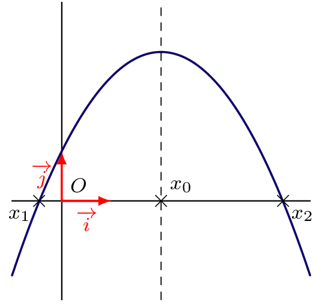
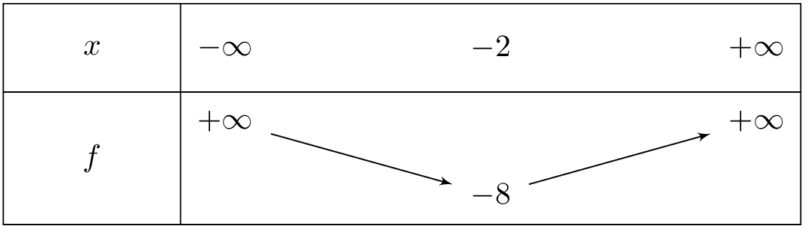

On considère $f$ une fonction polynôme de degré 2. À partir de la forme canonique, et suivant le signe de son coefficient dominant et de $\Delta$, on obtient les cas de figure suivants.

::: {.bloc .info}
À retenir : Les six cas de figure

**$a > 0$**

  
  
  

**$a < 0$**

  
  
  

:::

::: {.bloc .ex}

Exercice : Étude complète (extrait de devoir 2023) — Calculer, Raisonner

On considère la fonction $f$ définie par $f(x)=2x^2-5x+3$, et la fonction $g$ définie par $g(x)=-\left(x-\dfrac{3}{4}\right)^2-4$.

1. a. Résoudre l'inéquation $f(x) \geqslant 0$.

Afficher la correction :

$1$ est une racine évidente. En effet $2 \times 1^2 - 5 \times 1 + 3 =0$.

La fonction étant du second degré et admettant une racine, elle admet une seconde racine $x_2$. Comme le produit des racines vaut $\dfrac{c}{a}=\dfrac{3}{2}$, on a $1 \times x_2 = \dfrac{3}{2}$.

On déduit que les racines de $f$ sont $1$ et $\dfrac{3}{2}$.

Le polynôme est du signe de son coefficient dominant $2>0$ à l'extérieur des racines et du signe contraire à l'intérieur.

On déduit que $f(x) \geqslant 0$ pour $x \in \left]-\infty \, ; \, 1 \right] \cup \left[ \dfrac{3}{2} \, ; \, +\infty \right[$.

   b. Interpréter graphiquement le résultat.

Afficher la correction :

On déduit de la question précédente que la représentation graphique de $f$ est au-dessus de l'axe des abscisses sur $\left]-\infty \, ; \, 1 \right]$ et sur $\left[\dfrac{3}{2} \, ; \, +\infty \right[$.

2. a. Déterminer la forme canonique de $f$.

Afficher la correction :

Pour tout réel $x$,
$$f(x)=2x^2-5x+3 = 2\left(x^2-\dfrac{5}{2}x \right)+3 = 2\left[\left(x-\dfrac{5}{4} \right)^2 - \dfrac{25}{16} \right] + 3 = 2 \left(x- \dfrac{5}{4} \right)^2 - \dfrac{25}{8} + 3 = 2 \left(x- \dfrac{5}{4} \right)^2 - \dfrac{1}{8}$$

   b. Établir le tableau des variations de $f$.

Afficher la correction :

$f$ est une fonction polynôme du second degré de coefficient dominant $2>0$, sa représentation graphique est donc une parabole tournée vers le haut. On déduit de la forme canonique que l'axe de symétrie est $x=\dfrac{5}{4}$.

  

   c. Donner le minimum de $f$.

Afficher la correction :

On déduit du tableau des variations que $f$ admet un minimum en $\dfrac{5}{4}$, qui vaut $-\dfrac{1}{8}$.

3. La fonction $g$ admet-elle un extremum ? Si oui, le préciser.

Afficher la correction :

Pour tout $x \in \R$, $-\left(x-\dfrac{3}{4} \right)^2 \leqslant 0$, donc $g(x) \leqslant -4$.

Or $g\!\left(\dfrac{3}{4} \right) = -4$. On en déduit que pour tout $x \in \R$, $g(x) \leqslant g\!\left(\dfrac{3}{4} \right)$.

Donc $g$ admet un maximum en $\dfrac{3}{4}$, et il vaut $-4$.

4. Sans calcul, préciser la position relative des représentations graphiques de $f$ et $g$.

Afficher la correction :

Pour tout $x \in \R$,
$$g(x) \leqslant g\!\left(\dfrac{3}{4}\right) < f \!\left(\dfrac{5}{4} \right) \leqslant f(x)$$
Ainsi $g(x) < f(x)$ : la représentation graphique de $g$ est située en dessous de celle de $f$.

:::

::: {.bloc .ex}

Exercice : Étude complète (extrait de devoir 2025) — Calculer, Raisonner

Soit $f$ la fonction définie sur $\R$ par $f(x)=3x^{2}+12x+4$.

1. Déterminer la forme canonique de la fonction $f$.

Afficher la correction :

Pour tout $x \in \R$,
$$f(x)= 3x^2+12x+4 =3(x^2+4x)+4 = 3\left((x+2)^2-4\right) + 4 = 3(x+2)^2 - 8$$

2. Quelles sont les coordonnées du sommet de la parabole $\mathcal{C}_f$ représentant $f$ ?

Afficher la correction :

On déduit de la question précédente que les coordonnées du sommet sont $(-2\,;\, -8)$.

3. Déterminer le tableau de variation de la fonction $f$.

Afficher la correction :

$f$ est une fonction polynôme du second degré de coefficient dominant $3>0$. Sa représentation graphique est une parabole orientée vers le haut. Elle admet pour axe de symétrie la droite d'équation $x= -2$. Ainsi,

  

4. On admet que ce polynôme admet deux racines $x_1$ et $x_2$.

   a. Déterminer un réel $a\neq 5$ tel que $f(a)= f(5)$.

Afficher la correction :

D'après la forme canonique de $f$, sa représentation graphique admet un axe de symétrie d'équation $x=-2$.

Ainsi $f(5)= f(-2+7)= f(-2-7) = f(-9)$. Donc $a=-9$.

   b. Sans calculer les racines, montrer que $\dfrac{x_1+x_2}{x_1x_2}=-3$.

Afficher la correction :

En notant $S$ et $P$ respectivement la somme et le produit des racines,
$$\dfrac{x_1+x_2}{x_1x_2} = \dfrac{S}{P} = \dfrac{\dfrac{-12}{3}}{\dfrac{4}{3}} =\dfrac{-12}{4} = -3$$

:::
