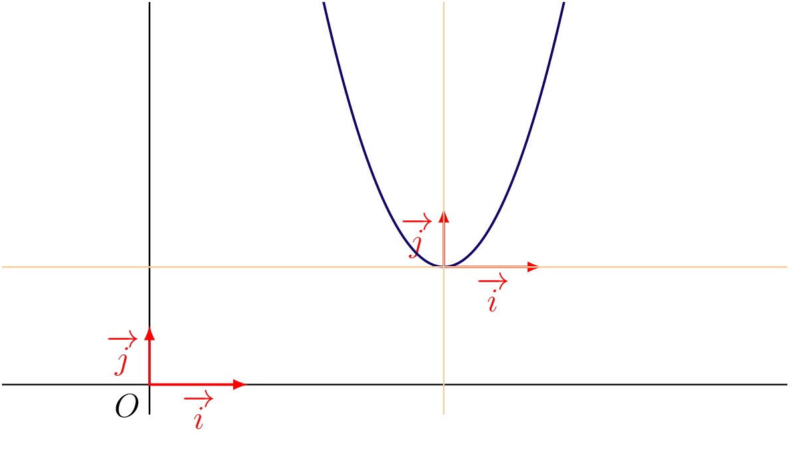

On considère, sur $\R$, les fonctions $f$ définie par $f(x)=ax^2+bx+c$ et $h$ définie par $h(x)=ax^2$, où $a$ est un réel non nul. Soit le vecteur $\ve{u}$ de coordonnées $(\alpha \, ; \, \beta)$, où $\alpha=-\dfrac{b}{2a}$ et $\beta=f(\alpha)$. Montrons que $\mathscr{C}_f = t_{\ve{u}}(\mathscr{C}_h)$.

Pour cela, on montre que $\mathscr{C}_f \subset t_{\ve{u}}(\mathscr{C}_h)$ et que $ t_{\ve{u}}(\mathscr{C}_h) \subset \mathscr{C}_f$.

- Soit $M'(x' \, ;\, y') \in t_{\ve{u}}(\mathscr{C}_h)$. Il existe $M(x\, ;\,y) \in \mathscr{C}_h$ tel que $t_{\ve{u}}(M)=M'$. On a alors, puisque $y=ax^2$,
  $$\begin{pmatrix}
  x'\\
  y'
  \end{pmatrix} = \begin{pmatrix}
  \alpha\\
  \beta
  \end{pmatrix} + \begin{pmatrix}
  x\\y
  \end{pmatrix} = \begin{pmatrix}
  x+\alpha\\
  ax^2+\beta
  \end{pmatrix} = \begin{pmatrix}
  x+\alpha\\
  a(x'-\alpha)^2+ \beta
  \end{pmatrix}$$
  Ainsi $y'=a(x'-\alpha)^2+ \beta$. Donc $t_{\ve{u}}(\mathscr{C}_h) \subset \mathscr{C}_f$.
- Réciproquement, soit $N'(x'\, ;\,y') \in \mathscr{C}_f$. On considère $N (x'-\alpha \,;\, y'-\beta)$. On a $\ve{NN'}= \ve{u}$, d'où $t_{\ve{u}}(N)=N'$ : $N$ est l'antécédent de $N'$ par la translation de vecteur $\ve{u}$. Reste à montrer que $N \in \mathscr{C}_h$. Puisque $N'(x'\, ;\, y') \in \mathscr{C}_f$,
  $$a(x'-\alpha)^2 = a(x'-\alpha)^2 + \beta - \beta = y'- \beta$$
  Donc $N \in \mathscr{C}_h$, d'où $\mathscr{C}_f \subset t_{\ve{u}}(\mathscr{C}_h)$.

Des inclusions réciproques, on déduit que $\mathscr{C}_f = t_{\ve{u}}(\mathscr{C}_h)$.

::: {.bloc .thm}
Propriété : 

Dans le plan rapporté à un repère orthogonal, la représentation graphique de $f:x \longmapsto ax^2+bx+c$ avec $a \neq 0$ est une **parabole** de sommet $S (\alpha \, ; \, \beta)$ avec
$$\alpha=-\dfrac{b}{2a} \et \beta=f(\alpha)=-\dfrac{\Delta}{4a}$$
:::

Démonstration :

La démonstration correspond à la partie traitée ci-dessus.

::: {.bloc .ex}

Exercice : Sommet et repère lié à la parabole — Calculer, Représenter

On considère la fonction $f$ définie par $f(x)=3x^2-18x+29$. Déterminer la forme canonique de $f$, en déduire le sommet de sa parabole, puis représenter la courbe.

Afficher la correction :

Pour tout réel $x$, $f(x)=3 (x-3)^2+2$.

On déduit que le sommet de la parabole a pour coordonnées $S(3\, ; \, 2)$.

Ainsi, dans le repère $(S \, ; \, \ve{i} , \ve{j})$, l'équation de la représentation graphique de $f$ est $y=3x^2$.

  

:::

::: {.bloc .rem}
Remarque : 

En appliquant une transformation appelée « affinité », on pourrait se ramener au repère $\left(S \,;\, \ve{i} \,,\, \dfrac{1}{3} \ve{j}\right)$. Dans ce repère, la représentation graphique a alors pour équation $y=x^2$.

Il s'agit d'une transformation géométrique ayant un facteur d'agrandissement ou de réduction suivant une seule direction.
:::
