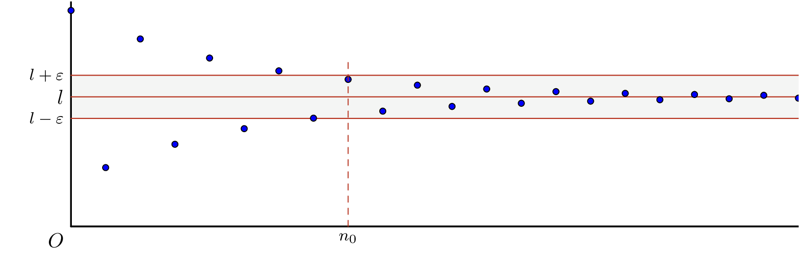

::: {.bloc .def}
Définition : 

On dit qu'une suite numérique $(u_n)$ admet une **limite réelle** $l$ si tous les termes de la suite sont aussi proches que l'on veut de $l$ à partir d'un certain rang. On dit alors que la suite $(u_n)$ **converge** vers $l$.
:::

::: {.bloc .info}
À retenir : Interprétation graphique

  

:::

::: {.bloc .sfc}

Savoir-Faire : Encadrer les termes d'une suite convergente — Représenter

Soit $(u_n)$ la suite définie par $u_n = \dfrac{4n+1}{n+2}$ pour tout $n \in \N$. Quelques valeurs :

<table>
<tbody>
<tr><td>$n$</td><td>$0$</td><td>$1$</td><td>$2$</td><td>\dots</td><td>$12$</td><td>$13$</td><td>\dots</td><td>$68$</td><td>$69$</td></tr>
<tr><td>$u_n$</td><td>$0{,}5$</td><td>$1{,}66\dots$</td><td>$2{,}25$</td><td>\dots</td><td>$3{,}5$</td><td>$3{,}533$</td><td>\dots</td><td>$3{,}9$</td><td>$3{,}901\dots$</td></tr>
</tbody>
</table>

La suite $(u_n)$ semble converger vers $4$ (résultat admis). Que peut-on dire des intervalles ouverts $]3{,}5\,;\,4{,}5[$ et $]3{,}9\,;\,4{,}1[$ vis-à-vis des termes de la suite ?

Afficher la correction :

- L'intervalle ouvert $]3{,}5 \,; \,4{,}5 [$ contient $4$. De plus, il contient tous les termes de la suite à partir d'un certain rang : ici, pour tout entier $n \geqslant 13$, on a $3{,}5 < u_n < 4{,}5$.
- De même, l'intervalle ouvert $]3{,}9 \,; \,4{,}1[$ contient $4$, et il contient tous les termes de la suite à partir d'un certain rang.

:::

::: {.bloc .sfc}

Savoir-Faire : Déterminer un rang seuil — Calculer, Raisonner

Déterminer le rang à partir duquel tous les termes de la suite précédente sont dans $]3{,}9\,;\,4{,}1[$.

Afficher la correction :

On détermine $p$ tel que, pour tout $n \geqslant p$, $3{,}9 < u_n < 4{,}1$. Pour tout $n \in \N$,
$$\begin{aligned}
3{,}9 \leqslant u_n \leqslant 4{,}1
&\Longleftrightarrow 3{,}9 \leqslant \dfrac{4n+1}{n+2} \leqslant 4{,}1 \\
&\underset{n+2 >0}{\Longleftrightarrow} 3{,}9(n+2) \leqslant 4n+1 \leqslant 4{,}1(n+2) \\
&\Longleftrightarrow -0{,}1n \leqslant -6{,}8 \et -0{,}1n \leqslant 7{,}2 \\
&\underset{-0{,}1<0}{\Longleftrightarrow} n\geqslant 68 \et n \geqslant -72
\end{aligned}$$
On déduit que l'affirmation est vraie à partir du rang $68$.

On peut montrer que, pour tout $\epsilon$ suffisamment petit, il existe un rang $p$ tel que, pour tout $n \geqslant p$, $u_n \in ]4-\epsilon \,;\, 4+ \epsilon[$.

:::

::: {.bloc .ex}

Exercice : Justifier une convergence — Raisonner

On considère la suite $(u_n)$ définie par $u_n= 1 -\dfrac{1}{3n^2}$. La calculatrice permet de conjecturer que la suite converge vers $1$. Montrer que, pour tout $k \in \N$, il existe un $n$ vérifiant $1-u_n < 10^{-k}$.

Afficher la correction :

Pour tout entier $n$, $1-u_n = \dfrac{1}{3n^2}$. Pour tout entier $k$,
$$\dfrac{1}{3n^2} <10^{-k} \Longleftrightarrow 3n^2 > 10^k \Longleftrightarrow n^2> \dfrac{10^k}{3} \Longleftrightarrow n>\sqrt{\dfrac{10^k}{3}}$$
Il suffit de prendre le premier entier strictement supérieur à $\sqrt{\dfrac{10^k}{3}}$.

On a ainsi montré ce qui était demandé : la suite $(u_n)$ converge vers $1$.

:::

::: {.bloc .def}
Définition : 

On dit qu'une suite numérique est **divergente** lorsqu'elle ne converge pas.
:::

::: {.bloc .ex}

Exercice : Montrer qu'une suite diverge — Raisonner

Montrer que la suite $u_n = n^2$ diverge.

Afficher la correction :

Il suffit de montrer que, pour tout $A \in \R^+$, il existe un $n$ vérifiant $u_n> A$.
$$n^2 > A \Longleftrightarrow n > \sqrt{A}$$
Il suffit de prendre le premier entier strictement supérieur à $\sqrt{A}$.

On déduit que la suite $(u_n)$ ne converge pas : elle diverge vers $+\infty$.

:::
