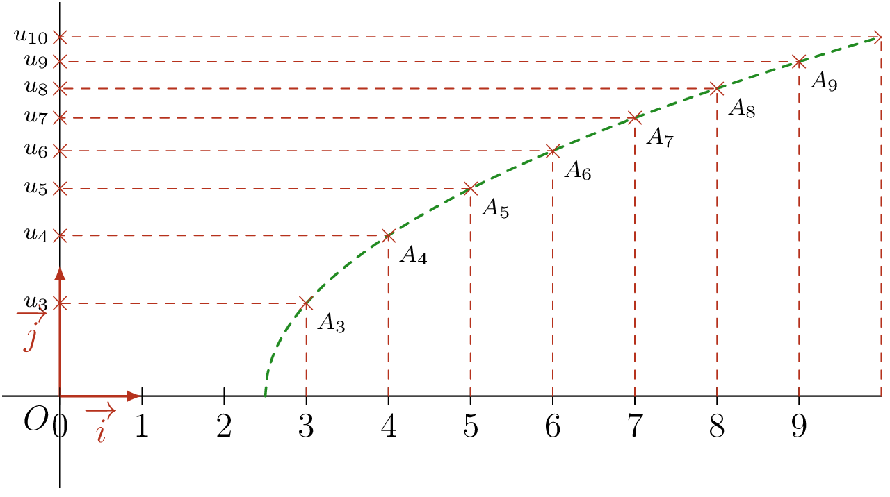

## Définition

::: {.bloc .def}
Définition : 

Soit $f$ une fonction définie sur $[a\,;\,+ \infty[$, avec $a$ réel positif ou nul. On définit une suite $(u_n)$ par
$$\forall n \in \N,\; n \geqslant a,\; u_n = f(n)$$
:::

::: {.bloc .rem}
Remarque : 

- Le premier terme de la suite est $u_{n_0}$, où $n_0$ est le plus petit entier de $[a\, ; \,+ \infty[ \cap \N$.
- Pour qu'une suite soit définie, tous ses termes, à partir de son premier terme, doivent exister.
- On peut calculer n'importe quel terme de la suite connaissant son indice : on parle alors de suite définie de façon **explicite**.
:::

::: {.bloc .sfc}

Savoir-Faire : Expliciter une suite fonctionnelle — Calculer

1. Soit $f$ définie sur $\R$ par $f(x) = 2x^2-5$. Exprimer $u_n=f(n)$ en fonction de $n$ et calculer ses premiers termes.

Afficher la correction :

Pour tout $n \geqslant 0$, $u_n = 2n^2-5$. Cette suite admet pour premier terme $u_0= -5$. On peut calculer directement n'importe quel terme : $u_5 = 2\times 5^2 - 5 = 45$, $u_{20} = 2 \times 20^2-5 = 795$, \dots

2. Soit $f$ définie sur $]2\,;\,+\infty[$ par $f(x) = \dfrac{x}{x - 2}$. Exprimer $u_n=f(n)$ en fonction de $n$ et calculer ses premiers termes.

Afficher la correction :

Pour tout $n > 2$, $u_n = \dfrac{n}{n -2}$. Le premier terme est $u_3 = \dfrac{3}{3-2} = 3$, puis $u_4 = 2$, $u_5 = \dfrac{5}{3}$, \dots

:::

::: {.bloc .rem}
Remarque : 

Dans le second cas, on ne peut pas définir la suite à partir de $u_0$, puisque $u_2$ n'est pas défini.
:::

::: {.bloc .rem}
Remarque : 

Pour une suite fonctionnelle définie par $u_n = f(n)$, les points de la représentation graphique de la suite sont les points de la courbe de $f$ dont les abscisses sont des nombres entiers.

<table>
<thead>
<tr><th>Caractéristique</th><th>Fonction $f$</th><th>Suite $(u_n)$</th></tr>
</thead>
<tbody>
<tr><td>Variable</td><td>Réelle : $x \in \R$</td><td>Entière : $n \in \N$</td></tr>
<tr><td>Notation</td><td>$f(x)$ (image de $x$)</td><td>$u_n$ (terme de rang $n$)</td></tr>
<tr><td>Domaine</td><td>Continu (intervalle)</td><td>Discret (valeurs isolées)</td></tr>
<tr><td>Graphique</td><td>Courbe (ligne continue)</td><td>Nuage de points isolés</td></tr>
<tr><td>Calcul</td><td>On peut calculer $f(0{,}5)$</td><td>$u_{0{,}5}$ n'existe pas</td></tr>
</tbody>
</table>

:::

## Représentation graphique

::: {.bloc .def}
Définition : 

On appelle **représentation graphique** d'une suite $(u_n)$ l'ensemble des points de coordonnées $(n \, ; \, u_n)$, où $n \in \N$.
:::

::: {.bloc .sfc}

Savoir-Faire : Représenter une suite — Représenter

Représenter la suite $(u_n)$ définie par $u_n= \sqrt{n - 2{,}5}$.

Afficher la correction :

Cette suite est définie pour $n \geqslant 3$ : son premier terme est donc $u_3$.

  

:::

::: {.bloc .rem}
Remarque : 

Les points de la représentation graphique ne sont pas les termes de la suite : on lit les valeurs de la suite sur l'axe des ordonnées.
:::
