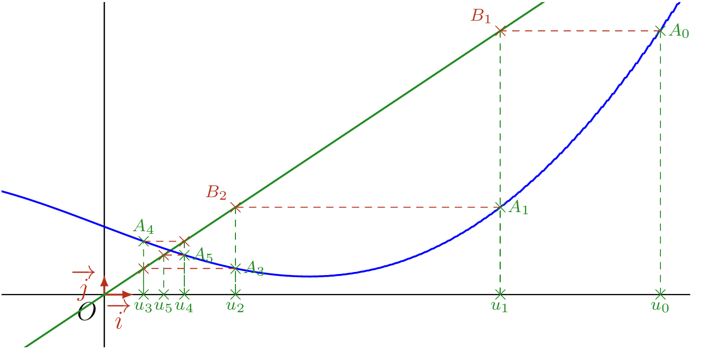

## Définition

On peut aussi définir une suite par une **relation de récurrence**, c'est-à-dire que le terme $u_{n+1}$ dépend de la ou des valeurs des termes précédents. Il est donc nécessaire de calculer $u_0$, $u_1$, \dots, $u_{n-1}$ pour calculer $u_n$. Ainsi, pour définir une suite par récurrence, il faut une ou plusieurs conditions initiales.

::: {.bloc .def}
Définition : 

Soit $f$ une fonction définie sur $I$ et à valeurs dans $I$ (c'est-à-dire que pour tout $x \in I$, $f(x) \in I$). Soit $a \in I$. La suite $(u_n)$ vérifiant
$$\left\{\begin{array}{l}
u_0 = a\\
u_{n+1}=f(u_n), \;\forall n \in \N
\end{array}
\right.$$
est appelée **suite récurrente du premier ordre**.
:::

::: {.bloc .rem}
Remarque : 

- On parle de premier ordre (ou d'ordre 1) car le terme $u_{n+1}$ est exprimé en fonction du seul terme précédent.
- On peut définir des suites à partir de plusieurs termes précédents (ordre 2, ordre 3, etc.).
- Pour calculer un terme de la suite, on doit calculer tous les termes précédents.
:::

::: {.bloc .sfc}

Savoir-Faire : Calculer des termes d'une suite récurrente — Calculer

On considère la suite $(u_n)$ définie par $u_0=2$ et, pour tout $n \in \N$, $u_{n+1} = \dfrac{u_n -1}{n+1}$. Déterminer les trois premiers termes de la suite.

Afficher la correction :

$$u_0=2 \qquad u_1 = \dfrac{u_0-1}{0+1} = 1 \qquad u_2 = \dfrac{u_1-1}{1+1} = 0$$

:::

::: {.bloc .ex}

Exercice : Forme explicite d'une suite récurrente — Raisonner

Soit $f$ définie sur $\R$ par $f(x) = 3x - 1$. On définit une suite $(u_n)_{n \in \N}$ par récurrence en posant
$$\left\{\begin{array}{l}
u_0 = 3\\
u_{n+1}= 3 u_n - 1
\end{array}
\right.$$
Ainsi $u_1 = 3 u_0 - 1 = 8$, $u_2 = 3u_1 - 1 = 23$, etc. Montrer que pour tout $n \in \N$, $u_n=\dfrac{5}{2} \times 3^n + \dfrac{1}{2}$.

Afficher la correction :

Soit $(v_n)$ la suite définie sur $\N$ par $v_n = \dfrac{5}{2} \times 3^n + \dfrac{1}{2}$.

Montrons que $(v_n)$ vérifie la même relation de récurrence. Pour tout $n \in \N$,
$$3 v_n -1 = 3 \times \left( \dfrac{5}{2} \times 3^n + \dfrac{1}{2} \right) -1 = \dfrac{5}{2} \times 3^{n+1} -\dfrac{3}{2}-1 = \dfrac{5}{2} \times 3^{n+1} + \dfrac{1}{2} =v_{n+1}$$
De plus, $v_0= \dfrac{5}{2} \times 3^0 + \dfrac{1}{2} = 3 = u_0$.

Les suites $(u_n)$ et $(v_n)$ vérifient la même relation de récurrence du premier ordre et $u_0=v_0$ : elles coïncident donc en tout rang.

Ainsi, pour tout $n \in \N$, $u_n=\dfrac{5}{2} \times 3^n + \dfrac{1}{2}$.

:::

::: {.bloc .sfc}

Savoir-Faire : Suite de Fibonacci — Calculer

On définit la suite de Fibonacci par $F_0=1$, $F_1=1$ et, pour tout $n \in \N$, $F_{n+2}=F_{n+1}+F_n$. Calculer $F_2$, $F_3$, $F_4$ et $F_5$.

Afficher la correction :

$$F_2=F_1+F_0=2 \quad,\quad F_3=F_2+F_1=3 \quad,\quad F_4=F_3+F_2=5 \quad,\quad F_5=F_4+F_3=8$$

:::

::: {.bloc .rem}
Remarque : 

Chaque terme étant défini en fonction des deux précédents, cette suite est une suite récurrente d'ordre 2 (pour la définir à l'aide d'une fonction, il faudrait introduire une fonction à deux variables).

On peut montrer (formule de Binet), où $\varphi$ est le nombre d'or, que pour tout $n \in \N$,
$$F_n= \dfrac{1}{\sqrt{5}} \left(\varphi^n - \left(-\dfrac{1}{\varphi}\right)^n\right)$$
:::

## Construction des termes d'une suite définie par récurrence d'ordre 1

::: {.bloc .info}
À retenir : Méthode de construction graphique

Soit une suite $(u_n)$ définie par récurrence $u_{n+1} = f(u_n)$ et de premier terme $u_0$.

- On trace $\mathcal{D}$ la droite d'équation $y = x$, et $\mathcal{C}_f$ la représentation graphique de la fonction $f$.
- On place $M_0 (u_0~;~0)$, puis $A_0$ le point de $\mathcal{C}_f$ d'abscisse $u_0$ ($A_0(u_0~;~u_1)$ puisque $f(u_0) = u_1$).
- On place $B_1 (u_1~;~u_1)$, le point de $\mathcal{D}$ ayant la même ordonnée que $A_0$.
- On projette $B_1$ sur l'axe des abscisses et on obtient $M_1(u_1~;~0)$.
- On réitère le procédé en partant de $M_1 (u_1 ~;~ 0)$ pour construire $M_2(u_2 ~;~ 0)$.
:::

::: {.bloc .sfc}

Savoir-Faire : Construire les termes d'une suite récurrente — Représenter

Soit $(u_n)_{n \in \N}$ une suite définie par $u_{n+1} = f(u_n)$, où $f$ est une fonction définie sur $\R$. Construire les premiers termes de $(u_n)$ sur l'axe des abscisses.

Afficher la correction :

  

:::
