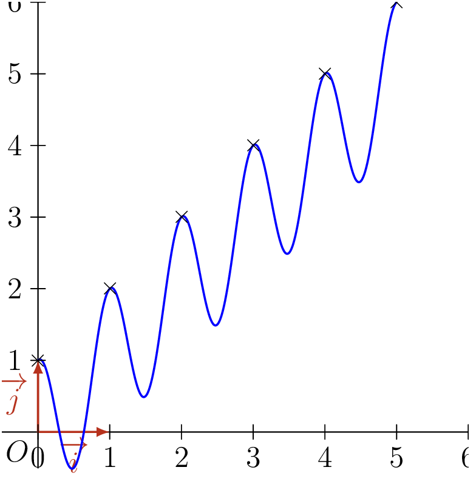

## Définition

::: {.bloc .def}
Définition : 

1. On dit qu'une suite $(u_n)$ est **croissante** à partir d'un certain rang $p$ si, pour tout entier naturel $n \geqslant p$, on a $u_n \leqslant u_{n+1}$.
2. On dit qu'une suite $(u_n)$ est **décroissante** à partir d'un certain rang $p$ si, pour tout entier naturel $n \geqslant p$, on a $u_n \geqslant u_{n+1}$.
3. On dit qu'une suite $(u_n)$ est **stationnaire** à partir d'un certain rang $p$ si, pour tout entier naturel $n \geqslant p$, on a $u_n = u_{n+1}$.
4. On dit qu'une suite $(u_n)$ est **monotone** si elle est croissante ou décroissante.
:::

::: {.bloc .rem}
Remarque : 

- Lorsque les inégalités sont strictes, comme dans le cas des fonctions, on parle de suite strictement croissante ou strictement décroissante.
- On dit « à partir d'un certain rang » car c'est le comportement global de la suite qui nous intéresse, et non ce qui se passe sur les premiers termes.
:::

## Étude des variations

### Application de la définition : différence $u_{n+1} - u_n$

::: {.bloc .sfc}

Savoir-Faire : Étudier les variations avec la différence — Raisonner

Étudier les variations de la suite $(u_n)_{n\in \N}$ définie par $u_n = n^2 - n$.

Afficher la correction :

Pour tout $n \in \N$,
$$u_{n+1} - u_n = (n+1)^2 - (n+1) - n^2 + n = n^2 + 2n + 1 - n - 1 - n^2 + n = 2n$$
Or $n \geqslant 0$, donc $2n \geqslant 0$. Ainsi, pour tout $n \in \N$, $u_{n+1} - u_n \geqslant 0$.

Donc la suite $(u_n)_{n \in \N}$ est croissante.

:::

::: {.bloc .sfc}

Savoir-Faire : Étudier les variations d'une suite récurrente — Raisonner

Soit $(u_n)_{n \in \N}$ la suite définie par $u_0 = 3$ et $u_{n+1} = - u_n^2 - u_n - 1$. Déterminer les variations de $(u_n)$.

Afficher la correction :

Pour tout $n \in \N$,
$$u_{n+1} - u_n = - u_n^2 - u_n - 1 - u_n = - u_n^2 - 2u_n - 1 = - (u_n +1)^2$$
qui est toujours négatif. Ainsi, pour tout $n \in \N$, $u_{n+1} - u_n \leqslant 0$.

Donc $(u_n)_{n \in \N}$ est une suite décroissante.

:::

### Variation de la fonction associée

::: {.bloc .thm}
Propriété : 

Soient $a \in \R^+$ et $I = [a\,;\,+\infty[$. Soit $(u_n)$ la suite définie par $u_n = f(n)$, où $f$ est une fonction définie sur $I$. Si $f$ est monotone sur $I$, alors $(u_n)$ est monotone et a les mêmes variations que $f$, pour tout entier naturel $n \geqslant a$.
:::

Démonstration :

On suppose $f$ croissante sur $I$. Alors, pour tout entier naturel $n \geqslant a$,
$$u_{n+1} - u_n = f(n+1) - f(n) \geqslant 0$$
Donc la suite $(u_n)$ est croissante pour tout entier naturel $n \geqslant a$. On raisonne de même si $f$ est décroissante.

::: {.bloc .sfc}

Savoir-Faire : Étudier les variations via la fonction associée — Raisonner

On considère la suite $(u_n)$ définie par $u_n= n^2-3n+1$. Étudier le sens de variation de la suite.

Afficher la correction :

Soit $f$ la fonction définie sur $[0\,;\,+\infty[$ par $f(x) = x^2-3x+1$.

$f$ est une fonction polynôme de degré $2$ de coefficient dominant $1 > 0$, donc sa représentation graphique est une parabole tournée vers le haut. Son axe de symétrie a pour équation $x = \dfrac{-(-3)}{2 \times 1} = \dfrac{3}{2}$. On déduit que :

- $f$ est décroissante sur $\left[0\,;\,\dfrac{3}{2}\right]$ ;
- $f$ est croissante sur $\left[\dfrac{3}{2}\,;\,+\infty\right[$ ;
- $f(1)=f(2)$.

On déduit que la suite $(u_n)$ est décroissante de $n=0$ à $n=1$, stationnaire entre $n=1$ et $n=2$, puis croissante à partir du rang $2$.

:::

::: {.bloc .rem}
Remarque : 

La réciproque de cette propriété est fausse. En effet, soit la suite définie par $u_n = n + \cos(2 \pi n)$. Cette suite est croissante puisque, pour tout $n \in \N$,
$$\begin{aligned}
u_{n+1} &= (n+1) + \cos(2\pi(n+1)) \\
&= n+1 + \cos(2\pi n + 2\pi) \\
&= n+1 + \cos(2\pi n) \\
&= u_n + 1
\end{aligned}$$
Donc $u_{n+1} > u_n$ pour tout $n \in \N$. Mais la fonction associée $f$ définie par $f(x) = x + \cos (2\pi x)$ n'est pas croissante, comme le montre sa courbe.

  

:::

### Étude du quotient

::: {.bloc .thm}
Propriété : 

1. Si $(u_n)$ est à termes strictement positifs à partir d'un certain rang $p$, alors pour tout $n \geqslant p$ :
   $$\dfrac{u_{n+1}}{u_n} \geqslant 1 \Longleftrightarrow \text{la suite est croissante}, \qquad \dfrac{u_{n+1}}{u_n} \leqslant 1 \Longleftrightarrow \text{la suite est décroissante}$$
2. Si $(u_n)$ est à termes strictement négatifs à partir d'un certain rang $p$, alors pour tout $n \geqslant p$ :
   $$\dfrac{u_{n+1}}{u_n} \leqslant 1 \Longleftrightarrow \text{la suite est croissante}, \qquad \dfrac{u_{n+1}}{u_n} \geqslant 1 \Longleftrightarrow \text{la suite est décroissante}$$
:::

Démonstration :

On traite le cas $u_n <0$ ; le cas $u_n>0$ se traite de façon analogue. Soit $(u_n)$ une suite à termes strictement négatifs. Alors, pour tout $n \geqslant p$,
$$u_{n+1}-u_n \geqslant 0 \Longleftrightarrow u_{n+1} \geqslant u_n \underset{u_n <0}{\Longleftrightarrow} \dfrac{u_{n+1}}{u_n} \leqslant 1$$
Ainsi la suite est croissante à partir du rang $p$ si et seulement si $\dfrac{u_{n+1}}{u_n} \leqslant 1$.

::: {.bloc .sfc}

Savoir-Faire : Étudier les variations par le quotient — Calculer, Raisonner

On considère la suite $(t_n)$ définie pour tout $n >4$ par $t_n=\dfrac{-2^n}{n-4}$.

1. À partir de quel rang la suite est-elle définie ?

Afficher la correction :

La suite est définie à partir du rang $5$, puisqu'elle n'est pas définie au rang $4$.

2. En utilisant la méthode du quotient, déterminer les variations de la suite $(t_n)$.

Afficher la correction :

Pour tout $n > 4$,
$$\dfrac{t_{n+1}}{t_n} = \dfrac{\dfrac{-2^{n+1}}{(n+1)-4}}{\dfrac{-2^n}{n-4}} = \dfrac{-2^{n+1}}{n-3} \times \dfrac{n-4}{-2^n} = \dfrac{2(n-4)}{n-3}$$
Or, pour tout $n \geqslant 5$,
$$\dfrac{2(n-4)}{n-3} \geqslant 1 \underset{n-3 >0}{\Longleftrightarrow} 2n-8 \geqslant n-3 \Longleftrightarrow n \geqslant 5$$
Donc, pour tout $n \geqslant 5$, $\dfrac{t_{n+1}}{t_n} \geqslant 1$.

La suite étant à termes strictement négatifs (pour tout $n >4$, $-2^n <0$ et $n-4>0$), on déduit que
$$\dfrac{t_{n+1}}{t_n} \geqslant 1 \underset{t_n <0}{\Longleftrightarrow} t_{n+1} \leqslant t_n$$
Donc la suite $(t_n)$ est décroissante.

:::
