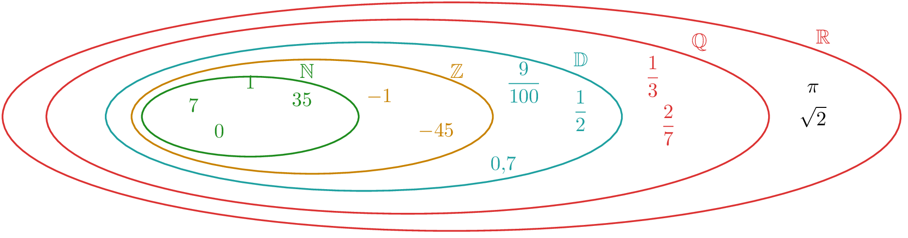
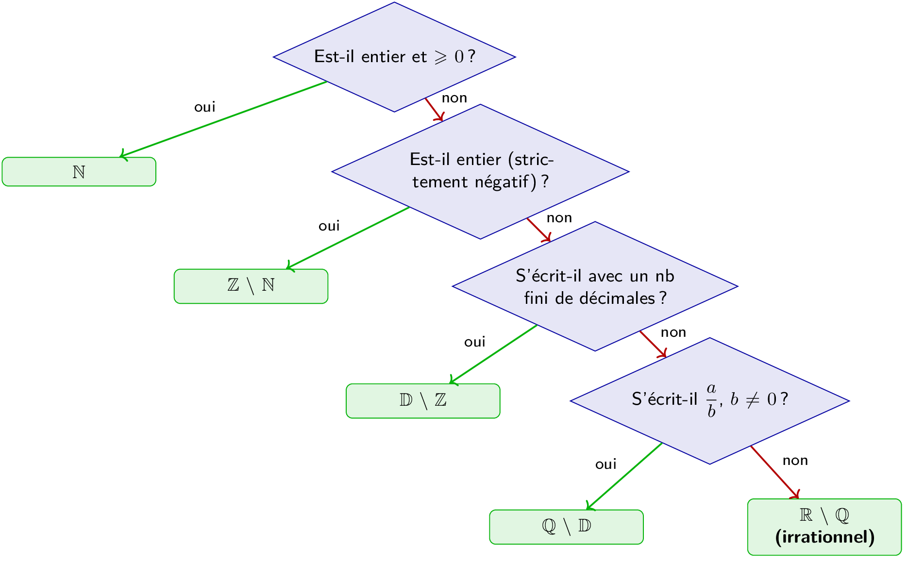

::: {.bloc .rem}
Anecdote historique : Le « scandale » de $\sqrt{2}$ — naissance des irrationnels

La secte pythagoricienne (Grèce antique, VIe–Ve siècle av. J.-C.) était convaincue que « tout est nombre », entendant par là que tout rapport entre grandeurs géométriques est un rapport de deux entiers.

**Le scandale.** Hippase de Métaponte aurait démontré que la diagonale d'un carré de côté $1$, de longueur $\sqrt{2}$, ne peut s'écrire $\dfrac{p}{q}$ avec $p, q \in \N^*$. La légende veut que ses frères de secte, incapables d'accepter ce résultat, l'aient noyé en mer Égée pour étouffer la découverte.

**La crise des fondements.** Cette découverte inaugure la première « crise des fondements » des mathématiques : si des grandeurs géométriques parfaitement réelles ne correspondent à aucune fraction, que sont vraiment les nombres ? Il faudra attendre Richard Dedekind (1872) et Georg Cantor pour que les réels soient rigoureusement définis — soit plus de **2 400 ans** après Hippase.
:::

## Ensemble des réels

::: {.bloc .def}
Définition : Ensemble des réels, nombres irrationnels

L'ensemble $\R$ des **nombres réels** est l'ensemble de tous les nombres représentables sur la droite graduée.

Un **nombre irrationnel** est un réel qui n'est pas rationnel. L'ensemble des irrationnels est noté $\R \setminus \Q$.
:::

::: {.bloc .rem}
Remarque : 

La géométrie fournit des exemples d'irrationnels :

- $\sqrt{2}$, longueur de la diagonale d'un carré de côté $1$ (irrationalité démontrée au chapitre 5) ;
- $\pi$, rapport du périmètre d'un cercle à son diamètre (irrationalité admise, démontrée par Lambert en 1761).

Les valeurs $3{,}14$ ou $\dfrac{22}{7}$ ne sont que des **valeurs approchées** rationnelles de $\pi$.
:::

## Hiérarchie des ensembles de nombres

  

$$\N \subset \Z \subset \D \subset \Q \subset \R$$

::: {.bloc .rem}
Irrationnels et rationnels : 

En notant $\mathbb{I} = \R \setminus \Q$ l'ensemble des irrationnels : $\Q \cap \mathbb{I} = \emptyset \et \Q \cup \mathbb{I} = \R$
:::

## Comment classer un nombre ?

  

::: {.bloc .sfc}

Savoir-Faire : Classer un rationnel dans la hiérarchie des ensembles — Raisonner

Déterminer le plus petit ensemble auquel appartient chacun des nombres $\dfrac{7}{40}$ et $\dfrac{5}{6}$.

Afficher la correction :

Les deux fractions sont irréductibles.

- $40 = 2^3 \times 5$ : le dénominateur n'a que $2$ et $5$ comme facteurs premiers, donc $\dfrac{7}{40} \in \D$ (en effet $\dfrac{7}{40} = 0{,}175$). Ce n'est pas un entier : le plus petit ensemble est $\D$.
- $6 = 2 \times 3$ : le facteur $3$ apparaît, donc $\dfrac{5}{6} \notin \D$. Le plus petit ensemble est $\Q$.

:::

::: {.bloc .ex}

Exercice : Appartenance et ensembles de nombres — Raisonner

Pour chacun des nombres suivants, indiquer le plus petit ensemble auquel il appartient parmi $\N$, $\Z$, $\D$, $\Q$, $\R \setminus \Q$.
$$\frac{-14}{2} \qquad \frac{5}{6} \qquad 0{,}125 \qquad \sqrt{5} \qquad \frac{22}{7} \qquad 4{,}0$$

Afficher la correction :

| Nombre | $\N$ | $\Z$ | $\D$ | $\Q$ | $\R \setminus \Q$ |
|:-----------------------|:---:|:---:|:---:|:---:|:---:|
| $\dfrac{-14}{2} = -7$  |     |  ✓  |     |     |     |
| $\dfrac{5}{6}$         |     |     |     |  ✓  |     |
| $0{,}125 = \dfrac{1}{8}$ |   |     |  ✓  |     |     |
| $\sqrt{5}$             |     |     |     |     |  ✓  |
| $\dfrac{22}{7}$        |     |     |     |  ✓  |     |
| $4{,}0 = 4$            |  ✓  |     |     |     |     |

:::
