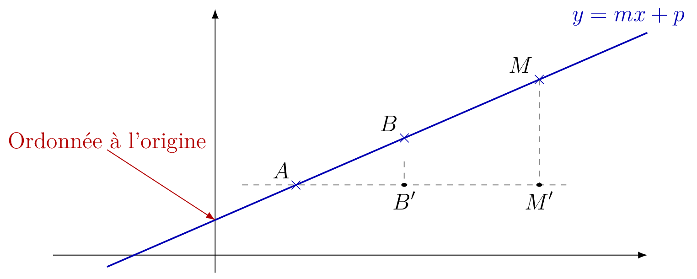
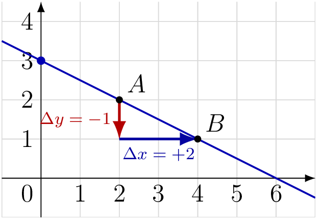
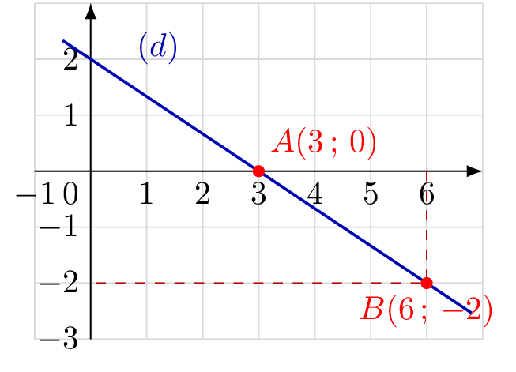
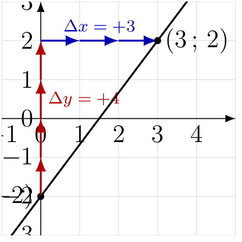
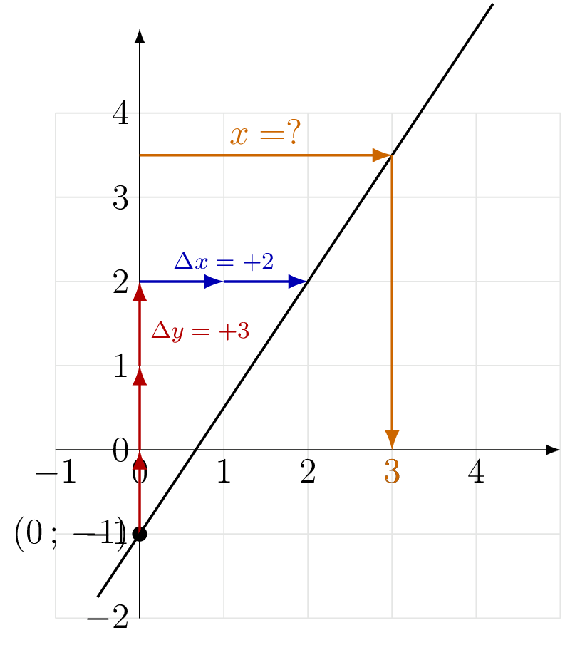
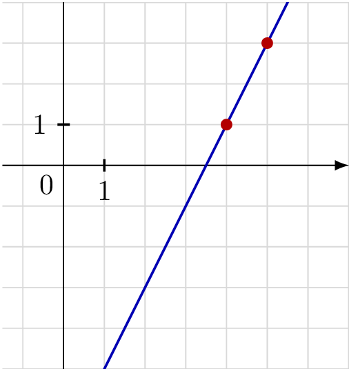

## Fonction affine et droite

::: {.bloc .thm}
Propriété : Représentation d'une fonction affine

La courbe représentative d'une fonction affine $f(x)=mx+p$ est une **droite** non parallèle à l'axe des ordonnées.

- Elle coupe l'axe des ordonnées au point $(0\,;\,p)$.
- Elle a pour coefficient directeur $m$.

On dit que la fonction admet pour représentative la droite d'équation $y=mx+p$.
:::

Démonstration : 

On se place dans un repère orthogonal $(O\,;\,I,\,J)$. Soit $(d)$ la droite passant par $A(x_A\,;\,y_A)$ et $B(x_B\,;\,y_B)$ avec $x_A \neq x_B$. On pose
$$m = \frac{y_B - y_A}{x_B - x_A} \quad \text{et} \quad p = y_A - mx_A$$

Soit $M(x\,;\,y)$ un point du plan. On note $A'$, $B'$, $M'$ les projetés orthogonaux respectifs de $A$, $B$, $M$ sur la droite horizontale d'ordonnée $y_A$.

  

**Sens direct.** Supposons $M \in (d)$. Si $x = x_A$, alors $M = A$ (la droite $(d)$ n'est pas verticale) et $y_A = mx_A + p$ par définition de $p$. Supposons maintenant $x \neq x_A$ ; on se place, comme sur la figure, dans le cas $x_A < x_B < x$ et $y_A < y_B$ (les autres cas se traitent de la même façon, en tenant compte des signes).

Les droites $(BB')$ et $(MM')$ sont verticales, donc parallèles. D'après le théorème de Thalès dans le triangle $AM'M$, la droite $(B'B)$ est parallèle à $(M'M)$ et coupe $[AM']$ en $B'$ et $[AM]$ en $B$, donc :
$$\frac{AB'}{AM'} = \frac{BB'}{MM'}$$

Or $AB' = x_B - x_A$, $AM' = x - x_A$, $BB' = y_B - y_A$ et $MM' = y - y_A$, d'où :
$$\frac{x_B - x_A}{x - x_A} = \frac{y_B - y_A}{y - y_A}$$

Donc $(y - y_A)(x_B - x_A) = (y_B - y_A)(x - x_A)$, d'où, puisque $x_B - x_A \neq 0$ :
$$y - y_A = \frac{y_B - y_A}{x_B - x_A}(x - x_A) = m(x - x_A)$$

d'où $y = mx + (y_A - mx_A) = mx + p$. Ainsi tout point de $(d)$ vérifie $y = mx + p$.

**Réciproque.** Soit $M(x_0\,;\,y_0)$ tel que $y_0 = mx_0 + p$.

*Si $x_0 = x_A$* : alors $y_0 = mx_A + p = mx_A + y_A - mx_A = y_A$, donc $M = A \in (d)$.

*Si $x_0 \neq x_A$* : notons $M^*$ le point de $(d)$ d'abscisse $x_0$. D'après le sens direct, $M^*$ a pour ordonnée $mx_0 + p = y_0$. Donc $M^* = M$, et $M \in (d)$.

**Conclusion :** l'ensemble des points du plan vérifiant $y = mx + p$ est exactement la droite $(d)$.

Enfin, pour $f(x)=mx+p$, la droite passant par $A(0\,;\,p)$ et $B(1\,;\,m+p)$ a pour coefficient $\dfrac{(m+p)-p}{1-0}=m$ et pour ordonnée à l'origine $p$ : la représentation graphique de $f$ est donc cette droite.

::: {.bloc .rem}
Remarque : 

- Si deux points ont la **même abscisse** ($x_1 = x_2$), la droite passant par ces points n'est pas la représentation d'une fonction, car un même réel $x$ aurait plusieurs images.
- L'ordonnée à l'origine de $f$ est $f(0)=p$ : c'est l'ordonnée du point d'intersection de la droite avec l'axe des ordonnées.
:::

::: {.bloc .rem}
Interprétation de la pente : 

Le coefficient directeur indique l'inclinaison de la droite par rapport à l'axe des abscisses. Pour deux points $A$ et $B$ de la droite :
$$m=\frac{\Delta y}{\Delta x}=\frac{y_B-y_A}{x_B-x_A}$$

Quand on **avance de $\Delta x$** vers la droite, on **monte de $\Delta y$** (ou on descend si $\Delta y<0$).
:::

## Lire l'expression d'une fonction affine

::: {.bloc .sfc}

Savoir-Faire : Lire graphiquement l'expression d'une fonction affine — Représenter

La droite ci-dessous est la représentation graphique d'une fonction affine $f$. Déterminer graphiquement l'expression de $f$.

  

Afficher la correction :

$f$ est une fonction affine, donc il existe deux réels $m$ et $p$ tels que $f(x)=mx+p$.

- La droite coupe l'axe des ordonnées au point $(0\,;\,3)$, donc $p=3$.
- On choisit deux points de la droite sur des nœuds du quadrillage, $A(2\,;\,2)$ et $B(4\,;\,1)$. Pour aller de $A$ à $B$ : $\Delta y=-1$ et $\Delta x=+2$, donc
  $$m=\frac{\Delta y}{\Delta x}=\frac{f(4)-f(2)}{4-2}=\frac{1-2}{2}=-\frac12$$

Ainsi, pour tout réel $x$, $f(x)=-\dfrac12x+3$.

:::

::: {.bloc .sfc}

Savoir-Faire : Lire graphiquement l'expression d'une fonction affine (2) — Représenter

La droite ci-dessous est la représentation graphique d'une fonction affine $g$. Déterminer graphiquement l'expression de $g$.

  

Afficher la correction :

$g$ est une fonction affine, donc il existe deux réels $m$ et $p$ tels que $g(x)=mx+p$.

- La droite coupe l'axe des ordonnées au point $(0\,;\,-2)$, donc $p=-2$.
- On choisit deux points de la droite sur des nœuds du quadrillage, $A(2\,;\,1)$ et $B(4\,;\,4)$. Pour aller de $A$ à $B$ : $\Delta y=+3$ et $\Delta x=+2$, donc
  $$m=\frac{\Delta y}{\Delta x}=\frac{g(4)-g(2)}{4-2}=\frac{4-1}{2}=\frac32$$

Ainsi, pour tout réel $x$, $g(x)=\dfrac32x-2$.

:::

## Tracer la représentation graphique

::: {.bloc .sfc}

Savoir-Faire : Tracer la droite représentative : méthode 1

Tracer la droite représentative de la fonction $f$ définie par $f(x)=-\dfrac{2}{3}x+2$.

Afficher la correction :

Soit $(d)$ la représentation graphique de $f$.

On choisit des valeurs de $x$ multiples de $3$ (dénominateur de $m$) pour éviter les fractions dans les calculs.

- $f(3)=-\dfrac{2}{3} \times 3 + 2 = 0$, donc $A(3\,;\,0)$ est un point de $(d)$.
- $f(6)=-\dfrac{2}{3}\times 6 +2=-4+2=-2$, donc $B(6\,;\,-2)$ est un point de $(d)$.

  

:::

::: {.bloc .sfc}

Savoir-Faire : Tracer la droite représentative : méthode 2

Tracer la droite représentative de la fonction $f$ définie par $f(x)=\dfrac{4}{3}x - 2$.

Afficher la correction :

La représentation graphique de $f$ admet $-2$ comme ordonnée à l'origine et $\dfrac43$ comme coefficient directeur.

On place le point $(0\,;\,-2)$, puis on monte de $4$ et on avance de $3$ : on obtient le point $(3\,;\,2)$. On trace la droite passant par ces deux points.

  

:::

::: {.bloc .ex}

Exercice : Tracer une droite et lire un antécédent — Représenter, Calculer

Tracer la droite représentative de $g(x)=\dfrac{3}{2}x-1$. Lire graphiquement un antécédent de $3{,}5$ par $g$, puis le vérifier algébriquement.

Afficher la correction :

*Point clef : pour tracer une droite, on place le point d'ordonnée à l'origine $(0\,;\,p)$, puis on utilise la pente $m$ pour trouver un second point.*

L'ordonnée à l'origine est $p=-1$ et le coefficient directeur est $m=\dfrac{3}{2}$ : quand on avance de $2$, on monte de $3$.

Lecture graphique : la droite atteint l'ordonnée $3{,}5$ en $x=3$, donc l'antécédent de $3{,}5$ par $g$ est $\mathbf{3}$.

Vérification : $\dfrac{3}{2}\times 3-1=\dfrac{9}{2}-1=\dfrac{7}{2}=3{,}5$. Donc $g(3)=3{,}5$, et donc $3$ est bien l'antécédent de $3{,}5$ par $g$.

  

:::

::: {.bloc .ex}

Exercice : Tableau de valeurs d'une fonction affine — Calculer, Raisonner, Représenter

Le tableau de valeurs suivant, auquel il manque certaines valeurs, est celui d'une fonction affine $f:x\mapsto ax+b$.

| $x$ | $0$ | | $4$ | $5$ |
|:---:|:---:|:---:|:---:|:---:|
| $f(x)$ | | $-3$ | $1$ | $3$ |

1. Dans un repère, tracer la représentation graphique de $f$.

Afficher la correction :

D'après le tableau, $f(4)=1$ et $f(5)=3$ : les points $(4\,;\,1)$ et $(5\,;\,3)$ appartiennent à la représentation graphique de $f$, qui est une droite. On trace la droite passant par ces deux points.

  

2. Déterminer l'expression de la fonction $f$.

Afficher la correction :

$f(4)=1$ et $f(5)=3$. Or $f$ est une fonction affine, donc il existe deux réels $a$ et $b$ tels que $f(x)=ax+b$, avec
$$a=\frac{f(5)-f(4)}{5-4}=\frac{3-1}{1}=2$$

Donc $f(x)=2x+b$. De plus $f(4)=1$, donc $2\times4+b=1$, d'où $b=-7$.

Ainsi, pour tout réel $x$, $f(x)=2x-7$.

3. Compléter le tableau de valeurs en justifiant.

Afficher la correction :

$f(0)=2\times0-7=-7$.

Soit $x\in\R$ tel que $f(x)=-3$.
Or
$$f(x)=-3 \iff 2x-7=-3 \iff 2x=4 \iff x=2$$

| $x$ | $0$ | $2$ | $4$ | $5$ |
|:---:|:---:|:---:|:---:|:---:|
| $f(x)$ | $-7$ | $-3$ | $1$ | $3$ |

4. Sans utiliser l'expression de la fonction $f$, peut-on déterminer, à partir de la lecture du tableau, la valeur de $f(6)$ ? Justifier.

Afficher la correction :

Oui. $f$ est affine, donc son taux d'accroissement est constant :
$$\frac{f(6)-f(5)}{6-5}=\frac{f(5)-f(4)}{5-4}=2$$

donc $f(6)-f(5)=2$, d'où $f(6)=3+2=5$.

:::
