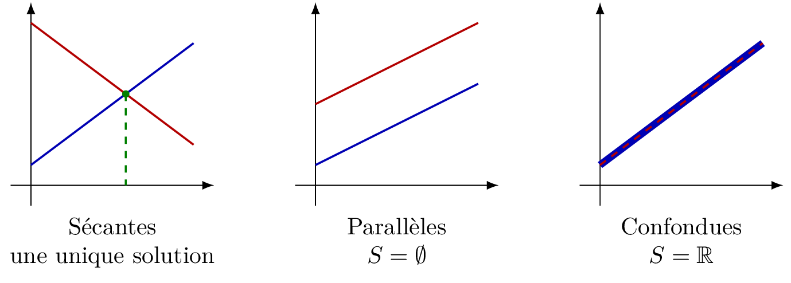
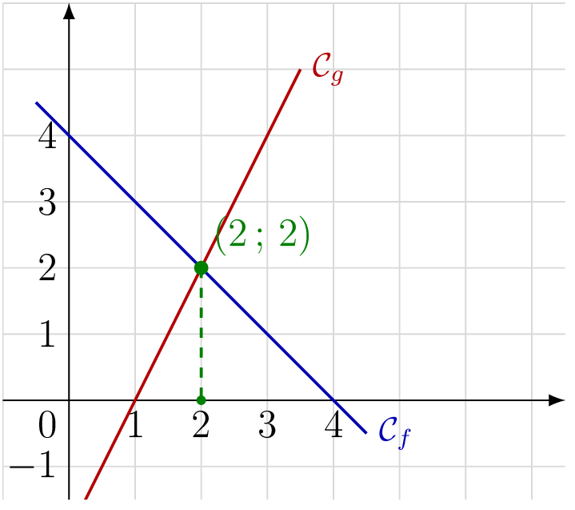
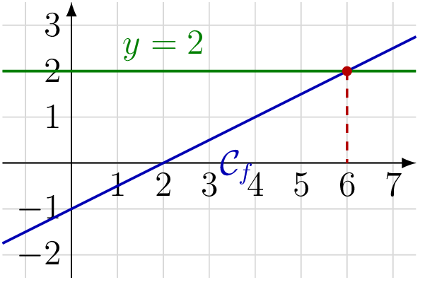

::: {.bloc .thm}
Propriété : Position relative de deux droites

Soient $f$ et $g$ deux fonctions affines de coefficients directeurs respectifs $m$ et $m'$, et de représentations graphiques respectives $d$ et $d'$.

- $d$ et $d'$ sont **sécantes** si et seulement si $m\neq m'$ ;
- $d$ et $d'$ sont **parallèles** si et seulement si $m=m'$.
:::

Démonstration : 

Notons $f(x)=mx+p$ et $g(x)=m'x+p'$. Un point $M(x\,;\,y)$ appartient à $d$ et à $d'$ si et seulement si $y=f(x)$ et $y=g(x)$ ; son abscisse vérifie donc $f(x)=g(x)$.

Pour tout réel $x$,
$$f(x)=g(x) \iff mx+p=m'x+p' \iff (m-m')x=p'-p$$

**Si $m\neq m'$**, cette équation a une unique solution $x=\dfrac{p'-p}{m-m'}$ : les droites $d$ et $d'$ ont un unique point commun, elles sont sécantes.

**Si $m=m'$**, l'équation s'écrit $0=p'-p$.
Si $p\neq p'$, elle n'a aucune solution : $d$ et $d'$ n'ont aucun point commun, elles sont parallèles (et distinctes).
Si $p=p'$, $f=g$ : $d$ et $d'$ sont confondues, donc parallèles.

Les deux situations (sécantes, parallèles) s'excluent : on obtient bien les deux équivalences.

  

::: {.bloc .sfc}

Savoir-Faire : Étudier l'intersection de deux droites — Calculer, Raisonner

On note $d$ et $d'$ les représentations graphiques respectives de $f$ et $g$. Dans chaque cas, déterminer si $d$ et $d'$ sont sécantes ou parallèles, puis résoudre l'équation $f(x)=g(x)$.

1. $f(x)=-2x+7$ et $g(x)=3x-3$.

Afficher la correction :

$f$ et $g$ n'ont pas le même coefficient directeur ($-2\neq3$), donc $d$ et $d'$ sont sécantes.

Pour tout réel $x$,
$$f(x)=g(x) \iff -2x+7=3x-3 \iff -2x-3x=-3-7 \iff -5x=-10 \iff x=2$$

Donc $S=\{2\}$ : $d$ et $d'$ se coupent au point d'abscisse $2$.

2. $f(x)=2x+1$ et $g(x)=2x-3$.

Afficher la correction :

$f$ et $g$ ont le même coefficient directeur $2$, donc $d$ et $d'$ sont parallèles.

Pour tout réel $x$,
$$f(x)=g(x) \iff 2x+1=2x-3 \iff 1=-3$$

ce qui est faux. Donc $S=\emptyset$ : $d$ et $d'$ n'ont aucun point commun.

:::

## Résolution graphique

::: {.bloc .sfc}

Savoir-Faire : Résolution graphique — Représenter, Calculer

Résoudre graphiquement $-x+4=2x-2$.

Afficher la correction :

*Point clef : on réécrit l'équation sous la forme $f(x)=g(x)$ avec $f(x)=-x+4$ et $g(x)=2x-2$. Les solutions sont les abscisses des points d'intersection des représentations graphiques $\mathcal{C}_f$ et $\mathcal{C}_g$.*

Les fonctions $f$ et $g$ définies par $f(x)=-x+4$ et $g(x)=2x-2$ sont affines, donc $\mathcal{C}_f$ et $\mathcal{C}_g$ sont des droites.

$\mathcal{C}_f$ et $\mathcal{C}_g$ se coupent au point d'abscisse $2$ (on a bien $f(2)=g(2)=2$), ainsi $S=\{2\}$.

  

:::

::: {.bloc .sfc}

Savoir-Faire : Résoudre graphiquement $f(x)=k$ — Représenter

$f$ est la fonction affine définie sur $\R$ par $f(x)=\dfrac12x-1$. Résoudre graphiquement l'équation $f(x)=2$.

Afficher la correction :

*Point clef : c'est le cas particulier de l'intersection de $\mathcal{C}_f$ avec la droite d'équation $y=2$, parallèle à l'axe des abscisses.*

On trace la droite parallèle à l'axe des abscisses passant par $(0\,;\,2)$.

Elle coupe $\mathcal{C}_f$ en un unique point, d'abscisse $6$.

Donc $S=\{6\}$.

  

:::
