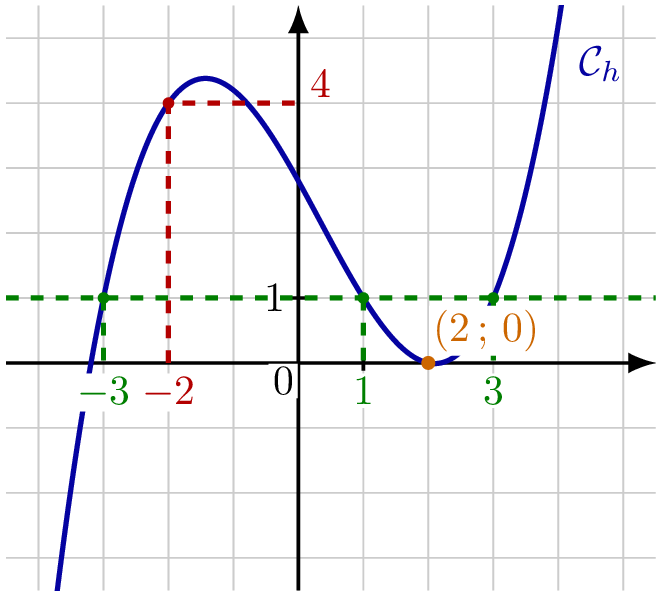

::: {.bloc .def}
Définition : Fonction

Une **fonction** $f$ définie sur un ensemble $D$ associe à tout réel $x \in D$ **un unique** réel noté $f(x)$.

- $D$ s'appelle l'**ensemble de définition** de $f$.
- $f(x)$ est l'**image** de $x$ par $f$.
- $x$ est un **antécédent** de $f(x)$ par $f$.
:::

::: {.bloc .rem}
Image et antécédent — mémo : 

- **Calculer une image :** on connaît $x$, on calcule $f(x)$.
- **Déterminer un antécédent :** on connaît le nombre $k$ (le résultat), on détermine les réels $x$ tels que $f(x)=k$ : on résout une équation.
:::

::: {.bloc .sfc}

Savoir-Faire : Calculer une image et chercher un antécédent — Calculer

Soit $g$ la fonction définie sur $\R$ par $g(x)=x^2$.

1. Calculer $g(-3)$.

Afficher la correction :

$g(-3)=(-3)^2=9$.

L'image de $-3$ par $g$ est $9$.

2. Déterminer le ou les antécédents de $4$ par $g$.

Afficher la correction :

Soit $x\in\R$ tel que $g(x)=4$.
Or
$$g(x)=4 \iff x^2=4 \iff x^2-4=0 \iff (x-2)(x+2)=0 \iff x=2 \text{ ou } x=-2$$

Le nombre $4$ admet donc deux antécédents par $g$, qui sont $2$ et $-2$.

:::

::: {.bloc .def}
Définition : Représentation graphique

Dans un repère du plan, la **représentation graphique** (ou courbe représentative) d'une fonction $f$ définie sur $D$ est l'ensemble $\mathcal{C}_f$ des points $M(x\,;\,y)$ tels que $x \in D$ et $y = f(x)$.

On dit que $\mathcal{C}_f$ a pour **équation** $y = f(x)$.
:::

::: {.bloc .sfc}

Savoir-Faire : Lire graphiquement images, antécédents et coordonnées — Représenter

La courbe $\mathcal{C}_h$ ci-dessous est la représentation graphique d'une fonction $h$ définie sur $\R$.

  

Déterminer graphiquement :

1. l'image de $-2$ par $h$ ;

Afficher la correction :

L'image de $-2$ par $h$ est $4$.

2. le ou les antécédents de $1$ par $h$ ;

Afficher la correction :

Le nombre $1$ a trois antécédents par $h$, qui sont $-3$, $1$ et $3$.

3. l'ordonnée du point de $\mathcal{C}_h$ d'abscisse $2$.

Afficher la correction :

Le point de $\mathcal{C}_h$ d'abscisse $2$ a pour ordonnée $0$ : c'est le point $(2\,;\,0)$.

:::

::: {.bloc .ex}

Exercice : Images et antécédents — Calculer, Raisonner

Soit $h$ la fonction définie sur $\R$ par $h(x)=x^2-1$.

Pour chaque question, préciser s'il s'agit d'un calcul d'image ou d'une recherche d'antécédent.

1. Calculer $h(0)$, $h(3)$ et $h(-3)$.

Afficher la correction :

Il s'agit de **calculs d'images**. $h(0)=0-1=-1$ ; $h(3)=9-1=8$ ; $h(-3)=9-1=8$.

2. Déterminer les antécédents de $3$ par $h$.

Afficher la correction :

Il s'agit d'une **recherche d'antécédents**. Soit $x\in\R$ tel que $h(x)=3$.
Or
$$h(x)=3 \iff x^2-1=3 \iff x^2-4=0 \iff (x-2)(x+2)=0 \iff x=2 \text{ ou } x=-2$$

Le nombre $3$ a deux antécédents par $h$, qui sont $2$ et $-2$.

3. Déterminer les antécédents de $-2$ par $h$.

Afficher la correction :

Il s'agit d'une **recherche d'antécédents**. Soit $x\in\R$ tel que $h(x)=-2$.
Or
$$h(x)=-2 \iff x^2-1=-2 \iff x^2=-1$$

Un carré est toujours positif ou nul, donc cette équation n'a pas de solution.
Le nombre $-2$ n'a aucun antécédent par $h$.

:::
