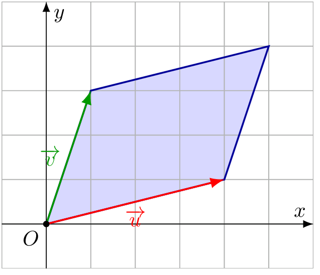

::: {.bloc .thm}
Propriété : Aire d'un parallélogramme

Soit $\left(O\,;\,\ve{i},\,\ve{j}\right)$   un repère **orthonormé** du plan, $\ve{u}\vecol{x}{y}$ et $\ve{v}\vecol{x'}{y'}$ deux vecteurs
non colinéaires. L'aire du parallélogramme construit sur $\ve{u}$ et $\ve{v}$ est
$$\mathscr{A} = \abs{\det(\ve{u},\ve{v})} = \abs{xy' - x'y}.$$

  

:::

Démonstration : 

Soit $A(x\,;\,y)$ et $B(x'\,;\,y')$ tels que $\ve{OA} = \ve{u}$ et $\ve{OB} = \ve{v}$, puis $A'(x\,;\,0)$ et $B'(x'\,;\,0)$.
On se place dans la configuration de la figure : $0 < x < x'$, $y > 0$, $y' > 0$, et $A$ situé sous la droite $(OB)$.

Le triangle $OBB'$ se décompose en trois morceaux : le triangle $OAB$, le triangle $OAA'$ et le trapèze $AA'B'B$. Ainsi
$$\mathscr{A}_{OAB}
= \mathscr{A}_{OBB'} - \mathscr{A}_{OAA'} - \mathscr{A}_{AA'B'B}
= \dfrac{1}{2}x'y' - \dfrac{1}{2}xy - \dfrac{1}{2}(y+y')(x'-x).$$
En développant, on obtient $\mathscr{A}_{OAB} = \dfrac{1}{2}(xy'-x'y)$
(ce nombre est bien positif dans cette configuration).

Le parallélogramme est formé de deux triangles superposables à $OAB$ : son aire vaut $xy' - x'y$.

Les autres configurations se traitent de façon analogue (admis) ; on obtient en général $\abs{xy'-x'y} = \abs{\det(\ve{u},\ve{v})}$.

  

::: {.bloc .rem}
Remarque : 

L'aire du triangle construit sur deux vecteurs $\ve{u}$ et $\ve{v}$ est la moitié
de l'aire du parallélogramme :
$$\mathscr{A}_{\triangle} = \dfrac{1}{2}\abs{\det(\ve{u},\ve{v})}.$$
Si $\ve{u}$ et $\ve{v}$ sont colinéaires, le parallélogramme est « aplati » et son aire est nulle : on retrouve $\det(\ve{u},\ve{v}) = 0$.
:::

::: {.bloc .sfc}

Savoir-Faire : Calculer l'aire d'un parallélogramme — Calculer

Soit $A(-1\,;\,-1)$, $B(2\,;\,5)$, $C(-2\,;\,-4)$.
Déterminer $D$ tel que $ABCD$ soit un parallélogramme, puis calculer son aire.

Afficher la correction :

*Point clef : l'aire du parallélogramme $ABCD$ est $\abs{\det(\ve{AB},\ve{AD})}$ : on utilise deux côtés issus d'un même sommet.*

$ABCD$ est un parallélogramme si et seulement si $\ve{AD} = \ve{BC}$.
$\ve{BC}\vecol{-4}{-9}$, donc $x_D = -1+(-4) = -5$ et $y_D = -1+(-9) = -10$ : $D(-5\,;\,-10)$.

$\ve{AB}\vecol{3}{6}$ et $\ve{AD}\vecol{-4}{-9}$.
$$\mathscr{A}_{ABCD} = \abs{\det(\ve{AB},\ve{AD})} = \abs{3 \times (-9) - (-4) \times 6}
= \abs{-27 + 24} = 3.$$

:::
