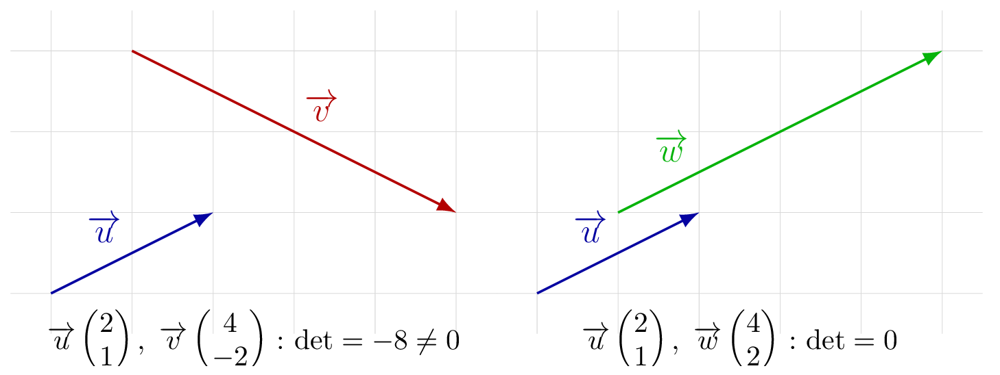
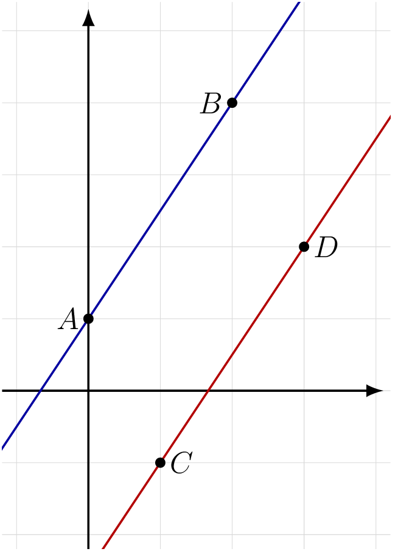
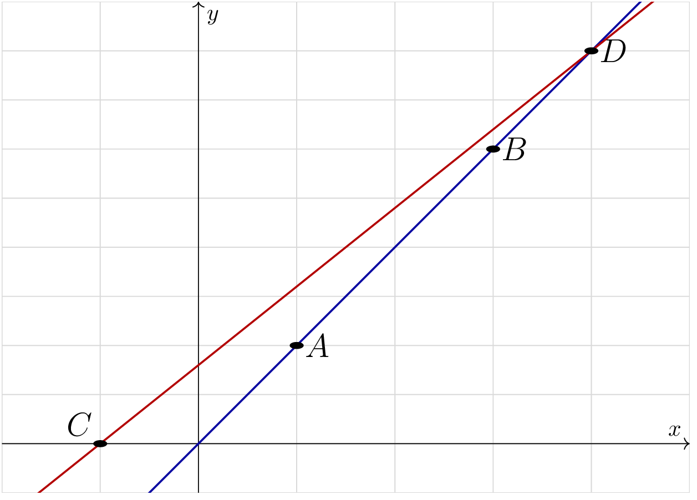

## Déterminant de deux vecteurs

::: {.bloc .def}
Définition : Déterminant de deux vecteurs

Soit $\left(O\,;\,\ve{i},\,\ve{j}\right)$   un repère du plan, $\ve{u}\vecol{x}{y}$ et $\ve{v}\vecol{x'}{y'}$ deux vecteurs.
On appelle **déterminant** du couple $(\ve{u}\,;\,\ve{v})$ le réel
$$\det(\ve{u},\ve{v}) = \begin{vmatrix} x & x' \\ y & y' \end{vmatrix} = xy' - x'y.$$
:::

::: {.bloc .rem}
Remarque : 

L'ordre des vecteurs a de l'importance : $\det(\ve{u},\ve{v}) = -\det(\ve{v},\ve{u})$.

On retient le calcul « en croix » : produit de la diagonale descendante moins produit de la diagonale montante.
:::

::: {.bloc .sfc}

Savoir-Faire : Calculer un déterminant — Calculer

Soit $\ve{u}\vecol{2}{3}$ et $\ve{v}\vecol{5}{-1}$. Calculer $\det(\ve{u},\ve{v})$.

Afficher la correction :

$$\det(\ve{u},\ve{v}) = \begin{vmatrix} 2 & 5 \\ 3 & -1 \end{vmatrix} = 2 \times (-1) - 5 \times 3 = -2 - 15 = -17.$$

:::

## Critère de colinéarité

::: {.bloc .thm}
Propriété : Critère de colinéarité

Soit $\left(O\,;\,\ve{i},\,\ve{j}\right)$   un repère du plan.
Deux vecteurs $\ve{u}\vecol{x}{y}$ et $\ve{v}\vecol{x'}{y'}$ sont **colinéaires**
si et seulement si
$$\det(\ve{u},\ve{v}) = xy' - x'y = 0.$$
:::

Démonstration exigible : 

**Sens direct.** Supposons $\ve{u}$ et $\ve{v}$ colinéaires.

- Si $\ve{u} = \ve{0}$, alors $x = y = 0$ et $xy' - x'y = 0$.
- Sinon, il existe $k \in \R$ tel que $\ve{v} = k\,\ve{u}$,
  c'est-à-dire $x' = kx$ et $y' = ky$. Alors $$xy' - x'y = x(ky) - (kx)y = 0.$$

**Réciproque.** Supposons $xy' - x'y = 0$, c'est-à-dire $xy' = x'y$.

- Si $\ve{u} = \ve{0}$, alors $\ve{u}$ est colinéaire à $\ve{v}$, car le vecteur nul est colinéaire à tout vecteur.
- Si $x \neq 0$, alors $xy' = x'y$ donne $y' = \dfrac{x'}{x}\,y$.
  En posant $k = \dfrac{x'}{x}$, on obtient $x' = kx$ et $y' = ky$,
  donc $\ve{v} = k\,\ve{u}$ : $\ve{u}$ et $\ve{v}$ sont colinéaires.
- Si $x = 0$ et $y \neq 0$, alors $xy' = 0$, d'où $x'y = 0$, donc $x' = 0$.
  Ainsi $\ve{u}\vecol{0}{y}$ et $\ve{v}\vecol{0}{y'}$,
  d'où $\ve{v} = \dfrac{y'}{y}\,\ve{u}$ : $\ve{u}$ et $\ve{v}$ sont colinéaires.

Dans tous les cas, $\ve{u}$ et $\ve{v}$ sont colinéaires.

::: {.bloc .rem}
Interprétation graphique du déterminant : 

  

À gauche, $\ve{u}$ et $\ve{v}$ ont des directions différentes : ils ne sont pas colinéaires.
À droite, $\ve{w} = 2\,\ve{u}$ : les deux vecteurs ont la même direction, ils sont colinéaires.
:::

::: {.bloc .info}
Méthode — Tester la colinéarité de deux vecteurs

- Calculer $\det(\ve{u},\ve{v}) = xy' - x'y$.
- Si $\det(\ve{u},\ve{v}) = 0$, les vecteurs sont **colinéaires**.
- Sinon, les vecteurs ne sont **pas colinéaires**.

**Cas particuliers :**

- Si les vecteurs ont des coordonnées simples, on peut aussi chercher directement $k$ tel que $\ve{v} = k\,\ve{u}$.
- Si un vecteur contient un paramètre, poser $\det = 0$ et résoudre l'équation obtenue.
- Pour tester l'alignement de trois points $A$, $B$, $C$, calculer $\det(\ve{AB},\ve{AC})$.
- Pour tester le parallélisme de $(AB)$ et $(CD)$, calculer $\det(\ve{AB},\ve{CD})$.
:::

## Application à l'alignement et au parallélisme

::: {.bloc .rem}
Remarque : 

D'après le chapitre sur les vecteurs :

- les droites $(AB)$ et $(CD)$ sont parallèles si et seulement si $\ve{AB}$ et $\ve{CD}$ sont colinéaires ;
- si de plus les droites ont un point commun, elles sont confondues : c'est ainsi que l'on montre que $A$, $B$, $C$ sont alignés si et seulement si $\ve{AB}$ et $\ve{AC}$ sont colinéaires.

Le déterminant permet de tester ces colinéarités par un simple calcul.
:::

::: {.bloc .sfc}

Savoir-Faire : Tester l'alignement de trois points — Raisonner

Soit $A(1\,;\,2)$, $B(3\,;\,5)$, $C(7\,;\,11)$.
Les points $A$, $B$, $C$ sont-ils alignés ?

Afficher la correction :

*Point clef : trois points $A$, $B$, $C$ sont alignés si et seulement si $\det(\ve{AB},\ve{AC})=0$.*

On calcule $\ve{AB}\vecol{2}{3}$ et $\ve{AC}\vecol{6}{9}$.
$$\det(\ve{AB},\ve{AC}) = 2 \times 9 - 6 \times 3 = 18 - 18 = 0.$$
Donc $\ve{AB}$ et $\ve{AC}$ sont colinéaires : les droites $(AB)$ et $(AC)$ sont parallèles.
Comme elles ont le point $A$ en commun, elles sont confondues : $A$, $B$, $C$ sont **alignés**.

:::

::: {.bloc .sfc}

Savoir-Faire : Montrer que deux droites sont parallèles — Raisonner

Soit $A(0\,;\,1)$, $B(2\,;\,4)$, $C(1\,;\,-1)$, $D(3\,;\,2)$.
Montrer que les droites $(AB)$ et $(CD)$ sont parallèles.

  

Afficher la correction :

*Point clef : $(AB)$ et $(CD)$ sont parallèles si et seulement si $\det(\ve{AB},\ve{CD})=0$.*

On calcule $\ve{AB}\vecol{2}{3}$ et $\ve{CD}\vecol{2}{3}$.
$$\det(\ve{AB},\ve{CD}) = 2 \times 3 - 2 \times 3 = 0.$$
Donc $\ve{AB}$ et $\ve{CD}$ sont colinéaires : les droites $(AB)$ et $(CD)$ sont **parallèles**.

On a même $\ve{AB} = \ve{CD}$ : $ABDC$ est un parallélogramme.

:::

::: {.bloc .sfc}

Savoir-Faire : Déterminer un point d'une droite — Calculer, Raisonner

Soit $A(-1\,;\,3)$ et $B(2\,;\,-3)$. Déterminer l'abscisse $x$ du point $M(x\,;\,5)$ de la droite $(AB)$.

Afficher la correction :

*Point clef : $M \in (AB)$ si et seulement si $A$, $B$, $M$ sont alignés, c'est-à-dire $\det(\ve{AB},\ve{AM}) = 0$.*

On a $\ve{AB}\vecol{3}{-6}$ et $\ve{AM}\vecol{x+1}{2}$.
$$\det(\ve{AB},\ve{AM}) = 3 \times 2 - (x+1) \times (-6) = 6 + 6x + 6 = 6x + 12.$$
$M \in (AB) \iff 6x + 12 = 0 \iff x = -2$. Donc $M(-2\,;\,5)$.

:::

::: {.bloc .ex}

Exercice : Colinéarité avec un paramètre — Calculer, Raisonner

Soit $x \in \R$, $\ve{u}\vecol{x+1}{3}$ et $\ve{v}\vecol{x^2}{x}$.
Déterminer les valeurs de $x$ pour lesquelles $\ve{u}$ et $\ve{v}$ sont colinéaires.

Afficher la correction :

*Point clef : $\ve{u}$ et $\ve{v}$ sont colinéaires si et seulement si leur déterminant est nul.*

$\ve{u}$ et $\ve{v}$ sont colinéaires si et seulement si $\det(\ve{u},\ve{v}) = 0$, soit
$$(x+1) \times x - x^2 \times 3 = 0
\iff x(x+1 - 3x) = 0
\iff x(1-2x) = 0.$$
Un produit de facteurs est nul si et seulement si l'un des facteurs est nul : $x = 0$ ou $x = \dfrac{1}{2}$.

- Pour $x = 0$ : $\ve{v} = \ve{0}$, qui est colinéaire à tout vecteur.
- Pour $x = \dfrac{1}{2}$ : $\ve{u}\vecol{\frac{3}{2}}{3}$ et $\ve{v}\vecol{\frac{1}{4}}{\frac{1}{2}}$, et l'on vérifie que $\ve{u} = 6\,\ve{v}$.

:::

::: {.bloc .ex}

Exercice : Alignement et parallélisme — Calculer, Raisonner

Soit $A(1\,;\,2)$, $B(3\,;\,6)$, $C(-1\,;\,0)$, $D(4\,;\,8)$.

1. Les points $A$, $B$, $C$ sont-ils alignés ?

Afficher la correction :

$\ve{AB}\vecol{2}{4}$ et $\ve{AC}\vecol{-2}{-2}$.
$$\det(\ve{AB},\ve{AC}) = 2 \times (-2) - (-2) \times 4 = -4 + 8 = 4 \neq 0.$$
Les vecteurs ne sont pas colinéaires : $A$, $B$, $C$ ne sont **pas alignés**.

2. Les droites $(AB)$ et $(CD)$ sont-elles parallèles ?

Afficher la correction :

$\ve{AB}\vecol{2}{4}$ et $\ve{CD}\vecol{5}{8}$.
$$\det(\ve{AB},\ve{CD}) = 2 \times 8 - 5 \times 4 = 16 - 20 = -4 \neq 0.$$
Les droites $(AB)$ et $(CD)$ ne sont **pas parallèles** : elles sont sécantes.

3. Le point $D$ appartient-il à la droite $(AB)$ ? Que peut-on en déduire ?

Afficher la correction :

$\ve{AD}\vecol{3}{6}$ et $\det(\ve{AB},\ve{AD}) = 2 \times 6 - 3 \times 4 = 0$ : $A$, $B$, $D$ sont alignés, donc $D \in (AB)$.

Comme $D \in (CD)$, les droites sécantes $(AB)$ et $(CD)$ se coupent en $D$.

  

:::
