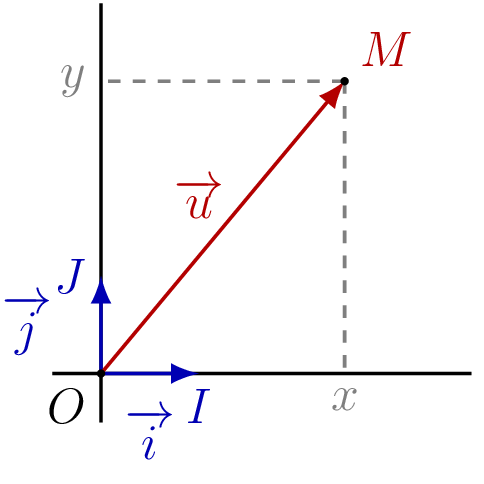
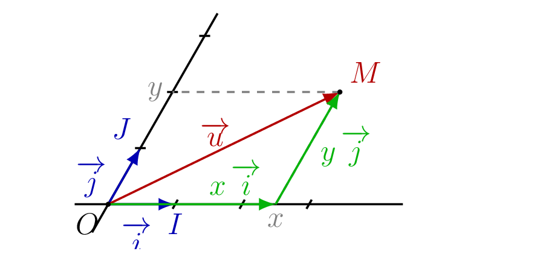
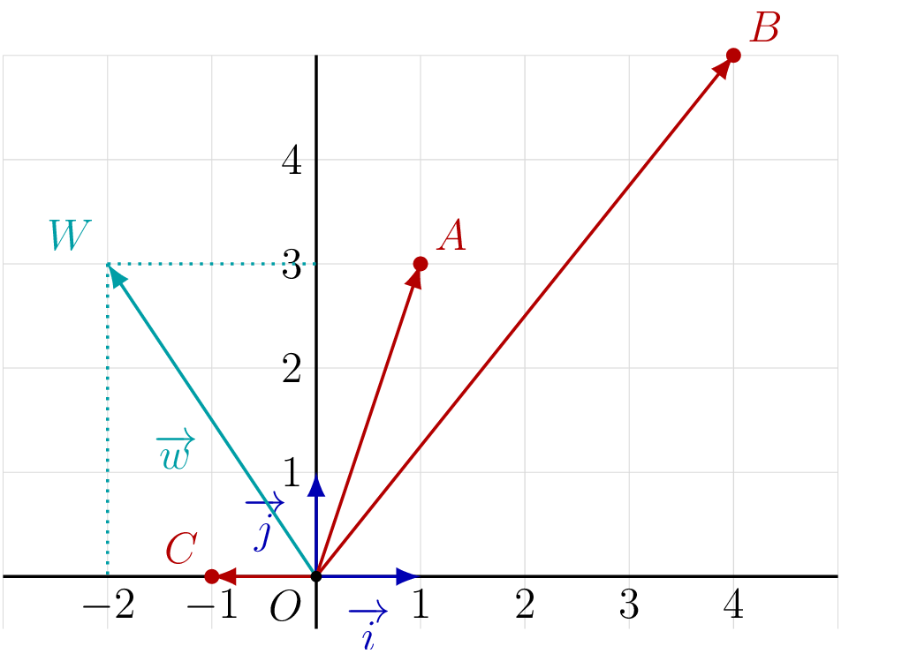

## Base orthonormée — rappel

::: {.bloc .def}
Définition : Base orthonormée

On dit que $(\ve{i}\,;\,\ve{j})$ est une **base orthonormée** du plan si :

- $\ve{i}$ et $\ve{j}$ sont **perpendiculaires** (orthogonaux) ;
- $\ve{i}$ et $\ve{j}$ sont de **norme** $1$ : $\norm{\ve{i}} = \norm{\ve{j}} = 1$.

On dit alors que $\left(O\,;\,\ve{i},\,\ve{j}\right)$ est un **repère orthonormé** du plan.
:::

::: {.bloc .rem}
Remarque : 

Dans un repère orthonormé, on a $\ve{i} = \ve{OI}$ et $\ve{j} = \ve{OJ}$,
où $OI = OJ = 1$ (unité) et $(OI) \perp (OJ)$.

Dans un repère orthonormé, les formules de distance et de norme proviennent
directement du théorème de Pythagore : c'est l'orthogonalité qui les rend possibles.

Dans un repère dont les axes ne sont pas perpendiculaires, ou dont les unités ne sont pas les mêmes
sur l'axe des abscisses et sur l'axe des ordonnées, on ne peut donc pas calculer une distance à partir
des coordonnées : sans angle droit, le théorème de Pythagore ne s'applique pas, et avec des unités
différentes, une même longueur n'aurait pas la même mesure selon sa direction.
:::

## Coordonnées d'un vecteur

::: {.bloc .def}
Définition : Coordonnées d'un vecteur

Soit $\left(O\,;\,\ve{i},\,\ve{j}\right)$   un repère du plan.
On considère $M(x \,;\,y)$ et $\ve{u} = \ve{OM}$.

Alors $\ve{u}$ s'écrit de manière **unique**
$$\ve{u} = x\,\ve{i} + y\,\ve{j},$$
où $x$ et $y$ sont des réels appelés **coordonnées** (ou composantes) de $\ve{u}$.

On note $\ve{u}\vecol{x}{y}$ ou $\ve{u}\,(x\,;\,y)$.

Repère orthonormé

Repère quelconque : on trace les parallèles aux axes passant par $M$.

:::

::: {.bloc .thm}
Propriété : Égalité de deux vecteurs

Soit $\left(O\,;\,\ve{i},\,\ve{j}\right)$   un repère du plan.
Deux vecteurs $\ve{u}\,(x\,;\,y)$ et $\ve{v}\,(x'\,;\,y')$ sont égaux
si et seulement s'ils ont les mêmes coordonnées :
$$\ve{u} = \ve{v} \iff x = x' \et y = y'.$$
:::

Démonstration : 

Soit $O$ l'origine du repère, et $A$, $B$ les points tels que $\ve{OA}=\ve{u}$ et $\ve{OB}=\ve{v}$.
Par définition des coordonnées d'un vecteur, $A(x\,;\,y)$ et $B(x'\,;\,y')$.

- $\ve{u}=\ve{v} \iff \ve{OA}=\ve{OB} \iff A=B$, car deux vecteurs de même origine sont égaux si et seulement si leurs extrémités coïncident (unicité de l'image par une translation).
- $A=B \iff x=x' \et y=y'$, puisque deux points sont égaux si et seulement s'ils ont les mêmes coordonnées.

D'où le résultat : $\ve{u}=\ve{v} \iff x=x' \et y=y'$.

::: {.bloc .info}
Méthode — Lire et représenter les coordonnées d'un vecteur

La **première coordonnée** (abscisse) est le déplacement horizontal :
positif vers la droite, négatif vers la gauche.

La **deuxième coordonnée** (ordonnée) est le déplacement vertical :
positif vers le haut, négatif vers le bas.
:::

::: {.bloc .sfc}

Savoir-Faire : Lire et représenter les coordonnées d'un vecteur — Représenter

  

1. On donne $A(1\,;\,3)$, $B(4\,;\,5)$, $C(-1\,;\,0)$.
   Lire les coordonnées des vecteurs $\ve{OA}$, $\ve{OB}$, $\ve{OC}$.

Afficher la correction :

*Point clef : les coordonnées d'un vecteur donnent directement le déplacement à effectuer : première coordonnée horizontalement, deuxième verticalement.*

Par définition, les coordonnées de $\ve{OM}$ sont celles du point $M$.
Donc $\ve{OA}\vecol{1}{3}$, $\ve{OB}\vecol{4}{5}$, $\ve{OC}\vecol{-1}{0}$.

2. Représenter le vecteur $\ve{w}\vecol{-2}{3}$ depuis l'origine $O$
   dans un repère orthonormé.

Afficher la correction :

On part de $O$, on se déplace de $2$ unités vers la **gauche** (abscisse $-2$),
puis de $3$ unités vers le **haut** (ordonnée $3$) : l'extrémité de $\ve{w}$ est le point $W(-2\,;\,3)$.

:::
