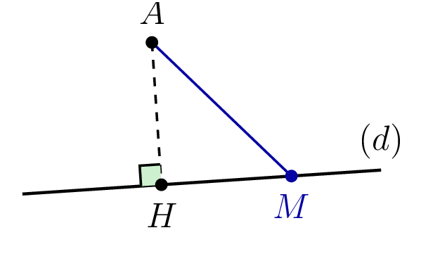

::: {.bloc .def}
Définition : Projeté orthogonal

Soit $A$ un point du plan et $(d)$ une droite.
Le **projeté orthogonal** de $A$ sur $(d)$ est le point $H$,
intersection de $(d)$ et de la perpendiculaire à $(d)$ passant par $A$.

  

:::

::: {.bloc .thm}
Propriété : Plus courte distance

Soit $H$ le projeté orthogonal de $A$ sur la droite $(d)$. Pour tout point $M$ de $(d)$,
$$AH \leqslant AM,$$
avec égalité si et seulement si $M = H$.
:::

Démonstration : 

Soit $M \in (d)$, $M \neq H$. Le triangle $AHM$ est rectangle en $H$, donc d'après le théorème de Pythagore,
$$AM^2 = AH^2 + HM^2 > AH^2,$$
car $HM > 0$. Les longueurs étant positives, $AM > AH$. Si $M = H$, on a bien sûr $AM = AH$.

::: {.bloc .def}
Définition : Distance d'un point à une droite

On appelle **distance** du point $A$ à la droite $(d)$, notée $d(A, (d))$, la longueur
$$d(A,(d)) = AH,$$
où $H$ est le projeté orthogonal de $A$ sur $(d)$.
:::

::: {.bloc .rem}
Remarque : 

Si $A$, $B$, $C$ forment un triangle et que $H$ est le projeté orthogonal de $A$ sur $(BC)$, alors $AH$ est la **hauteur** issue de $A$ : $d(A,(BC)) = AH$.
:::

::: {.bloc .info}
Méthode — Distance d'un point à une droite

Pour calculer la distance du point $A$ à la droite $(BC)$ :

1. calculer l'aire du triangle $ABC$, avec $\mathscr{A} = \dfrac{1}{2}\abs{\det(\ve{AB},\ve{AC})}$
   ou, si le triangle est rectangle, avec les deux côtés de l'angle droit ;
2. calculer la longueur de la base $BC$ ;
3. écrire $\mathscr{A} = \dfrac{1}{2} \times BC \times AH$ ;
4. résoudre pour obtenir la hauteur $AH = d(A,(BC))$.
:::

::: {.bloc .ex}

Exercice : Distance d'un point à une droite — Calculer, Raisonner

Dans un repère orthonormé, on considère $A(1\,;\,4)$, $B(1\,;\,0)$ et $C(5\,;\,0)$.

1. Vérifier que le triangle $ABC$ est rectangle en $B$.

Afficher la correction :

$$AB = \sqrt{(1-1)^2+(0-4)^2} = 4 \qquad BC = \sqrt{(5-1)^2+(0-0)^2} = 4 \qquad AC = \sqrt{(5-1)^2+(0-4)^2} = \sqrt{32} = 4\sqrt{2}$$
On a $AB^2 + BC^2 = 16 + 16 = 32 = AC^2$.
D'après la réciproque du théorème de Pythagore, le triangle $ABC$ est rectangle en $B$.

2. Calculer l'aire du triangle $ABC$.

Afficher la correction :

Le triangle est rectangle en $B$, donc
$$\mathscr{A}_{ABC} = \dfrac{1}{2} \times AB \times BC = \dfrac{1}{2} \times 4 \times 4 = 8.$$

3. En déduire la distance de $B$ à la droite $(AC)$.

Afficher la correction :

*Point clef : pour calculer la distance d'un point à une droite, on exprime l'aire du triangle de deux façons et on résout l'égalité obtenue.*

Soit $H$ le projeté orthogonal de $B$ sur $(AC)$. En prenant $[AC]$ pour base :
$$\mathscr{A}_{ABC} = \dfrac{1}{2} \times AC \times BH
\iff 8 = \dfrac{1}{2} \times 4\sqrt{2} \times BH
\iff BH = \dfrac{16}{4\sqrt{2}} = \dfrac{4}{\sqrt{2}} = \dfrac{4\sqrt{2}}{2} = 2\sqrt{2}.$$
Donc $d(B,(AC)) = 2\sqrt{2}$.

:::

::: {.bloc .ex}

Exercice : Synthèse — Géométrie repérée — Calculer, Raisonner

Dans un repère orthonormé, on considère $A(1\,;\,2)$, $B(5\,;\,-1)$, $C(3\,;\,4)$.

1. Calculer les coordonnées de $\ve{AB}$ et $\ve{AC}$, puis la norme $\norm{\ve{AB}}$.

Afficher la correction :

$$\ve{AB}\vecol{4}{-3},\quad \ve{AC}\vecol{2}{2},\quad \norm{\ve{AB}} = \sqrt{4^2+(-3)^2} = \sqrt{25} = 5$$

2. Déterminer les coordonnées du milieu $I$ de $[BC]$.

Afficher la correction :

$$I\left(\dfrac{5+3}{2}\,;\,\dfrac{-1+4}{2}\right) = I\left(4\,;\,\dfrac{3}{2}\right)$$

3. Déterminer les coordonnées du point $D$ tel que $ABDC$ soit un parallélogramme, puis vérifier que $I$ est le milieu de $[AD]$.

Afficher la correction :

$ABDC$ est un parallélogramme si et seulement si $\ve{AB} = \ve{CD}$.
Avec $D(x\,;\,y)$, $\ve{CD}\vecol{x-3}{y-4}$, d'où
$$\begin{cases} x - 3 = 4 \\ y - 4 = -3 \end{cases} \iff \begin{cases} x = 7 \\ y = 1 \end{cases} : \quad D(7\,;\,1).$$
Le milieu de $[AD]$ est $\left(\dfrac{1+7}{2}\,;\,\dfrac{2+1}{2}\right) = \left(4\,;\,\dfrac{3}{2}\right)$ : c'est bien $I$.
Les diagonales $[AD]$ et $[BC]$ du parallélogramme se coupent en leur milieu.

4. Calculer l'aire du triangle $ABC$.

Afficher la correction :

$$\mathscr{A}_{ABC} = \dfrac{1}{2}\abs{\det(\ve{AB},\ve{AC})}
= \dfrac{1}{2}\abs{4 \times 2 - 2 \times (-3)}
= \dfrac{1}{2}\abs{8+6} = 7$$

5. En déduire la distance du point $A$ à la droite $(BC)$.

Afficher la correction :

*Point clef : on exprime l'aire du triangle de deux façons et on résout l'égalité obtenue.*

Soit $H$ le projeté orthogonal de $A$ sur $(BC)$.
$$BC = \sqrt{(3-5)^2+(4-(-1))^2} = \sqrt{4+25} = \sqrt{29}$$
En exprimant l'aire avec la base $[BC]$ :
$$\mathscr{A}_{ABC} = \dfrac{1}{2} \times BC \times AH
\iff 7 = \dfrac{1}{2} \times \sqrt{29} \times AH
\iff AH = \dfrac{14}{\sqrt{29}} = \dfrac{14\sqrt{29}}{29}.$$
Donc $d(A,(BC)) = \dfrac{14\sqrt{29}}{29} \approx 2{,}60$.

:::
