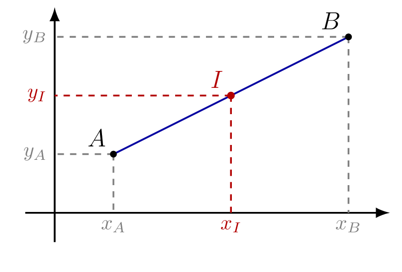

::: {.bloc .thm}
Propriété : Coordonnées du milieu

Soit $\left(O\,;\,\ve{i},\,\ve{j}\right)$   un repère du plan, $A(x_A\,;\,y_A)$ et $B(x_B\,;\,y_B)$ deux points. Le milieu $I$ du segment $[AB]$ a pour coordonnées
$$I\left(\dfrac{x_A + x_B}{2}\,;\,\dfrac{y_A + y_B}{2}\right).$$

  

:::

Démonstration : 

$I$ est le milieu de $[AB]$ si et seulement si $\ve{AI} = \ve{IB}$,
si et seulement si $\ve{OI} - \ve{OA} = \ve{OB} - \ve{OI}$ (relation de Chasles),
si et seulement si $2\,\ve{OI} = \ve{OA} + \ve{OB}$.

En coordonnées :
$$2x_I = x_A + x_B \et 2y_I = y_A + y_B,$$
d'où $x_I = \dfrac{x_A + x_B}{2}$ et $y_I = \dfrac{y_A + y_B}{2}$.

::: {.bloc .rem}
Remarque : 

Les coordonnées du milieu sont les **moyennes** des coordonnées des extrémités :
on fait la moyenne des abscisses et la moyenne des ordonnées.

Cette formule est valable dans n'importe quel repère, orthonormé ou non.
:::

::: {.bloc .sfc}

Savoir-Faire : Calculer les coordonnées d'un milieu — Calculer

Soit $A(-3\,;\,5)$ et $B(7\,;\,-1)$. Calculer les coordonnées du milieu $I$ de $[AB]$.

Afficher la correction :

$$x_I = \dfrac{-3+7}{2} = 2,\qquad y_I = \dfrac{5 + (-1)}{2} = 2.$$
Donc $I(2\,;\,2)$.

:::

::: {.bloc .ex}

Exercice : Milieu et parallélogramme — Calculer, Raisonner

Soit $A(1\,;\,7)$, $B(-4\,;\,2)$, $C(2\,;\,-2)$ et $D(7\,;\,3)$.

1. Calculer les coordonnées du milieu $L$ de $[AC]$ et du milieu $M$ de $[BD]$.

Afficher la correction :

$$L\left(\dfrac{1+2}{2}\,;\,\dfrac{7+(-2)}{2}\right) = L\left(\dfrac{3}{2}\,;\,\dfrac{5}{2}\right)
\qquad
M\left(\dfrac{-4+7}{2}\,;\,\dfrac{2+3}{2}\right) = M\left(\dfrac{3}{2}\,;\,\dfrac{5}{2}\right)$$

2. Que peut-on conclure pour le quadrilatère $ABCD$ ?

Afficher la correction :

$L$ et $M$ ont les mêmes coordonnées, donc $L = M$ :
les diagonales $[AC]$ et $[BD]$ se coupent en leur milieu.
Or un quadrilatère dont les diagonales se coupent en leur milieu est un parallélogramme.
Donc $ABCD$ est un parallélogramme.

:::

::: {.bloc .ex}

Exercice : Nature d'un quadrilatère — Calculer, Raisonner

Soit $A(1\,;\,1)$, $B(4\,;\,2)$, $C(5\,;\,5)$ et $D(2\,;\,4)$ dans un repère orthonormé.

1. Montrer que $ABCD$ est un parallélogramme.

Afficher la correction :

Le milieu de $[AC]$ est $\left(\dfrac{1+5}{2}\,;\,\dfrac{1+5}{2}\right) = (3\,;\,3)$
et le milieu de $[BD]$ est $\left(\dfrac{4+2}{2}\,;\,\dfrac{2+4}{2}\right) = (3\,;\,3)$.

Les diagonales $[AC]$ et $[BD]$ ont le même milieu : $ABCD$ est un **parallélogramme**.

2. Montrer que $ABCD$ est un losange.

Afficher la correction :

*Point clef : un parallélogramme qui a deux côtés consécutifs de même longueur est un losange.*
$$AB = \sqrt{(4-1)^2+(2-1)^2} = \sqrt{10} \qquad AD = \sqrt{(2-1)^2+(4-1)^2} = \sqrt{10}$$
$ABCD$ est un parallélogramme avec $AB = AD$ : c'est un **losange**.

3. $ABCD$ est-il un carré ?

Afficher la correction :

*Point clef : un losange est un carré si et seulement si ses diagonales ont la même longueur (c'est alors aussi un rectangle).*
$$AC = \sqrt{4^2+4^2} = \sqrt{32} = 4\sqrt{2} \qquad BD = \sqrt{(-2)^2+2^2} = \sqrt{8} = 2\sqrt{2}$$
$AC \neq BD$ : le losange $ABCD$ n'est **pas un carré**.

:::

::: {.bloc .ex}

Exercice : Cercle et triangle rectangle — Calculer, Raisonner

Dans un repère orthonormé, on considère $A(-2\,;\,1)$, $B(4\,;\,-3)$ et $C(3\,;\,2)$.
On note $\mathscr{C}$ le cercle de diamètre $[AB]$.

1. Déterminer les coordonnées du centre $\Omega$ de $\mathscr{C}$ et son rayon $r$.

Afficher la correction :

Le centre est le milieu de $[AB]$ : $\Omega\left(\dfrac{-2+4}{2}\,;\,\dfrac{1+(-3)}{2}\right) = \Omega(1\,;\,-1)$.

$AB = \sqrt{6^2+(-4)^2} = \sqrt{52} = 2\sqrt{13}$, donc $r = \dfrac{AB}{2} = \sqrt{13}$.

2. Le point $C$ appartient-il au cercle $\mathscr{C}$ ?

Afficher la correction :

*Point clef : un point appartient à un cercle si et seulement si sa distance au centre est égale au rayon.*
$$\Omega C = \sqrt{(3-1)^2+(2-(-1))^2} = \sqrt{4+9} = \sqrt{13} = r.$$
Donc $C \in \mathscr{C}$.

3. En déduire la nature du triangle $ABC$, puis vérifier par le calcul.

Afficher la correction :

$C$ appartient au cercle de diamètre $[AB]$, donc le triangle $ABC$ est **rectangle en $C$**.

Vérification : $AC = \sqrt{5^2+1^2} = \sqrt{26}$ et $BC = \sqrt{(-1)^2+5^2} = \sqrt{26}$, d'où
$$AC^2 + BC^2 = 26 + 26 = 52 = AB^2.$$
D'après la réciproque du théorème de Pythagore, $ABC$ est rectangle en $C$ ; comme de plus $AC = BC$, il est **rectangle isocèle en $C$**.

:::
