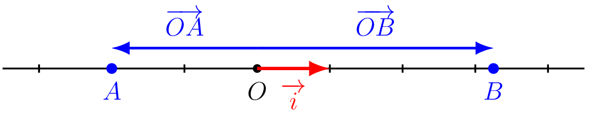
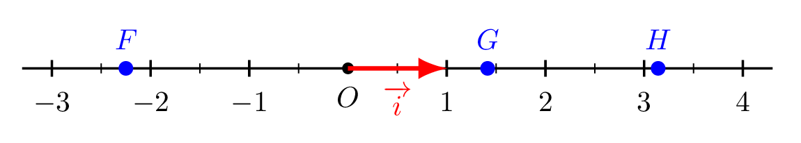
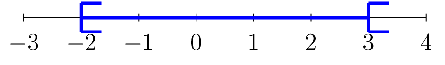

## Ensemble des réels, droite des réels

::: {.bloc .thm}
Propriété : Droite numérique (admis)

À tout point de la droite graduée est associé un unique nombre réel
(son abscisse) et, réciproquement, à tout nombre réel correspond un
unique point de la droite graduée.
:::

::: {.bloc .rem}
Représentation graphique : droite des réels

On représente graphiquement l'ensemble des réels par une droite graduée,
orientée de gauche à droite, munie du repère $(O\,;\,I)$ ou, de façon équivalente, du repère $\left(O\,;\,\ve{i}\right)$ où $\ve{i} = \ve{OI}$.

  

L'idée essentielle est que la droite réelle est **continue** :
il n'existe pas de « trou ».
:::

::: {.bloc .def}
Définition : Ensemble des réels

On appelle **ensemble des réels**, noté $\R$, l'ensemble de tous
les nombres représentables sur la droite graduée.
:::

::: {.bloc .def}
Définition : Abscisse d'un point

Soit $M$ un point de la droite graduée munie du repère $\left(O\,;\,\ve{i}\right)$.

Il existe un unique réel $x$ tel que $\ve{OM} = x\,\ve{i}$.
Ce réel $x$ est appelé l'**abscisse** de $M$ dans le repère $\left(O\,;\,\ve{i}\right)$ ; on note $M(x)$.
:::

::: {.bloc .rem}
Illustration : 

  

On a $\ve{OA} = -2\,\ve{i}$ et $\ve{OB} = 3{,}25\,\ve{i}$.

Ainsi, dans le repère $\left(O\,;\,\ve{i}\right)$, $A$ a pour abscisse $-2$ et $B$ a pour abscisse $3{,}25$ : on note $A(-2)$ et $B(3{,}25)$.
:::

::: {.bloc .sfc}

Savoir-Faire : Lire et placer une abscisse — Représenter

La droite graduée ci-dessous est munie du repère $\left(O\,;\,\ve{i}\right)$.

1. Lire les abscisses des points $C$, $D$ et $E$.

   

     
   

Afficher la correction :

$C(-1{,}5)$,  $D(0{,}5)$  et  $E(2{,}5)$.

2. Placer les points $F(-2{,}25)$, $G\left(\sqrt{2}\right)$ et $H(\pi)$.

Afficher la correction :

*Point clef : pour placer un nombre irrationnel, on utilise un encadrement décimal.*

$F$ est au milieu des graduations $-2{,}5$ et $-2$.

On a vu que $1{,}41 < \sqrt{2} < 1{,}42$ : $G$ est placé juste avant la graduation $1{,}5$.

De même $3{,}14 < \pi < 3{,}15$ : $H$ est placé juste après la graduation $3$.

  

*On peut placer $\sqrt{2}$ correctement car on peut construire ce nombre, c que l'on ne peut pas faire avec $\pi$.*

:::

## Notion d'intervalle

::: {.bloc .rem}
Remarque : 

La représentation de $\R$ étant une droite, on peut définir sur cette
droite des segments (ouverts ou fermés) et des demi-droites (ouvertes ou fermées).
:::

::: {.bloc .sfc}

Savoir-Faire : Représenter un segment sur la droite graduée — Représenter

Soit $A(-3)$ et $B(4)$ deux points d'une droite graduée.
Représenter $[AB[$ sur une droite graduée.

Afficher la correction :

  

:::

::: {.bloc .rem}
Remarque : 

Ce segment est un morceau de la droite des réels. Le point $A$ a pour
abscisse $-3$ et $B$ pour abscisse $4$.

Pour tout point $M(x) \in [AB[$,
$M$ est compris entre $A$ et $B$, donc :
$-3 \leqslant x < 4$
:::

::: {.bloc .def}
Définition : Intervalle

Un **intervalle** est une partie de $\R$ constituée de tous les
réels compris entre deux **bornes** (finies ou infinies),
éventuellement incluses.
:::

::: {.bloc .rem}
Tableau des intervalles — intervalles bornés : 

<table>
<tr><th><strong>Notation</strong></th><th><strong>Ensemble des réels $x$ tels que</strong></th><th><strong>Représentation</strong></th></tr>
<tr><td>$[a\,;\,b]$</td><td>$a \leqslant x \leqslant b$</td><td></td></tr>
<tr><td>$[a\,;\,b[$</td><td>$a \leqslant x < b$</td><td></td></tr>
<tr><td>$]a\,;\,b]$</td><td>$a < x \leqslant b$</td><td></td></tr>
<tr><td>$]a\,;\,b[$</td><td>$a < x < b$</td><td></td></tr>
</table>

:::

::: {.bloc .rem}
Tableau des intervalles — intervalles non bornés : 

<table>
<tr><th><strong>Notation</strong></th><th><strong>Ensemble des réels $x$ tels que</strong></th><th><strong>Représentation</strong></th></tr>
<tr><td>$[a\,;\,+\infty[$</td><td>$x \geqslant a$</td><td></td></tr>
<tr><td>$]a\,;\,+\infty[$</td><td>$x > a$</td><td></td></tr>
<tr><td>$]-\infty\,;\,b]$</td><td>$x \leqslant b$</td><td></td></tr>
<tr><td>$]-\infty\,;\,b[$</td><td>$x < b$</td><td></td></tr>
</table>

:::

::: {.bloc .hist}
Anecdote : 

Le symbole $\infty$ est dû au mathématicien John Wallis (1655,
*De sectionibus conicis*). Il désigne le caractère illimité
d'un ensemble de nombres ; ce n'est pas un nombre réel.
:::

::: {.bloc .rem}
Vocabulaire : 

Soient $a$ et $b$ deux réels tels que $a < b$.

- Dans les intervalles d'extrémités $a$ et $b$, le réel $a$ est la **borne inférieure** et $b$ la **borne supérieure**.
- $[a\,;\,b]$ est un intervalle **fermé** et $]a\,;\,b[$ est un intervalle **ouvert**.
- L'ensemble des réels est lui-même un intervalle : $\R = \left]-\infty\,;\,+\infty\right[$.
- $x \in [a\,;\,b] \iff a \leqslant x \leqslant b$. Ainsi $[a\,;\,b]$ est un encadrement de $x$ d'amplitude $b - a$ de $x$.
:::

::: {.bloc .sfc}

Savoir-Faire : Déterminer si un réel appartient à un intervalle — Raisonner

Soit $I = [-2\,;\,3[$. Les réels $-2$, $3$, $2{,}99$ et $-5$ appartiennent-ils à $I$ ?

Afficher la correction :

*Point clef : $x \in [-2\,;\,3[$ signifie $-2 \leqslant x < 3$ : on teste cet encadrement pour chaque réel.*

- $-2 \in I$ car $-2 \leqslant -2 < 3$ : la borne $-2$ est incluse.
- $3 \notin I$ car l'inégalité $3 < 3$ est fausse : la borne $3$ est exclue.
- $2{,}99 \in I$ car $-2 \leqslant 2{,}99 < 3$.
- $-5 \notin I$ car $-5 < -2$.

:::

::: {.bloc .rem}
Lire les crochets : 

- Crochet tourné **vers l'intérieur** de l'intervalle : la borne est **incluse** ($\leqslant$ ou $\geqslant$).
- Crochet tourné **vers l'extérieur** de l'intervalle : la borne est **exclue** ($<$ ou $>$).
- En $-\infty$ et en $+\infty$, le crochet est toujours tourné vers l'extérieur.
:::

::: {.bloc .sfc}

Savoir-Faire : Lire un intervalle sur une droite graduée — Représenter

Donner l'ensemble des réels représentés ci-dessous, sous forme d'inégalité
puis d'intervalle.

  

Afficher la correction :

$-2 \leqslant x < 3$, soit $x \in [-2\,;\,3[$.

:::

::: {.bloc .sfc}

Savoir-Faire : Lire et écrire un intervalle — Représenter

Soit $x$ un réel. Écrire sous forme d'intervalle l'ensemble des
solutions des inégalités suivantes, puis représenter chacune sur
une droite graduée.

1. $-2 \leqslant x < 5$
2. $x \leqslant -1$

Afficher la correction :

$-2 \leqslant x < 5 \Longleftrightarrow x \in [-2\,;\,5[$.

  

$x \leqslant -1 \Longleftrightarrow x \in ]-\infty\,;\,-1]$.

  

:::
