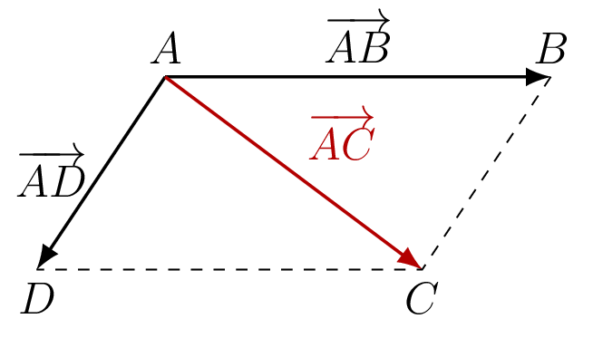
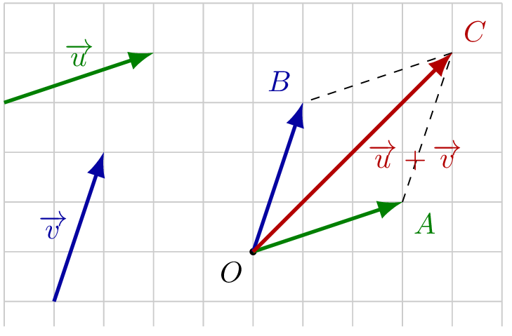

::: {.bloc .thm}
Propriété : Identité du parallélogramme

Soient $A$, $B$, $C$ et $D$ quatre points du plan.

$ABCD$ est un **parallélogramme** si et seulement si
$$\ve{AC} = \ve{AB} + \ve{AD}$$

  

:::

Démonstration : 

- **Sens direct ($\Longrightarrow$) :**  
  Si $ABCD$ est un parallélogramme, alors $\ve{AD}=\ve{BC}$. D'après la relation de Chasles,
  $$\ve{AC}=\ve{AB}+\ve{BC}=\ve{AB}+\ve{AD}$$
- **Sens indirect ($\Longleftarrow$) :**  
  Supposons $\ve{AC}=\ve{AB}+\ve{AD}$. Soit $C'$ le point tel que $ABC'D$ soit un parallélogramme. D'après le sens direct, $\ve{AC'}=\ve{AB}+\ve{AD}=\ve{AC}$. Or un vecteur n'a qu'un seul représentant d'origine $A$, donc $C'=C$ : $ABCD$ est un parallélogramme.

::: {.bloc .sfc}

Savoir-Faire : Reconnaître un parallélogramme — Raisonner

Les points $O$, $A$, $B$, $C$, $E$, $F$ vérifient $\ve{OE} = \ve{OA}+\ve{OB}$ et $\ve{OF} = \ve{OB}+\ve{OC}$.

Montrer que $AEFC$ est un parallélogramme.

Afficher la correction :

$\ve{OE} = \ve{OA}+\ve{OB}$ signifie que $OAEB$ est un parallélogramme (identité du parallélogramme), donc $\ve{AE} = \ve{OB}$.

$\ve{OF} = \ve{OB}+\ve{OC}$ signifie que $OBFC$ est un parallélogramme, donc $\ve{CF} = \ve{OB}$.

Ainsi $\ve{AE} = \ve{CF}$, d'où $AEFC$ est un **parallélogramme**.

:::

::: {.bloc .sfc}

Savoir-Faire : Construire la somme de deux vecteurs de même origine — Représenter

Les vecteurs $\ve{u}$ et $\ve{v}$ sont représentés sur le quadrillage ci-dessous.

  

Construire le représentant d'origine $O$ du vecteur $\ve{u}+\ve{v}$.

Afficher la correction :

- On trace le représentant d'origine $O$ de $\ve{u}$ : $\ve{OA}=\ve{u}$.
- On trace le représentant d'origine $O$ de $\ve{v}$ : $\ve{OB}=\ve{v}$.
- On construit le point $C$ tel que $OACB$ soit un parallélogramme.

D'après l'identité du parallélogramme, $\ve{OC}=\ve{OA}+\ve{OB}=\ve{u}+\ve{v}$.

:::
