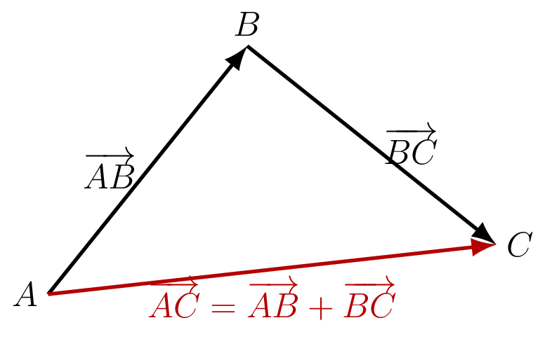

::: {.bloc .thm}
Propriété : Relation de Chasles

Soient $A$, $B$ et $C$ trois points quelconques du plan. Alors :
$$\ve{AC} = \ve{AB} + \ve{BC}$$

  

:::

Démonstration : 

$t_{\ve{AB}}(A)=B$ et $t_{\ve{BC}}(B)=C$.

Ainsi, appliquer $t_{\ve{AB}}$ puis $t_{\ve{BC}}$ envoie $A$ sur $C$ : c'est la translation de vecteur $\ve{AB}+\ve{BC}$. Or la translation qui envoie $A$ sur $C$ est la translation de vecteur $\ve{AC}$. Par unicité, $\ve{AC} = \ve{AB} + \ve{BC}$.

::: {.bloc .rem}
Remarque : 

La relation de Chasles correspond à un déplacement en deux étapes : aller de $A$ à $B$, puis de $B$ à $C$, revient à aller directement de $A$ à $C$.

Elle se généralise à un nombre quelconque de points : pour tous points $A_1$, $A_2$, …, $A_n$ du plan,
$$\ve{A_1A_2} + \ve{A_2A_3} + \cdots + \ve{A_{n-1}A_n} = \ve{A_1A_n}$$
:::

::: {.bloc .rem}
Somme de deux vecteurs et relation de Chasles : 

- La **définition de la somme** s'applique à deux vecteurs **quelconques** $\ve{u}$ et $\ve{v}$ : pour construire $\ve{u}+\ve{v}$, on doit d'abord choisir des représentants placés bout à bout (ou de même origine).
- La **relation de Chasles** est un outil de calcul : elle s'utilise lorsque les vecteurs sont **déjà écrits bout à bout**, l'extrémité du premier étant l'origine du second ($\ve{AB}+\ve{BC}$). Elle permet aussi, dans l'autre sens, de décomposer un vecteur en passant par un point intermédiaire ($\ve{AC}=\ve{AM}+\ve{MC}$).
- Attention : $\ve{AB}+\ve{CD}$ ne se simplifie pas par Chasles, car $B\neq C$.
:::

::: {.bloc .sfc}

Savoir-Faire : Simplifier par la relation de Chasles — Calculer

Simplifier les expressions suivantes.

1. $\ve{AB}+\ve{BC}+\ve{CD}+\ve{DA}$

Afficher la correction :

*Point clef : on enchaîne les vecteurs tête-à-queue en repérant les points qui se télescopent (lettre de fin d'un vecteur = lettre de début du suivant).*

$\ve{AB}+\ve{BC}+\ve{CD}+\ve{DA} = \ve{AC}+\ve{CA} = \ve{AA} = \ve{0}$.

2. $\ve{MA}+\ve{BC}+\ve{AM}$

Afficher la correction :

$\ve{MA}+\ve{AM} = \ve{MM} = \ve{0}$, donc $\ve{MA}+\ve{BC}+\ve{AM} = \ve{BC}$.

:::

::: {.bloc .rem}
Point méthode — utiliser la relation de Chasles : 

Pour **simplifier** une somme, on enchaîne les vecteurs tête-à-queue : $\ve{AB}+\ve{BC} = \ve{AC}$ et $\ve{AB}+\ve{BC}+\ve{CA} = \ve{0}$.

Les **télescopages** sont utiles : $\ve{AB}+\ve{BC}+\ve{CD}+\ve{DA} = \ve{AA} = \ve{0}$.

Pour **éclater** un vecteur, on introduit un point intermédiaire $M$ : $\ve{AC} = \ve{AM} + \ve{MC}$.
:::

::: {.bloc .ex}

Exercice : Application de Chasles — Raisonner

Peut-on trouver six points $A$, $B$, $C$, $D$, $E$, $F$ deux à deux distincts tels que :
$$\ve{AC} + \ve{BD} + \ve{CF} + \ve{DA} + \ve{EB} = \ve{0}~?$$

Afficher la correction :

*Point clef : on réorganise pour enchaîner les vecteurs tête-à-queue afin de simplifier facilement les sommes vectorielles.*

$$\ve{AC}+\ve{CF}+\ve{BD}+\ve{DA}+\ve{EB} = \ve{AF} + \ve{BA} + \ve{EB} = \ve{AF} + \ve{EA} = \ve{EF}$$

Ainsi $\ve{EF} = \ve{0}$, ce qui impose $E = F$, en contradiction avec l'hypothèse.

On **ne peut donc pas** trouver de tels six points distincts.

:::
