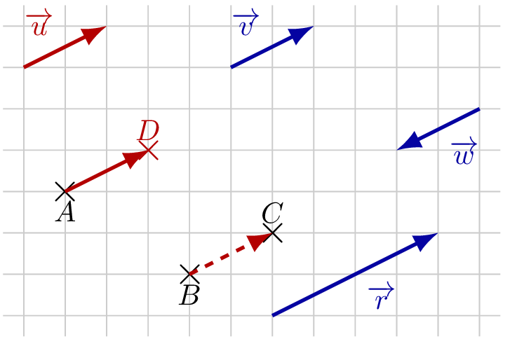

::: {.bloc .def}
Définition : Vecteur opposé

On appelle **vecteur opposé** à $\ve{u}$ l'unique vecteur $-\ve{u}$ tel que $\ve{u}+(-\ve{u}) = \ve{0}$.
:::

::: {.bloc .rem}
Caractéristiques d'un vecteur opposé : 

Deux vecteurs sont opposés si et seulement s'ils ont même norme, même direction, mais des **sens contraires**.
:::

::: {.bloc .rem}
Remarque : 

Soit $\ve{u} = \ve{AB}$, alors $-\ve{u} = \ve{BA}$.
:::

::: {.bloc .sfc}

Savoir-Faire : Reconnaître des vecteurs opposés — Raisonner

Les deux questions sont indépendantes.

1. On reprend la figure du savoir-faire *Construire l'image d'un point par une translation* (page [Translation et notion de vecteur](translation_vecteur.qmd)). Citer un vecteur opposé au vecteur $\ve{u}$.

  

Afficher la correction :

$\ve{w}$ a la même direction et la même norme que $\ve{u}$, mais le sens contraire : $\ve{w}=-\ve{u}$.

2. Soit $M$ le milieu du segment $[AB]$. Que peut-on dire des vecteurs $\ve{MA}$ et $\ve{MB}$ ? Que peut-on dire de $\ve{MA}+\ve{MB}$ ?

Afficher la correction :

$M$ est le milieu de $[AB]$, donc $MA=MB$ et les points $A$, $M$, $B$ sont alignés, $M$ étant entre $A$ et $B$. Les vecteurs $\ve{MA}$ et $\ve{MB}$ ont donc la même direction, la même norme et des sens contraires : ils sont opposés, $\ve{MA}=-\ve{MB}$.

Ainsi $\ve{MA}+\ve{MB}=\ve{MA}+(-\ve{MA})=\ve{0}$.

:::

::: {.bloc .rem}
Point méthode — soustraire deux vecteurs : 

Soustraire un vecteur revient à ajouter son opposé :
$$\ve{u} - \ve{v} = \ve{u} + (-\ve{v})$$

En pratique, pour simplifier $\ve{AC} - \ve{BC}$, on écrit :
$$\ve{AC} - \ve{BC} = \ve{AC} + \ve{CB} = \ve{AB}$$
:::

::: {.bloc .sfc}

Savoir-Faire : Simplifier une différence de vecteurs — Calculer

Simplifier $\ve{MA}-\ve{MB}+\ve{AC}$.

Afficher la correction :

$$\ve{MA}-\ve{MB}+\ve{AC} = \ve{MA}+\ve{BM}+\ve{AC} = \ve{BM}+\ve{MA}+\ve{AC} = \ve{BC}$$

:::

::: {.bloc .ex}

Exercice : Vecteur opposé dans un parallélogramme — Calculer, Raisonner

Soit $ABCD$ un parallélogramme.

1. Montrer que $\ve{AB}$ et $\ve{CD}$ sont des vecteurs opposés.

Afficher la correction :

Dans un parallélogramme $ABCD$, on a $\ve{AB} = \ve{DC}$ par définition.

Or $\ve{DC} = -\ve{CD}$, donc $\ve{AB} = -\ve{CD}$ : les vecteurs $\ve{AB}$ et $\ve{CD}$ sont **opposés** (même norme, même direction, sens contraires).

2. Simplifier $\ve{AC}+\ve{BD}$.

Afficher la correction :

*Point clef : on décompose avec la relation de Chasles en passant par $B$ puis par $C$.*

$\ve{AC}+\ve{BD} = (\ve{AB}+\ve{BC}) + (\ve{BC}+\ve{CD}) = \ve{BC}+\ve{BC} + (\ve{AB}+\ve{CD})$.

D'après la question 1, $\ve{AB}+\ve{CD} = \ve{0}$, donc $\ve{AC}+\ve{BD} = \ve{BC}+\ve{BC}$, que l'on notera $2\,\ve{BC}$ dans la partie suivante.

:::
