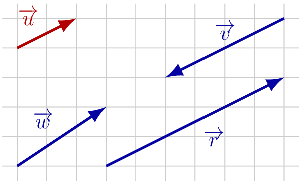
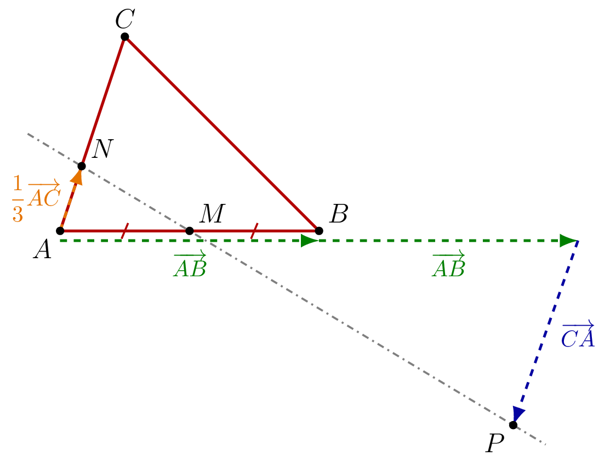
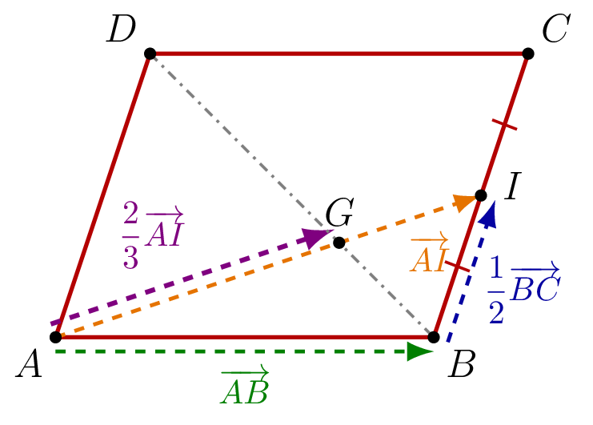

## Définition

::: {.bloc .def}
Définition : Vecteurs colinéaires

Deux vecteurs $\ve{u}$ et $\ve{v}$ sont **colinéaires** s'il existe un réel $k$ tel que $\ve{u} = k\,\ve{v}$ (ou $\ve{v} = k\,\ve{u}$).

En particulier, le vecteur nul $\ve{0}$ est colinéaire à tout vecteur.
:::

::: {.bloc .rem}
Illustration graphique : 

$$\ve{v} = 1{,}5\,\ve{u} \qquad \text{et} \qquad \ve{w} = -2{,}3\,\ve{u}$$

Les vecteurs $\ve{u}$, $\ve{v}$ et $\ve{w}$ sont colinéaires.

  

:::

::: {.bloc .rem}
Remarque : 

Deux vecteurs non nuls sont colinéaires si et seulement s'ils ont la **même direction**, qu'ils soient de même sens ou de sens opposés.
:::

::: {.bloc .sfc}

Savoir-Faire : Tester la colinéarité — Raisonner

On considère deux vecteurs $\ve{u}$ et $\ve{v}$ tels que :
$$\ve{u} = 2\ve{AB}-\ve{AC} \qquad \text{et} \qquad \ve{v} = \ve{AC}-2\ve{AB}$$

Les vecteurs $\ve{u}$ et $\ve{v}$ sont-ils colinéaires ?

Afficher la correction :

$$\ve{v} = \ve{AC}-2\ve{AB} = -(2\ve{AB}-\ve{AC}) = -\ve{u}$$

Les vecteurs sont colinéaires, ils sont même opposés.

:::

::: {.bloc .sfc}

Savoir-Faire : Reconnaître graphiquement des vecteurs colinéaires — Représenter

Les vecteurs $\ve{u}$, $\ve{v}$, $\ve{w}$ et $\ve{r}$ sont représentés sur le quadrillage ci-dessous.

  

Parmi les vecteurs $\ve{v}$, $\ve{w}$ et $\ve{r}$, lesquels sont colinéaires à $\ve{u}$ ? Le cas échéant, donner le réel $k$ correspondant.

Afficher la correction :

- On remarque que $\ve{v}=-2\ve{u}$ : $\ve{v}$ et $\ve{u}$ sont colinéaires.
- On remarque que $\ve{r}=3\ve{u}$ : $\ve{r}$ et $\ve{u}$ sont colinéaires.
- $\ve{w}$ n'a pas la même direction que $\ve{u}$ : il n'existe aucun réel $k$ tel que $\ve{w}=k\ve{u}$, donc $\ve{w}$ et $\ve{u}$ ne sont pas colinéaires.

:::

## Alignement et parallélisme

::: {.bloc .rem}
Idée fondamentale : 

Un vecteur permet de traduire des propriétés géométriques (parallélisme, alignement, milieu) en égalités vectorielles.
:::

::: {.bloc .thm}
Propriété : Caractérisations par la colinéarité (admis)

Soient $A$, $B$, $C$, $D$ des points du plan avec $A\neq B$ et $C\neq D$.

1. $A$, $B$ et $C$ sont **alignés** si et seulement si $\ve{AB}$ et $\ve{AC}$ sont colinéaires.
2. Les droites $(AB)$ et $(CD)$ sont **parallèles** (ou confondues) si et seulement si $\ve{AB}$ et $\ve{CD}$ sont colinéaires.
:::

::: {.bloc .rem}
Point méthode — Démontrer un alignement ou un parallélisme : 

**Pour montrer que $A$, $B$, $C$ sont alignés :** on montre que $\ve{AB}$ et $\ve{AC}$ sont colinéaires, en exhibant un réel $k$ tel que $\ve{AB} = k\,\ve{AC}$.

**Pour montrer que $(AB)\parallel(CD)$ :** on montre que $\ve{AB}$ et $\ve{CD}$ sont colinéaires, en exhibant un réel $k$ tel que $\ve{AB} = k\,\ve{CD}$.

**En pratique :** on écrit les deux vecteurs comme combinaisons linéaires des deux mêmes vecteurs non colinéaires, par exemple $\alpha\,\ve{AB}+\beta\,\ve{AC}$. Cette décomposition est alors **unique** : les deux vecteurs sont colinéaires si et seulement si leurs coefficients sont proportionnels.

**Attention :** il faut trouver un **même** réel $k$ pour les deux coefficients. Ne jamais conclure à la colinéarité en ne comparant qu'un seul coefficient.
:::

::: {.bloc .sfc}

Savoir-Faire : Alignement de trois points — Raisonner, Calculer

Soient $A$, $B$, $C$ trois points non alignés. Les points $M$ et $N$ sont définis par :
$$\ve{AM} = 2\ve{AB} + \ve{AC} \qquad \text{et} \qquad \ve{AN} = 4\ve{AB} + 2\ve{AC}$$

Montrer que $A$, $M$, $N$ sont alignés.

Afficher la correction :

*Point clef : pour montrer que trois points $A$, $M$, $N$ sont alignés, on montre que les vecteurs $\ve{AM}$ et $\ve{AN}$ sont colinéaires.*

$$\ve{AN} = 4\ve{AB} + 2\ve{AC} = 2(2\ve{AB}+\ve{AC}) = 2\,\ve{AM}$$

Les vecteurs $\ve{AN}$ et $\ve{AM}$ sont colinéaires, donc les droites $(AM)$ et $(AN)$ sont parallèles. Or $A$ appartient aux deux droites, donc les droites sont confondues, donc les points $A$, $M$, $N$ sont **alignés**.

:::

::: {.bloc .ex}

Exercice : Parallélisme et alignement par décomposition — Calculer, Raisonner

Soit $ABC$ un triangle, $M$ le milieu de $[AB]$, et $N$, $P$ les points définis par
$$\ve{AN} = \frac13\ve{AC} \qquad \text{et} \qquad \ve{AP} = 2\ve{AB}-\ve{AC}$$

1. Faire une figure.

Afficher la correction :

  

2. Exprimer $\ve{MN}$ et $\ve{BC}$ en fonction de $\ve{AB}$ et $\ve{AC}$.

Afficher la correction :

$M$ est le milieu de $[AB]$, donc $\ve{MA}=-\dfrac12\ve{AB}$. D'après la relation de Chasles,
$$\ve{MN} = \ve{MA}+\ve{AN} = -\frac12\ve{AB}+\frac13\ve{AC} \et \ve{BC} = \ve{BA}+\ve{AC} = -\ve{AB}+\ve{AC}$$

3. Les droites $(MN)$ et $(BC)$ sont-elles parallèles ?

Afficher la correction :

Supposons qu'il existe un réel $k$ tel que $\ve{MN}=k\,\ve{BC}$, c'est-à-dire
$$-\frac12\ve{AB}+\frac13\ve{AC} = -k\,\ve{AB}+k\,\ve{AC}$$

Les vecteurs $\ve{AB}$ et $\ve{AC}$ ne sont pas colinéaires, donc la décomposition est unique : $k=\dfrac12$ et $k=\dfrac13$, ce qui est impossible.

Les vecteurs $\ve{MN}$ et $\ve{BC}$ ne sont pas colinéaires : les droites $(MN)$ et $(BC)$ ne sont **pas parallèles**.

4. Exprimer $\ve{MP}$ en fonction de $\ve{AB}$ et $\ve{AC}$.

Afficher la correction :

D'après la relation de Chasles,
$$\ve{MP} = \ve{MA}+\ve{AP} = -\frac12\ve{AB}+2\ve{AB}-\ve{AC} = \frac32\ve{AB}-\ve{AC}$$

5. Montrer que les points $M$, $N$ et $P$ sont alignés.

Afficher la correction :

$$\ve{MP} = \frac32\ve{AB}-\ve{AC} = -3\left(-\frac12\ve{AB}+\frac13\ve{AC}\right) = -3\,\ve{MN}$$

Les vecteurs $\ve{MP}$ et $\ve{MN}$ sont colinéaires, donc les points $M$, $N$ et $P$ sont **alignés**.

:::

::: {.bloc .ex}

Exercice : Alignement dans un parallélogramme — Calculer, Raisonner

Soit $ABCD$ un parallélogramme et $I$ le milieu de $[BC]$. On note $G$ le point défini par $\ve{AG} = \dfrac{2}{3}\ve{AI}$.

1. Faire une figure.

Afficher la correction :

  

2. Exprimer $\ve{AI}$ en fonction de $\ve{AB}$ et $\ve{AD}$.

Afficher la correction :

$I$ est le milieu de $[BC]$, donc $\ve{BI}=\dfrac12\ve{BC}$. De plus $ABCD$ est un parallélogramme, donc $\ve{BC}=\ve{AD}$.

D'après la relation de Chasles,
$$\ve{AI} = \ve{AB}+\ve{BI} = \ve{AB}+\frac12\ve{BC} = \ve{AB}+\frac12\ve{AD}$$

3. En déduire $\ve{AG}$ en fonction de $\ve{AB}$ et $\ve{AD}$.

Afficher la correction :

$$\ve{AG} = \frac23\ve{AI} = \frac23\left(\ve{AB}+\frac12\ve{AD}\right) = \frac23\ve{AB}+\frac13\ve{AD}$$

4. Exprimer $\ve{DB}$ et $\ve{DG}$ en fonction de $\ve{AB}$ et $\ve{AD}$.

Afficher la correction :

D'après la relation de Chasles,
$$\ve{DB} = \ve{DA}+\ve{AB} = \ve{AB}-\ve{AD}$$
$$\ve{DG} = \ve{DA}+\ve{AG} = -\ve{AD}+\frac23\ve{AB}+\frac13\ve{AD} = \frac23\ve{AB}-\frac23\ve{AD}$$

5. Montrer que les points $D$, $G$ et $B$ sont alignés.

Afficher la correction :

$$\ve{DG} = \frac23\ve{AB}-\frac23\ve{AD} = \frac23\left(\ve{AB}-\ve{AD}\right) = \frac23\ve{DB}$$

Les vecteurs $\ve{DG}$ et $\ve{DB}$ sont colinéaires, donc les points $D$, $G$ et $B$ sont **alignés**.

:::
