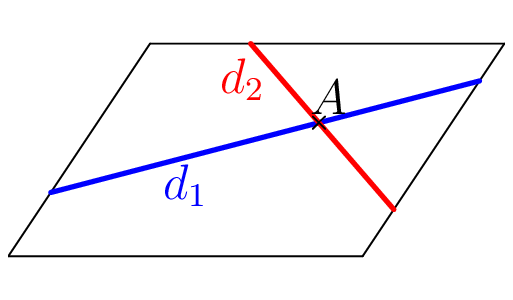
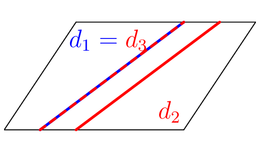
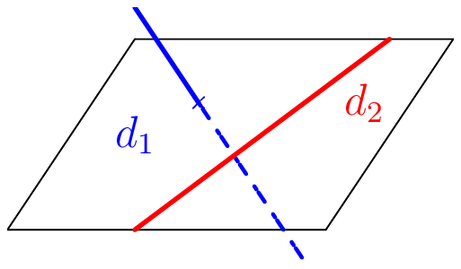
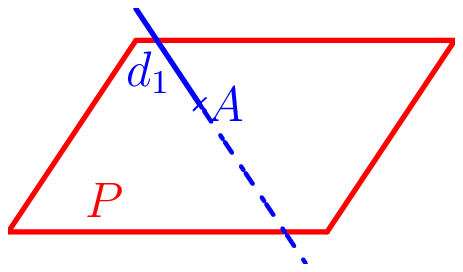
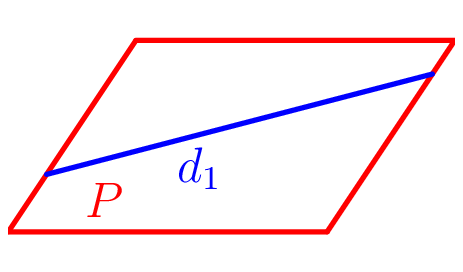
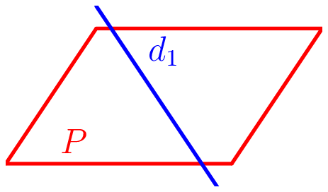
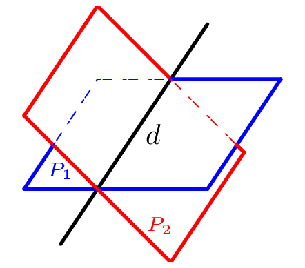
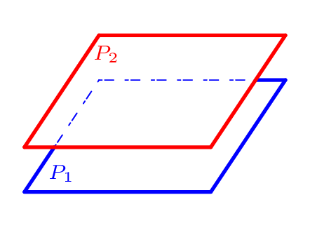
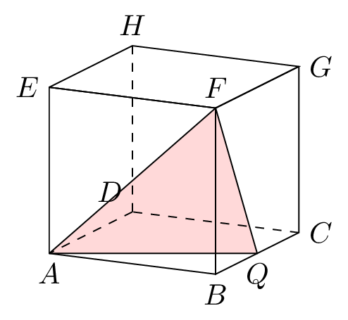

### Positions relatives de deux droites

::: {.bloc .thm}
Théorème (admis) : 

Soient $d_1$ et $d_2$ deux droites de l'espace. Alors :

* ou bien elles sont **coplanaires** (elles appartiennent à un même plan), et dans ce cas :
    * elles sont **sécantes** : elles admettent un unique point d'intersection ;
    * ou elles sont **parallèles** (strictement parallèles ou confondues) ;
* ou bien elles sont **non coplanaires**.
:::

::: {.bloc .rem}
Remarque : 

Deux droites non coplanaires ne sont ni parallèles, ni sécantes. On dit parfois qu'elles sont « gauches ».
:::

::: {.bloc .rem}
Illustration graphique :  

- Droites coplanaires sécantes : un point d'intersection

  

- Droites coplanaires parallèles : aucun point d'intersection (strictement parallèles) ou une infinité (confondues)
  

  

- Droites non coplanaires : aucun point d'intersection

  

:::

### Positions relatives d'une droite et d'un plan
::: {.bloc .thm}
Théorème (admis) : 

Soit $d$ une droite de l'espace et $\mathscr{P}$ un plan de l'espace, alors $d$ et $\mathscr{P}$ sont :

* **sécants** : ils ont un unique point d'intersection $M$. On note alors $\{M\}=d \cap \mathscr{P}$ ;
* **la droite est incluse dans le plan** (une infinité de points communs) : $d \subset \mathscr{P}$ donc $d \cap \mathscr{P} = d$ ;
* **strictement parallèles** : $d \cap \mathscr{P} = \emptyset$.
:::

::: {.bloc .rem}
Remarque : 

Dans les deux derniers cas, on dit que la droite $d$ est **parallèle** au plan $\mathscr{P}$.
:::

::: {.bloc .rem}
Illustration graphique :  

- Droite et plan sécants : un point d'intersection
  

  

- Droite et plan parallèles : droite incluse dans le plan
  

  

- Droite et plan parallèles : aucun point d'intersection
  

  

:::

::: {.bloc .ex}
Exemple :  
Soit $ABCD$ un tétraèdre, $I$ le milieu de $[AB]$ et $J$ le point vérifiant $\ve{AJ} = \frac{3}{4} \ve{AD}$.  
Déterminons l'intersection de $(IJ)$ avec $(BCD)$.  
Les droites $(IJ)$ et $(BD)$ sont coplanaires (dans le plan $(ABD)$). On a $\frac{AI}{AB} = \frac{1}{2} \neq \frac{3}{4} = \frac{AJ}{AD}$ ; on déduit de la contraposée du théorème de Thalès dans le triangle $ABD$ que les droites $(IJ)$ et $(BD)$ ne sont pas parallèles.

  

Elles sont donc sécantes en un point noté $K$. De plus 
$$(BD) \subset (BCD) \quad \text{et} \quad K \in (BD) \Rightarrow K \in (BCD)$$
Ainsi $K  \in (IJ)\cap (BCD)$.  
Or $I \not \in (BCD)$ donc $(IJ) \not\subset (BCD)$  
La droite $(IJ)$ et le plan $(BCD)$ sont donc sécants : $K$ est leur unique point d'intersection.

:::

### Positions relatives de deux plans
::: {.bloc .thm}
Théorème (admis) : 

Soient $\mathscr{P}_1$ et $\mathscr{P}_2$ deux plans de l'espace, alors ils sont :

* **Strictement parallèles** : ils n'ont aucun point en commun, $\mathscr{P}_1 \cap \mathscr{P}_2 = \emptyset$ ;
* **Confondus** : $\mathscr{P}_1 = \mathscr{P}_2$ ;
* **Sécants** : l'intersection est une droite $d$. On note alors $\mathscr{P}_1 \cap \mathscr{P}_2 = d$.
:::

::: {.bloc .rem}
Illustration graphique :  

- Plans sécants : une droite d'intersection

  

- Plans strictement parallèles : aucun point d'intersection

  

- Plans confondus : un plan d'intersection

  

:::

::: {.bloc .ex}
Exemple :  

Soit $ABCDEFGH$ un cube. Soit $Q$ le milieu de $[BC]$. Déterminons l'intersection de $(DCG)$ et $(AQF)$.

Afficher la correction :

Les droites $(AQ)$ et $(DC)$ étant coplanaires (dans le plan $(ABC)$) et non parallèles, elles sont sécantes. Soit $I$ leur point d'intersection.  
Les droites $(FQ)$ et $(CG)$ sont coplanaires (dans le plan $(BCG)$) et non parallèles, donc elles sont sécantes. Soit $J$ ce point d'intersection.

Ainsi :
$$\left. \begin{array}{l}
I = (AQ) \cap (DC)\\
J = (FQ) \cap (GC)
\end{array} \right\} \text{ Donc } \left. \begin{array}{l}
I \in (AQF) \cap (DCG)\\
J \in (FQA) \cap (DCG)
\end{array} \right\}$$

  

Les plans $(AQF)$ et $(DCG)$ ne sont pas confondus ($A \notin (DCG)$) et ont des points communs : ils sont sécants suivant une droite. Cette droite contient $I$ et $J$ (distincts) : l'intersection de ces deux plans est la droite $(IJ)$.

:::
