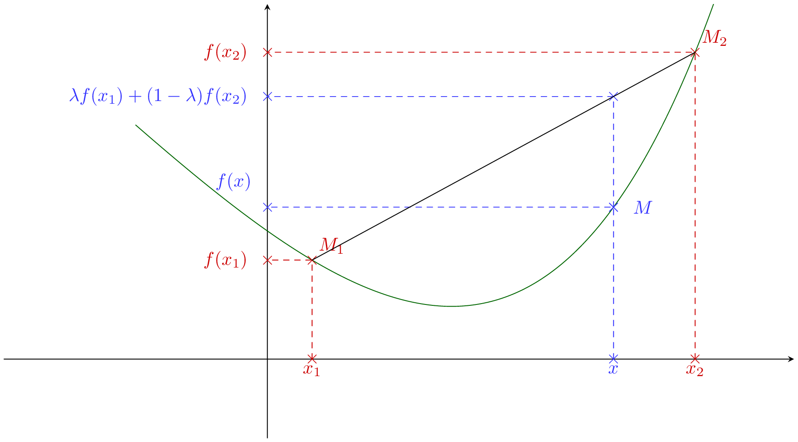
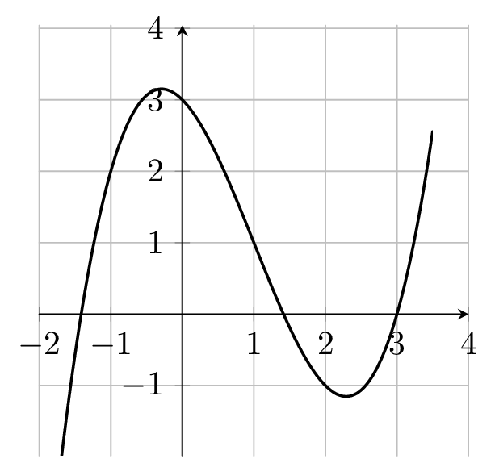

## Définition

::: {.bloc .def}
Définition : 

Soit $f$ une fonction définie sur un intervalle $I$ de $\mathbb{R}$.  
On dit que $f$ est **convexe** sur $I$ lorsque : 
$$\forall x_1, x_2 \in I, \, \forall \lambda \in [0 \, ; \, 1], \, f(\lambda x_1 + (1-\lambda) x_2) \leqslant \lambda f(x_1) + (1- \lambda) f(x_2)$$ 
:::

::: {.bloc .rem}
Remarque : 

Puisque $\lambda \in [0\, ; \, 1]$, pour tous $x_1,x_2 \in I$, le réel $x=\lambda x_1 + (1-\lambda)x_2$ est compris entre $x_1$ et $x_2$ ; comme $I$ est un intervalle, $x \in I$.  
Lorsque $\lambda$ décrit $[0\,;\,1]$, $x$ décrit tout le segment d'extrémités $x_1$ et $x_2$.
:::

::: {.bloc .rem}
Interprétation graphique :  

Cette définition est un peu abstraite, on peut lui donner un sens graphique simple. Commençons par donner un sens à $\forall x_1, x_2 \in I, \, \forall \lambda \in [0 \, ; \, 1]$ :

* On note $M_1(x_1\,;\,f(x_1))$ et $M_2(x_2\,;\,f(x_2))$ deux points de $\mathscr{C}_f$.
* $x = \lambda x_1 + (1-\lambda)x_2$ est un réel compris entre $x_1$ et $x_2$ : $M(x\,;\,f(x))$ est le point de $\mathscr{C}_f$ d'abscisse $x$.
* $\lambda f(x_1) + (1- \lambda) f(x_2)$ est l'ordonnée du point $P$ du segment $[M_1M_2]$ (la corde) dont l'abscisse est $x$.
* L'inégalité de la définition s'écrit donc $y_M \leqslant y_P$.

  

Ainsi, la fonction $f$ est convexe si et seulement si, pour tout couple $(M_1 \, ; \, M_2)$ de points de la représentation graphique de $f$, tout point $M$ de $\mathscr{C}_f$ d'abscisse comprise entre celles de $M_1$ et $M_2$ est en dessous du segment $[M_1M_2]$.
:::

::: {.bloc .ex}
Exemple :  

Montrons que la fonction carré est convexe sur $\mathbb{R}$.

Afficher la correction :

Notons $f : x \longmapsto x^2$. Pour tous $x,y\in\mathbb{R}$ et $t\in[0\,;\,1]$ :
$$
\begin{aligned}
t\,x^2+(1-t)\,y^2 - \left(tx+(1-t)y\right)^2 
&= t\,x^2+(1-t)\,y^2 - \big(t^2 x^2 + 2t(1-t)xy + (1-t)^2 y^2\big)\\
&= \big(t-t^2\big)x^2 + \big((1-t)-(1-t)^2\big)y^2 - 2t(1-t)xy\\
&= t(1-t)\,x^2 + t(1-t)\,y^2 - 2t(1-t)xy\\
&= t(1-t)\,\left(x^2 - 2xy + y^2\right)\\
&= t(1-t)\,\left(x-y\right)^2 \;\geqslant\; 0 \quad \text{car } t \geqslant 0 \text{ et } 1-t \geqslant 0.
\end{aligned}
$$
Ainsi,
$$\left(tx+(1-t)y\right)^2 \leqslant t\,x^2+(1-t)\,y^2,$$
c'est-à-dire
$$f\left(tx+(1-t)y\right) \leqslant t\,f(x) + (1-t)\,f(y).$$
La fonction carré est donc convexe sur $\R$.

:::

::: {.bloc .rem}
À retenir :  
Une fonction $f$ est convexe sur $I$ si et seulement si sa représentation graphique est en dessous de chacune de ses cordes (entre les extrémités de la corde).
:::

::: {.bloc .def}
Définition : 

On dit qu'une fonction $f$ est **concave** sur un intervalle $I$ de $\mathbb{R}$ lorsque $-f$ est convexe sur cet intervalle $I$.
:::

::: {.bloc .rem}
À retenir :  
Une fonction $f$ est concave sur $I$ si et seulement si sa représentation graphique est au-dessus de chacune de ses cordes.
:::

::: {.bloc .ex}
Exemple :  
On considère la fonction $f$ dont on donne la représentation graphique ci-dessous sur $[-2 \, ; \, 3{,}5]$.  
Le point d'abscisse $1$ joue un rôle particulier : il y a un changement de convexité (tout comme un extremum local où l'on observe un changement de variation de la fonction.)

  

On peut déterminer graphiquement que la fonction $f$ est concave sur $[-2 \, ; \, 1]$ et convexe sur $[1 \, ; \, 3{,}5]$.
:::

::: {.bloc .def}
Définition : Point d'inflexion 
Soient $f$ une fonction définie sur un intervalle $I$ et $\mathscr{C}_f$ sa représentation graphique. On appelle **point d'inflexion** de $\mathscr{C}_f$ tout point de $\mathscr{C}_f$ où $f$ change de convexité.
:::

::: {.bloc .ex}
Exemple :  
Dans l'exemple précédent, le point d'abscisse $1$ est un point d'inflexion de la représentation graphique de la fonction.

:::
