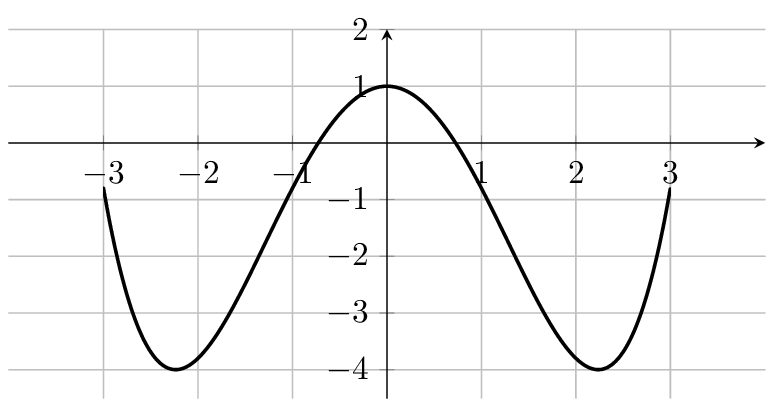
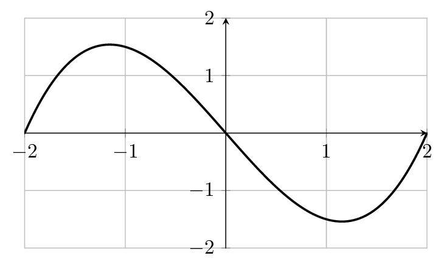

::: {.bloc .def}
Définition : Ensemble centré

Soit $a$ un réel. On dit qu'une partie $E$ de $\mathbb{R}$ est centrée en $a$ (ou symétrique par rapport à $a$) lorsque, pour tout $x \in E$, le réel $2a - x$ (symétrique de $x$ par rapport à $a$) appartient aussi à $E$.  
En particulier, $E$ est centrée en $0$ lorsque, pour tout $x \in E$, $-x \in E$.
:::

::: {.bloc .ex}
Exemple :  

* Soit $r > 0$. Les intervalles bornés centrés en $a$ sont de la forme $[a-r \,;\, a+r]$ ou $]a-r \,;\, a+r[$.
    * $[a-r \,;\, a+r]$ est l'ensemble des réels solutions de $|x-a| \leqslant r$.
    * Ainsi, les intervalles de la forme $]-r \,;\, r[$ sont centrés en $0$.
* Soit $r>0$, les ensembles de la forme $]-\infty \,;\, -r[ \cup ]r \,;\, +\infty[$ sont centrés en $0$.
* L'intervalle $[8 \,;\, 12]$ est centré en $10$.
:::

::: {.bloc .def}
Définition : 

Soit $f$ une fonction définie sur un ensemble $I$ centré en $0$.

1. On dit que $f$ est paire lorsque : $\forall x \in I, \, f(-x) = f(x)$.
2. On dit que $f$ est impaire lorsque : $\forall x \in I, \, f(-x) = -f(x)$.
:::

::: {.bloc .ex}
Exemple :  

* La fonction $f: x \longmapsto \dfrac{-2}{1+x^2}$ est définie sur $\mathbb{R}$ qui est centré en $0$.  
  C'est une fonction paire, en effet, pour tout $x \in \mathbb{R}$ :
  $$f(-x) = \dfrac{-2}{1+(-x)^2} = \dfrac{-2}{1+x^2} = f(x).$$
* La fonction $g: x \longmapsto \dfrac{x^2+1}{x}$ est définie sur $\mathbb{R}^*$, qui est centré en $0$.  
  C'est une fonction impaire, en effet, pour tout $x \in \mathbb{R}^*$ :
  $$g(-x) = \dfrac{(-x)^2+1}{-x} = -\dfrac{x^2+1}{x} = -g(x).$$
:::

::: {.bloc .rem}
Remarque : 

1. Si $f$ est impaire et que $0 \in I$, alors $f(0) = -f(0)$, donc $f(0) = 0$.  
   Cependant, une fonction paire comme une fonction impaire peut ne pas être définie en $0$.  
   En effet, les fonctions $f$ et $g$ définies sur $]-\infty \,;\, -2[ \cup ]2 \,;\, +\infty[$ par
   $$f(x) = \dfrac{1}{\sqrt{x^2-4}} \quad \text{et} \quad g(x) = \dfrac{x}{\sqrt{x^2-4}}$$
   ne sont pas définies en $0$ et sont respectivement paire et impaire.

2. Une fonction peut n'être ni paire ni impaire : par exemple, la fonction $h: x \longmapsto x+1$ vérifie $h(-1) = 0$ et $h(1) = 2$, donc $h(-1) \neq h(1)$ et $h(-1) \neq -h(1)$.
:::

::: {.bloc .thm}
Propriété : 

Toute fonction $f$ définie sur un ensemble centré en $0$ se décompose de manière unique comme somme d'une fonction paire et d'une fonction impaire :
$$f = i + p \quad \text{où} \quad i(x) = \dfrac{f(x) - f(-x)}{2} \quad \text{et} \quad p(x) = \dfrac{f(x) + f(-x)}{2}.$$
:::

Démonstration : 

Voir la page [Raisonnement par analyse-synthèse](../logique/AnalyseSynthese.qmd) du chapitre « Logique et raisonnements ».

### Parité et représentation graphique

::: {.bloc .thm}
Propriété : 

Soit $f$ une fonction définie sur un ensemble $E$ centré en $0$.

1. $f$ est paire si et seulement si $\mathscr{C}_f$ admet l'axe des ordonnées comme axe de symétrie.
2. $f$ est impaire si et seulement si $\mathscr{C}_f$ admet l'origine comme centre de symétrie.
:::

Démonstration : 

Soit $f$ une fonction définie sur un ensemble $E$ centré en $0$. On note $\mathscr{C}_f$ sa représentation graphique.

1. $f$ est paire si et seulement si pour tout $x \in E$, $f(x) = f(-x)$ si et seulement si pour tout $x \in E$, les points $M(x; f(x))$ et $M'(-x; f(-x))$ sont symétriques par rapport à l'axe des ordonnées, ce qui équivaut à dire que $\mathscr{C}_f$ admet l'axe des ordonnées comme axe de symétrie.

2. $f$ est impaire si et seulement si pour tout $x \in E$, $f(-x) = -f(x)$ si et seulement si pour tout $x \in E$, les points $M(x; f(x))$ et $M'(-x; f(-x))$ sont symétriques par rapport à l'origine du repère, ce qui équivaut à dire que $\mathscr{C}_f$ admet l'origine du repère comme centre de symétrie.

::: {.bloc .ex}
Exemple :  

- La fonction $f$ définie sur $\R$ par $f(x) = \dfrac{1}{5}x^4 - 2x^2 + 1$ est paire car $f(-x) = \dfrac{1}{5}x^4 - 2x^2 + 1 = f(x)$ : sa courbe (à gauche) est symétrique par rapport à l'axe des ordonnées.
- La fonction $g$ définie sur $\R$ par $g(x) = \dfrac{1}{2}x^3 - 2x$ est impaire car $g(-x) = -\dfrac{1}{2}x^3 + 2x = -g(x)$ : sa courbe (à droite) est symétrique par rapport à l'origine.

  
  

:::
