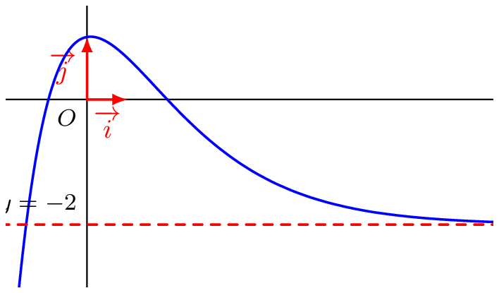
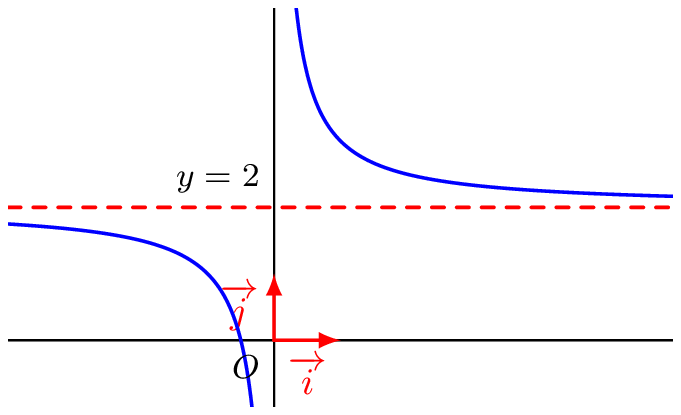
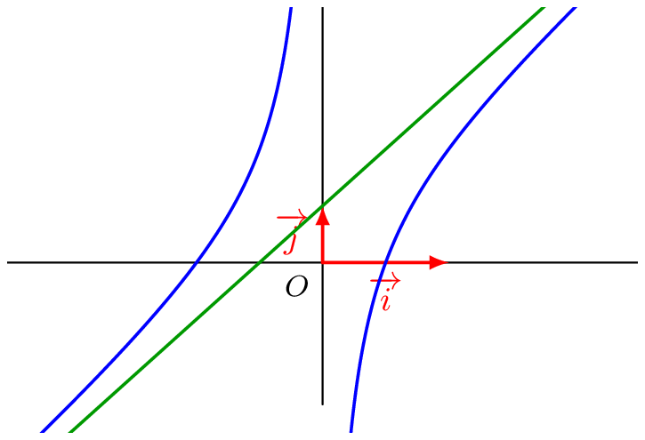

## Notion d'asymptote en l'infini
::: {.bloc .def}
Définition : 

Soient $f$ une fonction et $l \in \mathbb{R}$ tel que $\lim_{x \to +\infty} f(x) = l$ (resp. $\lim_{x \to -\infty} f(x) = l$).  
La droite d'équation $y=l$ est une **asymptote horizontale** à la courbe représentative de la fonction $f$ au voisinage de $+\infty$ (resp. $-\infty$).
:::

::: {.bloc .ex}

Exemple : Asymptote horizontale

- Soit la fonction $f$ définie par $f(x)=(2x+3)\e^{-0{,}63x}-2$, dont on donne ci-dessous la représentation graphique.

  

On conjecture que $\lim\limits_{x \to + \infty} f(x) = -2$, donc que la droite d'équation $y=-2$ est une asymptote horizontale à $\mathscr{C}_f$ au voisinage de $+\infty$.

- Soit la fonction $g$ définie sur $\R^*$ par $g(x)=\dfrac{1}{x}+2$, dont on donne ci-dessous la représentation graphique.

  

On a démontré que $\lim\limits_{x \to + \infty} g(x) = 2$ (et on démontre de même que $\lim\limits_{x \to - \infty} g(x) = 2$), donc la droite d'équation $y=2$ est une asymptote horizontale à $\mathscr{C}_g$ au voisinage de $+\infty$ et au voisinage de $-\infty$.

:::

::: {.bloc .def}
Définition : 

Soient $f$ et $g$ deux fonctions définies sur $[a\,;\,+\infty[$. On dit que **la représentation graphique de $g$ est asymptotique à la représentation graphique de $f$** (et réciproquement) au voisinage de $+\infty$ lorsque $$\lim_{x \to + \infty} \bigl(f(x)-g(x)\bigr)=0$$
Lorsque $g$ est une fonction affine $x \longmapsto ax+b$ avec $a \neq 0$, on dit que la droite d'équation $y = ax+b$ est une **asymptote oblique** à la courbe de $f$ au voisinage de $+\infty$.  
On a des définitions analogues au voisinage de $-\infty$.
:::

::: {.bloc .ex}

Exemple : Asymptote oblique

On considère la fonction $f$ définie sur $\mathbb{R}^*$ par $f(x)= 2x+1- \dfrac{1}{x}$.

Pour tout réel $x$ non nul, $f(x)-(2x+1)= -\dfrac{1}{x}$.  
Ainsi $\lim_{x \to \pm \infty} \bigl(f(x)-(2x+1)\bigr) = \lim_{x \to \pm \infty} \left(-\dfrac{1}{x}\right) = 0$.  

On conclut que la droite d'équation $y=2x+1$ est une asymptote oblique à la représentation graphique de $f$ au voisinage de $+\infty$ et de $-\infty$.

  

:::
