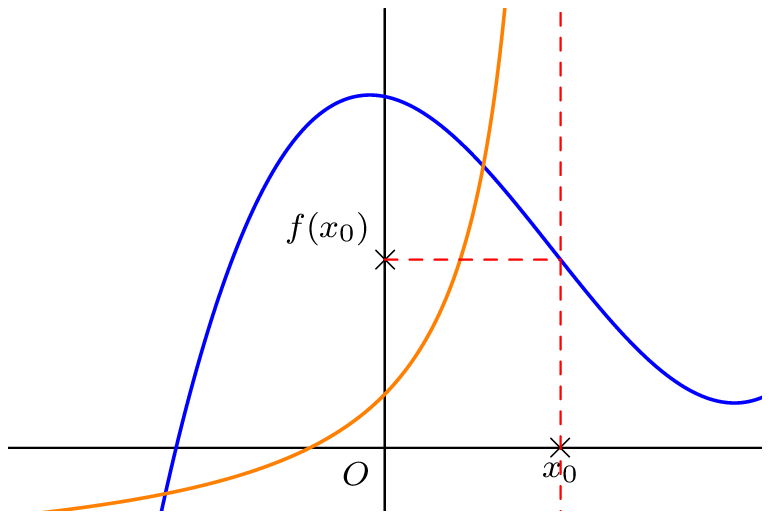
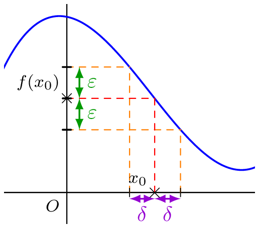

## Notion de limite en $x_0$

::: {.bloc .def}
Définition : 

Soit $x_0$ un réel appartenant à l'ensemble de définition de $f$ ou en étant une borne. La limite d’une fonction $f$ en $x_0$, si elle existe, décrit le comportement de $f(x)$ quand $x$ se rapproche de $x_0$. On la note $$\lim_{x \to x_0} f(x)$$
:::

::: {.bloc .rem}
Illustration :  
Deux cas de figure peuvent se présenter : la limite est finie, ou elle est infinie.

  

:::

## Cas particulier : Le nombre dérivé

::: {.bloc .rem}
Rappel :  
On pose, pour tout $x \in D_f \setminus \{x_0\}$, 
$$\tau_{x_0}(x)=\dfrac{f(x)-f(x_0)}{x-x_0}$$
Ainsi, pour $f$ dérivable en $x_0$, on a 
$$f'(x_0) = \lim_{x \to x_0} \tau_{x_0}(x)$$
:::

::: {.bloc .ex}
Exemple :  
En reconnaissant des taux d'accroissement (avec $\e^0 = 1$ et $\cos\left(\frac{\pi}{2}\right) = 0$) :
$$\lim_{x \to 0} \dfrac{\e^x-1}{x} = \exp'(0) = 1 \quad \text{ ; } \quad \lim_{x \to \dfrac{\pi}{2}} \dfrac{\cos(x)}{x-\dfrac{\pi}{2}} = \cos'\left(\dfrac{\pi}{2}\right) = -\sin\left(\dfrac{\pi}{2}\right) = -1$$

:::

## Limite finie d'une fonction
::: {.bloc .def}
Définition : 

Soit $f$ une fonction définie sur un intervalle $I$, $x_0$ un élément ou une borne de $I$, et $l$ un réel.  
On dit que $f$ admet $l$ pour limite au voisinage de $x_0$ (ou en $x_0$) et on note $$\lim_{x \to x_0} f(x) = l$$
lorsque 
$$\forall \epsilon >0, \, \exists \delta >0, \, \forall x \in I, \, (|x - x_0| < \delta \Rightarrow |f(x)-l| < \epsilon)$$
:::

::: {.bloc .rem}
Illustration :  

  

:::

::: {.bloc .rem}
 Remarque :  Comprendre la définition 

- L'inégalité $\abs{x-x_0} < \delta$ signifie que $x \in ]x_0-\delta \, ; \, x_0+\delta[$.
- L'inégalité $\abs{f(x)-l} < \epsilon$ signifie que $f(x) \in ]l-\epsilon \, ; \, l+\epsilon[$.
- L'ordre des quantificateurs est important : le $\delta$ dépend du $\epsilon$.

Autrement dit, pour tout intervalle ouvert $J$ contenant $l$, il existe un intervalle ouvert $K$ contenant $x_0$ tel que, pour tout $x \in I \cap K$, $f(x) \in J$ : $J$ contient tous les réels $f(x)$ pour $x$ suffisamment proche de $x_0$.
:::

::: {.bloc .rem}
Remarque :  
Lorsque $x_0 \in I$, on peut prendre $x = x_0$ dans la définition : on obtient $|f(x_0) - l| < \epsilon$ pour tout $\epsilon > 0$, donc la limite, si elle existe, est nécessairement $l = f(x_0)$. Dire que $f(x)$ est aussi proche que l'on veut de $f(x_0)$ pour $x$ suffisamment proche de $x_0$, c'est dire que $f$ est continue en $x_0$ (voir le chapitre sur la continuité).
:::
