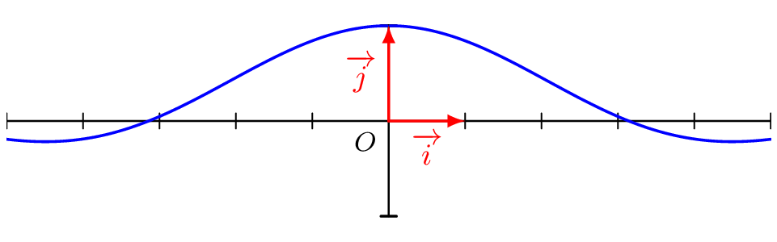
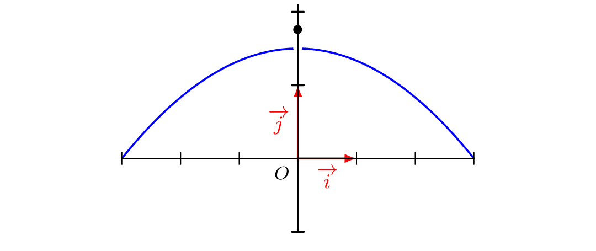

## Propriétés

::: {.bloc .thm}
Propriété : Unicité de la limite 
Soit $f$ une fonction définie sur un intervalle $I$ et $x_0$ un élément ou une borne de $I$. Si $f$ admet une limite finie en $x_0$, alors cette limite est unique.

:::

Démonstration : 

On suppose par l'absurde qu'il existe deux limites distinctes $l$ et $l'$ en $x_0$. Soit $\epsilon = \dfrac{|l - l'|}{3} > 0$.  
Par définition :

* il existe $\delta_1 > 0$ tel que, pour tout $x \in I$, $|x - x_0| < \delta_1 \Rightarrow |f(x) - l| < \epsilon$ ;
* il existe $\delta_2 > 0$ tel que, pour tout $x \in I$, $|x - x_0| < \delta_2 \Rightarrow |f(x) - l'| < \epsilon$.

Soit $\delta = \min(\delta_1, \delta_2)$ et $x \in I$ tel que $|x - x_0| < \delta$ (un tel $x$ existe car $I$ est un intervalle contenant $x_0$).  
Par l'inégalité triangulaire :
$$|l - l'| = |l - f(x) + f(x) - l'| \leqslant |f(x) - l| + |f(x) - l'| < 2\epsilon = \dfrac{2|l - l'|}{3}$$
Ce qui est impossible car $|l - l'| > 0$. D'où l'unicité de la limite.

::: {.bloc .ex}
Exemple :  
On considère la fonction $f$, définie sur $\R^*$ par $f(x)=\dfrac{\sin(x)}{x}$, dont on donne la représentation graphique.

  

On considère la fonction $g$ définie sur $\R$ par $g(x)=\sin(x)$.

Comme $\sin(0) = 0$, on a, pour tout $x \in \R^*$ : $$f(x) = \frac{g(x)-g(0)}{x-0}$$

Or la fonction $g$ est dérivable sur $\R$, donc en particulier en $0$, et $\sin'=\cos$.

Ainsi $$\lim_{x \to 0} f(x) = g'(0) = \cos(0) = 1$$

La fonction $f$ possède donc une limite en $0$ alors qu'elle n'y est pas définie.
:::

::: {.bloc .ex}
Exemple :  

Montrons, en utilisant la définition, que $\lim_{x \to 1} \dfrac{2x+3}{x+4} = 1$.

Afficher la correction :

On note $f(x) = \dfrac{2x+3}{x+4}$ pour $x > -4$. On a $$|f(x)- 1| = \left| \dfrac{2x+3}{x+4} - 1 \right| = \left| \dfrac{x-1}{x+4} \right| = \dfrac{|x-1|}{|x+4|}$$
Pour $x \in [0\, ;\, 2]$ (intervalle centré en $1$), on a $|x+4| \geqslant 4$, donc $|f(x)-1| \leqslant \dfrac{1}{4} |x-1|$.  
Soit $\epsilon > 0$ et $\delta = \min\{1 \, ; \, 4\epsilon\} > 0$. Si $|x-1| < \delta$, alors $x \in \left]0\,;\,2\right[$ et
$$|f(x)-1| \leqslant \dfrac{1}{4} |x-1| < \dfrac{4\epsilon}{4} = \epsilon.$$
On en déduit que $$\lim_{x \to 1} \dfrac{2x+3}{x+4} = 1$$

*Cet exemple est théorique : l'utilisation de la définition n'est pas pratique. La propriété suivante simplifie les choses lorsque $a$ appartient à l'ensemble de définition.*
:::

::: {.bloc .thm}
Propriété : 

Soit $f$ une fonction définie sur $D_f$, $a \in D_f$, telle que $f$ admet une limite finie en $a$.  
Alors $$\lim_{x \to a} f(x)= f(a)$$
On admet que les fonctions usuelles (polynômes, fonctions rationnelles, racine carrée, valeur absolue, exponentielle, sinus, cosinus) admettent une limite en tout point $a$ de leur ensemble de définition : cette limite est donc $f(a)$.
:::

Démonstration : 

Soit $l = \lim\limits_{x \to a} f(x)$ et $\epsilon > 0$. Par définition, il existe $\delta > 0$ tel que, pour tout $x \in D_f$, $|x - a| < \delta \Rightarrow |f(x) - l| < \epsilon$.  
Comme $a \in D_f$ et $|a - a| = 0 < \delta$, on peut prendre $x = a$ : $|f(a) - l| < \epsilon$.  
Ainsi $0 \leqslant |f(a) - l| < \epsilon$ pour tout $\epsilon > 0$, ce qui impose $|f(a) - l| = 0$, c'est-à-dire $l = f(a)$.

::: {.bloc .ex}
Exemple :  

Soit $f$ définie sur $]3\, ; \, +\infty[$ par $f(x)= \dfrac{2x-3}{x-3}$.  

* $f$ est une fonction rationnelle et $5 \in ]3\,;\,+\infty[$, donc d'après la propriété : $$\lim_{x \to 5} f(x) = f(5) = \dfrac{2 \times 5 -3}{5-3} = \dfrac{7}{2}$$  
* $3 \notin ]3\,;\,+\infty[$, on ne peut pas calculer directement $\lim_{x \to 3} f(x)$.  
Il faut utiliser la définition ou des propriétés (voir les pages suivantes).

:::

::: {.bloc .rem}
Interprétation graphique :  
Plus $x$ se rapproche de $a$, plus $f(x)$ se rapproche de $f(a)$ : la courbe ne présente pas de « saut » en $a$.

:::

::: {.bloc .rem}
Remarque :  
Une fonction peut être définie en $a$ sans y admettre de limite. Considérons la fonction $f$ dont la courbe est donnée ci-dessous :

  

Pour tout $x \in [-3\,;\,3]$, 

$$f(x)= \left\{\begin{array}{ll}1,75& \text{ si } x=0\\
\frac{1}{6} \left(9-x^2\right)&\text{ si } x \neq 0
\end{array} \right.$$

Pour $x \neq 0$, $f(x)$ se rapproche de $\dfrac{9}{6} = 1{,}5$ quand $x$ tend vers $0$, alors que $f(0) = 1{,}75 \neq 1{,}5$. D'après la propriété, la fonction $f$ n'admet pas de limite en $0$.

:::
