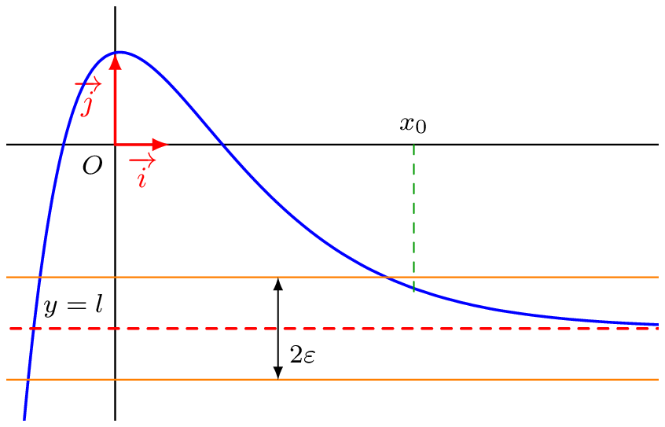
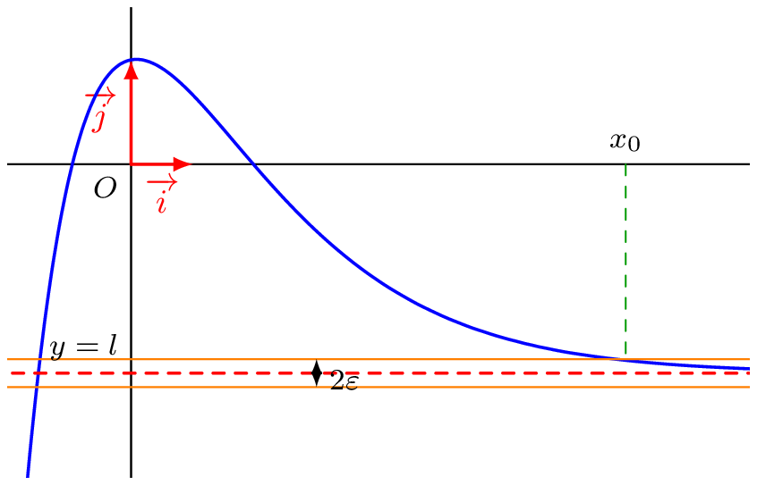
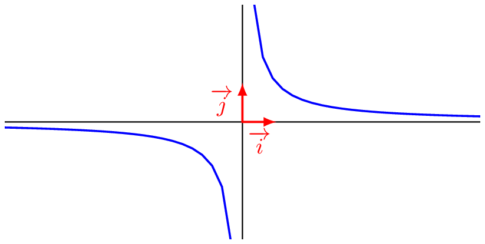

## Limite finie

::: {.bloc .def}
Définition : 

Soit $l \in \mathbb{R}$ et $f$ une fonction définie sur $D_f$.  
On dit que $f$ admet une limite finie $l$ en $+\infty$ (resp. $-\infty$) et on note $$\lim_{x \to +\infty} f(x)= l \quad \left( \text{resp. } \lim_{x \to -\infty} f(x)= l\right)$$
lorsque :
$$\forall \epsilon > 0, \, \exists x_0 \in \mathbb{R}, \,\forall x \in D_f, \, (x \geqslant x_0 \Rightarrow |f(x)-l| \leqslant \epsilon) \quad \left(\text{resp. } (x \leqslant x_0 \Rightarrow |f(x)-l| \leqslant \epsilon) \right) $$
:::

::: {.bloc .rem}
Illustration :  
Soit $f:x \longmapsto (2x+3)\e^{-0{,}63x}-2$, qui admet $-2$ pour limite en $+\infty$ : pour tout $\epsilon > 0$, la courbe est dans la bande comprise entre les droites d'équations $y = -2-\epsilon$ et $y = -2+\epsilon$ à partir d'une certaine abscisse $x_0$.

  
  

:::

::: {.bloc .thm}
Propriété : Unicité de la limite

Soit $f$ une fonction admettant une limite finie $l$ en $\pm \infty$.  
Alors le réel $l$ est unique ; ce nombre est appelé la limite de $f$ en $\pm \infty$.
:::

Démonstration : 

On fait la démonstration en $+\infty$. On suppose par l'absurde qu'il existe deux limites distinctes $l$ et $l'$.  
Par définition on a :
$$\forall \epsilon > 0, \, \exists x_0 \in D_f, \,\forall x \in D_f, \, (x \geqslant x_0 \Rightarrow |f(x)-l| \leqslant \epsilon)$$
et 
$$\forall \epsilon > 0, \, \exists x_1 \in D_f, \,\forall x \in D_f, \, (x \geqslant x_1 \Rightarrow |f(x)-l'| \leqslant \epsilon)$$
Soit alors $\epsilon = \dfrac{|l-l'|}{4}$ et $x_{max} = \max(x_0,x_1)$.  
Ainsi pour tout réel $x \geqslant x_{max}$ :
$$|l-l'| = |f(x)-l' - (f(x)-l)| \leqslant |f(x)-l'| + |f(x)-l| \leqslant \dfrac{|l-l'|}{4} + \dfrac{|l-l'|}{4} = \dfrac{|l-l'|}{2}$$
Ainsi $|l - l'| \leqslant \dfrac{|l-l'|}{2}$, donc $|l - l'| \leqslant 0$, ce qui est impossible puisque $l \neq l'$ : d'où l'unicité de la limite.

::: {.bloc .ex}
Exemple :  

Soit $f:x \longmapsto 2+\dfrac{1}{x}$ définie sur $\mathbb{R}^*$.  
Démontrer que $$\lim_{x \to + \infty} f(x) = 2$$

Afficher la correction :

Soit $\epsilon > 0$ et $x_0 = \dfrac{1}{\epsilon} > 0$.  
La fonction inverse étant décroissante sur $\mathbb{R}^*_+$, pour tout $x > 0$ :
$$x \geqslant x_0 \Rightarrow 0 < \dfrac{1}{x} \leqslant \dfrac{1}{x_0} = \epsilon \Rightarrow |f(x) - 2| = \dfrac{1}{x} \leqslant \epsilon.$$
Ainsi, par définition, $\lim_{x \to +\infty} f(x) = 2$.

:::

::: {.bloc .ex}
Exemple :  

On considère la fonction $f$ définie sur $\mathbb{R}$ par $f(x) = \cos(\pi x)$. Montrons qu'elle n'admet pas de limite en l'infini.

Afficher la correction :

Supposons par l'absurde que la fonction admette une limite $l$ en $+\infty$ : $$\lim_{x \to +\infty} \cos( \pi x) = l$$
Alors, pour toute suite $(x_n)$ tendant vers $+\infty$, la suite $(\cos(\pi x_n))$ tend vers $l$ (composition).

* On considère $x_n = 2n$, alors $\cos(\pi x_n) = \cos(2 \pi n) = 1$, ainsi $$\lim_{n \to +\infty} \cos(2 n \pi) = 1.$$
* On considère $y_n = 2n+1$, alors $\cos(\pi y_n) = \cos(2 \pi n +\pi) = \cos(\pi) = -1$, ainsi $$\lim_{n \to +\infty} \cos(2 n \pi + \pi) = -1.$$

On aurait donc $l = 1$ et $l = -1$, ce qui est impossible : la fonction n'admet pas de limite en $+\infty$.

:::

::: {.bloc .thm}
Propriété (admise) : 

On considère $n \in \mathbb{N}^*$.
$$\lim_{x \to +\infty} \dfrac{1}{x^n}= 0  \qquad \lim_{x \to + \infty} \dfrac{1}{\sqrt{x}}= 0    \qquad \qquad \lim_{x \to - \infty} \dfrac{1}{x^n} = \begin{cases}
0^+, \text{ si } n \text{ pair}\\
0^-, \text{ si } n \text{ impair}
\end{cases} $$
:::

::: {.bloc .rem}
Remarque :  

  

On parle de $0^+$ et $0^-$ : il s'agit de préciser si l'on s'approche de $0$ par des valeurs supérieures ($0^+$, valeurs positives) ou par des valeurs inférieures ($0^-$, valeurs négatives).
:::
