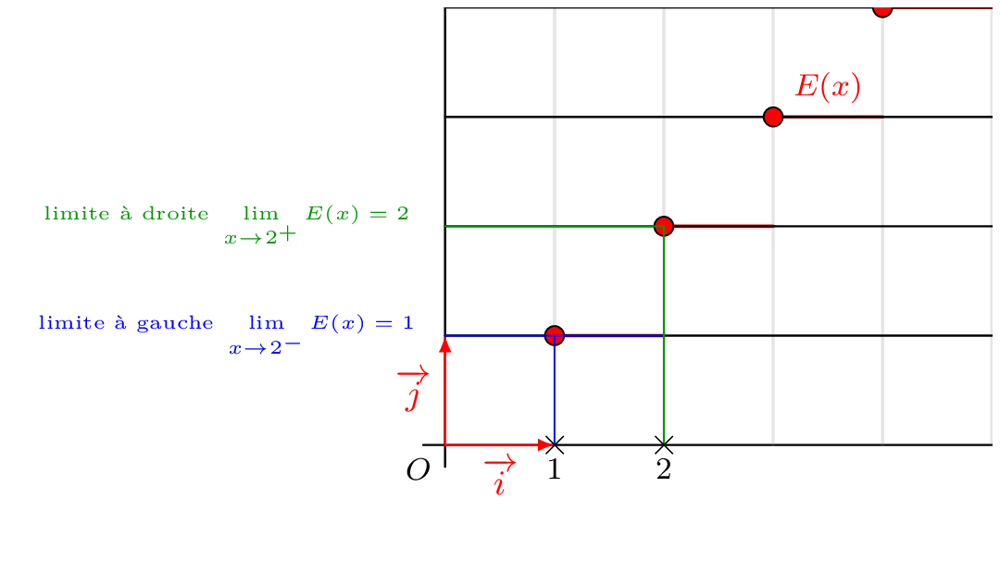

::: {.bloc .rem}
Introduction :  
Certaines fonctions n'ont pas le même comportement suivant que $x$ tend vers $a$ par valeurs supérieures ou par valeurs inférieures à $a$. On introduit alors la notion, plus subtile, de limite à gauche et limite à droite.

:::

::: {.bloc .def}
Définition :  
On dit que $f(x)$ tend vers $l$ quand $x$ tend vers $a$ par valeurs supérieures (resp. par valeurs inférieures) si la restriction de $f$ à $]a\, ; \, +\infty[$ (resp. $]-\infty \, ; a [$) tend vers $l$ quand $x$ tend vers $a$.

On note alors $$\lim_{x \to a^+} f(x)= l \quad  \left( \text{resp. } \lim_{x \to a^-} f(x) = l \right)$$
On parle de limite à droite (resp. à gauche) en $a$.
:::

::: {.bloc .rem}
Remarque : 

On peut évidemment donner une définition quantifiée pour la limite par valeurs supérieures :
$$\forall \epsilon >0, \, \exists \delta >0,\, \forall x \in I, (0 < x - a < \delta \Rightarrow |f(x)-l| < \epsilon)$$
:::

::: {.bloc .ex}
Exemple :  

Soit $f$ définie sur $\mathbb{R}$ par 
$$f(x)=\begin{cases}
x-1 \, ,\text{ si } x \geqslant 0\\
x+1 \, ,\text{ sinon} 
\end{cases}$$
Déterminer la limite à droite et la limite à gauche.

Afficher la correction :

Pour $x > 0$, $f(x) = x - 1$ et pour $x < 0$, $f(x) = x + 1$, donc $$\lim_{x \to 0^+} f(x) = -1 \quad \text{ et } \quad \lim_{x \to 0^-} f(x) = 1$$
On observe que la limite à droite et la limite à gauche ne sont pas les mêmes.

:::

::: {.bloc .thm}
Propriété (admise) : 

Soit $I$ un intervalle et $a \in I$. Soit $f$ une fonction.

* Si $f$ est définie sur $I$ sauf en $a$, alors $f$ possède une limite en $a$ si et seulement si $f$ possède une limite à droite et une limite à gauche, et si elles sont égales.
* Si $f$ est définie sur $I$, alors $f$ possède une limite en $a$ si et seulement si $f$ possède une limite à droite et une limite à gauche, et si elles sont égales à $f(a)$.
:::

::: {.bloc .ex}
Exemple :  

Soit $f$ définie sur $\mathbb{R}$ par 
$$f(x)=\begin{cases}
x^2-2x\, , \text{ si } x < 0\\
x+1\, , \text{ si } x > 0\\
1\, , \text{ si } x=0
\end{cases}$$
La fonction admet-elle une limite en $0$ ?

Afficher la correction :

On a $\lim_{x \to 0^-} f(x)=0$, $\lim_{x \to 0^+} f(x) = 1$ et $f(0)=1$.  
D'après la propriété, $f$ n'admet donc pas de limite en $0$.

:::

::: {.bloc .ex}
Exemple :  
On considère la fonction partie entière $E : x \longmapsto E(x)$ ($E(x)$ est le plus grand entier inférieur ou égal à $x$), dont on donne la représentation graphique.

  

Pour tout entier $n$, $\lim\limits_{x \to n^-} E(x) = n-1$ et $\lim\limits_{x \to n^+} E(x) = n$ : la fonction partie entière admet en tout point de $\Z$ une limite à gauche et une limite à droite, mais elles sont différentes. Elle n'admet donc de limite en aucun entier.

:::
