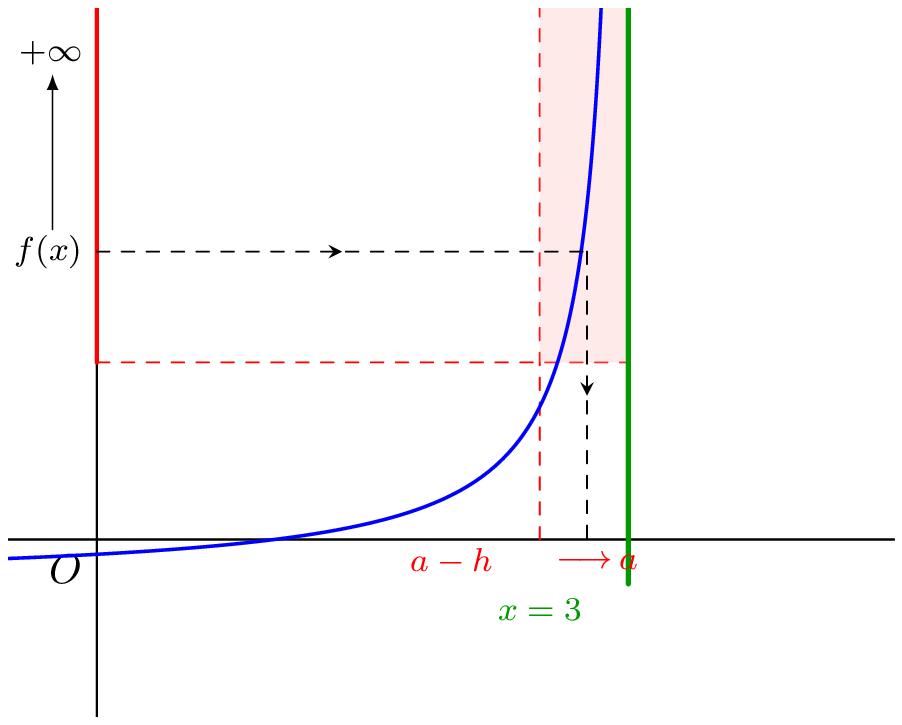
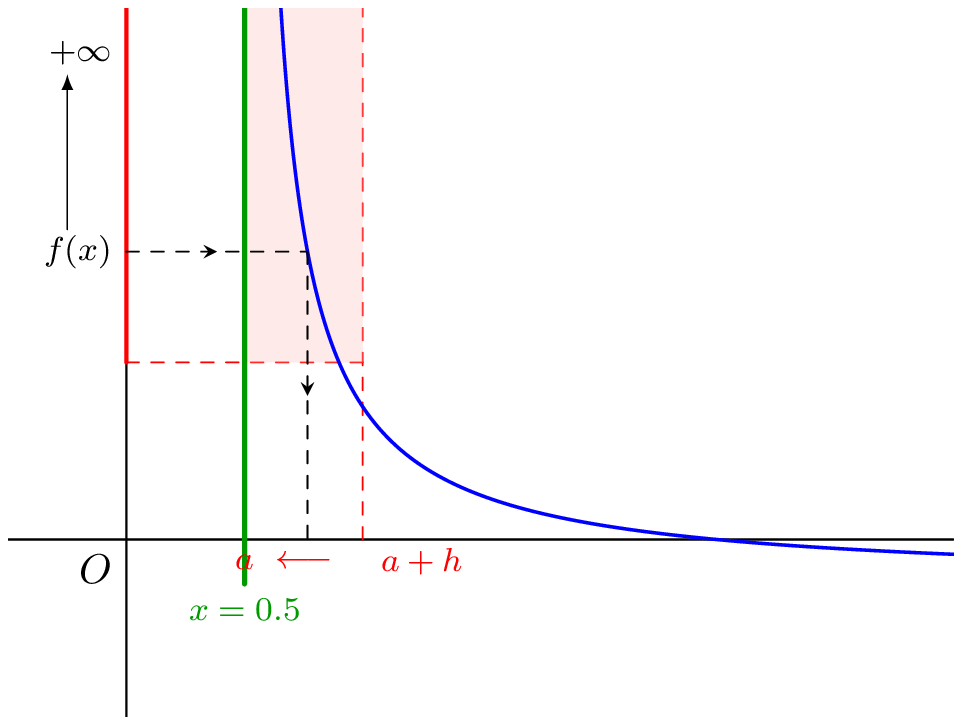
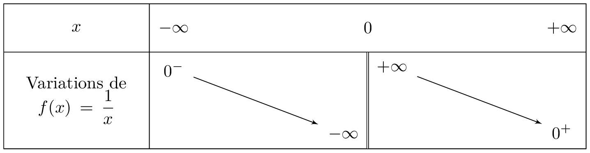

## Définition
::: {.bloc .def}
Définition : 

Soit $f$ une fonction définie sur $D_f$ et $x_0$ un réel n'appartenant pas à $D_f$ mais borne d'un intervalle inclus dans $D_f$.  
On dit que $f$ tend vers $+\infty$ quand $x$ tend vers $x_0$ et on note $$\lim_{x \to x_0} f(x) = +\infty$$ lorsque 
$$\forall A >0, \, \exists \delta >0 , \, \forall x \in D_f, \, (|x-x_0| < \delta \Rightarrow f(x) \geqslant A)$$
On définit de même $\lim\limits_{x \to x_0} f(x) = -\infty$ en remplaçant $f(x) \geqslant A$ par $f(x) \leqslant -A$.
:::

::: {.bloc .ex}
Exemple :  

On considère la fonction $f$ définie sur $\mathbb{R}^*$ par $f(x) = \dfrac{1}{x^2}$. 

Étudier la limite en $0$.

Afficher la correction :

Soit $A > 0$ et $\delta = \dfrac{1}{\sqrt{A}}$. Pour tout $x \in \R^*$, la fonction carré étant croissante sur $[0\,;\,+\infty[$ et la fonction inverse décroissante sur $]0\,;\,+\infty[$ :
$$0 < |x| < \dfrac{1}{\sqrt{A}} \Rightarrow 0 < x^2 < \dfrac{1}{A} \Rightarrow \dfrac{1}{x^2} > A$$
Ce qui prouve, par définition, que $$\lim_{x \to 0}\dfrac{1}{x^2} = +\infty$$

:::

## Interprétation graphique
::: {.bloc .def}
Définition : 

Soit $f$ une fonction définie sur $I\setminus\{a\}$ (où $I$ est un intervalle contenant $a$ ou dont $a$ est une borne) vérifiant l'une des limites suivantes : $$ \lim_{x\to a^+}f(x)=+\infty \quad \text{ou} \quad \lim_{x\to a^-}f(x)=+\infty  \quad \text{ou} \quad  \lim_{x\to a^+}f(x)=-\infty \quad \text{ou} \quad \lim_{x\to a^-}f(x)=-\infty$$
On dit alors que la droite d'équation $x=a$ est **une asymptote verticale** à la courbe représentative de la fonction $f$. 

:::

::: {.bloc .ex}
Illustration :  

- Cas de la limite en $a^-$ (limite à gauche)

  

  On écrit alors $\lim\limits_{x \to a^-} f(x)= + \infty$.

- Cas de la limite en $a^+$ (limite à droite)

  

  On écrit alors $\lim\limits_{x \to a^+} f(x)= + \infty$.
:::

## Limites de fonctions usuelles

::: {.bloc .thm}
Propriété (admise) :  
On considère $n \in \N^*$.
$$\lim_{x \to 0^+} \frac{1}{x^n}= +\infty  \qquad \qquad \lim_{x \to 0^+} \frac{1}{\sqrt{x}}= +\infty \qquad \qquad 
\lim_{x \to 0^-}\frac{1}{x^n} = \left\{\begin{array}{l}
+\infty, \text{ si } n \text{ pair}\\
-\infty, \text{ si } n \text{ impair}\\
\end{array} \right.$$

:::

::: {.bloc .ex}
Exemple :  
Tableau des variations de la fonction inverse (la droite d'équation $x = 0$ est asymptote verticale à l'hyperbole) :

  

:::
