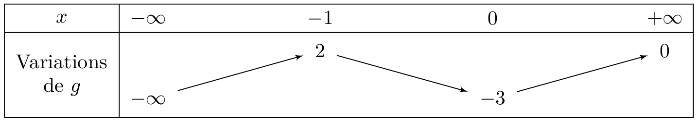

### Somme de limites

::: {.bloc .thm}
Propriété (admise) : 

| Si $\lim_{x\to \alpha}u(x)=$ | $\ell$ | $\ell$ | $\ell$ | $+\infty$ | $-\infty$ | $+\infty$ |
| :--- | :---: | :---: | :---: | :---: | :---: | :---: |
| **et** $\lim_{x\to \alpha}v(x)=$ | $\ell '$ | $+\infty$ | $-\infty$ | $+\infty$ | $-\infty$ | $-\infty$ |
| **alors par somme** $\lim_{x\to \alpha}(u+v)(x)=$ | $\ell + \ell '$ | $+\infty$ | $-\infty$ | $+\infty$ | $-\infty$ | **F.I.** |

:::

::: {.bloc .rem}
Remarque : 
Dans ces tableaux, $\alpha$ désigne un réel, $+\infty$ ou $-\infty$.  
**F.I.** signifie forme indéterminée : sans transformation de l'écriture, on ne peut pas donner la limite de la fonction au point considéré.  
Il faut alors lever l'indétermination par le calcul (factorisation, simplification, quantité conjuguée...) ou grâce à un autre théorème (comparaison, croissances comparées...).
:::

::: {.bloc .ex}

Exemple : Somme de limites 

Soit $f$ la fonction définie sur $]0 ; +\infty[$ par $f(x)=x^2-1+\dfrac{1}{x}$.

* $\lim\limits_{\underset{x>0}{x\to 0}}(x^2-1)=-1$ et $\lim_{\underset{x>0}{x\to 0}}\dfrac{1}{x}=+\infty$ donc, par somme, $\lim_{\underset{x>0}{x\to 0}}f(x)=+\infty$.  
La courbe représentative de la fonction $f$ admet pour asymptote l'axe des ordonnées.

* $\lim\limits_{x\to +\infty}(x^2-1)=+\infty$ et $\lim_{x\to +\infty}\dfrac{1}{x}=0$ donc, par somme, $\lim_{x\to +\infty}f(x)=+\infty$.

:::

### Produit de limites
::: {.bloc .thm}
Propriété (admise) : 

| Si $\lim_{x\to \alpha}u(x)=$ | $\ell$ | $\ell \ne 0$ | $+\infty$ ou $-\infty$ | $0$ |
| :--- | :---: | :---: | :---: | :---: |
| **et** $\lim_{x\to \alpha}v(x)=$ | $\ell '$ | $+\infty$ ou $-\infty$ | $+\infty$ ou $-\infty$ | $+\infty$ ou $-\infty$ |
| **alors par produit** $\lim_{x\to \alpha}(u \times v)(x)=$ | $\ell \times \ell '$ | $\pm\infty$ | $\pm\infty$ | **F.I.** |

Le signe de la limite infinie est donné par la règle des signes.
:::

::: {.bloc .ex}
Exemple :  

Soit $f$ la fonction définie sur $]0 ; +\infty[$ par $f(x)=x^2\times \left(\dfrac{1}{x}-1\right)$.  
Déterminer les limites en $+ \infty$ et en $0$.

Afficher la correction :

* $\lim_{\underset{x>0}{x\to 0}}x^2=0$ et $\lim_{\underset{x>0}{x\to 0}}\left(\dfrac{1}{x}-1\right)=+\infty$. (Nous sommes en présence de la forme indéterminée « $0\times \infty$ ».)  
Pour tout réel $x$ non nul, $x^2\times \left(\dfrac{1}{x}-1\right)=x- x^2$.  
De plus $\lim\limits_{\underset{x>0}{x\to 0}}(x- x^2)=0$. 

On en déduit que $\lim_{\underset{x>0}{x\to 0}}f(x)=0$.

* $\lim_{x\to +\infty}x^2=+\infty$   
  De plus $\lim_{x \to + \infty} \dfrac{1}{x}= 0$, donc  $\lim_{x\to +\infty}\left(\dfrac{1}{x}-1\right)=-1$   
  Par produit, $\lim_{x\to +\infty}f(x)=-\infty$.

:::

### Quotient de limites
::: {.bloc .thm}
Propriété (admise) : 

| Si $\lim_{x\to \alpha}u(x)=$ | $\ell$ | $\ell \ne 0$ | $\ell$ | $+\infty$ ou $-\infty$ | $0$ | $+\infty$ ou $-\infty$ |
| :--- | :---: | :---: | :---: | :---: | :---: | :---: |
| **et** $\lim_{x\to \alpha}v(x)=$ | $\ell ' \ne 0$ | $0$ | $+\infty$ ou $-\infty$ | $\ell '$ | $0$ | $+\infty$ ou $-\infty$ |
| **alors par quotient** $\lim_{x\to \alpha}\left(\dfrac{u}{v} \right)(x)=$ | $\dfrac{\ell}{ \ell '}$ | $\pm\infty$ | $0$ | $\pm\infty$ | **F.I.** | **F.I.** |

Le signe de la limite infinie est donné par la règle des signes ; dans le cas « $\dfrac{\ell}{0}$ », il faut connaître le signe de $v(x)$ au voisinage de $\alpha$ ($0^+$ ou $0^-$).
:::

::: {.bloc .ex}
Exemple :  
Soit $f$ la fonction définie sur $]1 ; +\infty[$ par $f(x)=\dfrac{x^3-1}{x^2-1}$.

Déterminer les limites aux bornes de l'ensemble de définition

Afficher la correction :

- $\lim\limits_{x\to 1}\, (x^3-1)=0 \et \lim\limits_{x\to 1}  \, (x^2-1)=0$.  
Nous sommes en présence de la forme indéterminée « $\dfrac{0}{0}$ ».

Or pour tout réel $x > 1$, 

$$\dfrac{x^3-1}{x^2-1} = \dfrac{(x-1)(x^2+x+1)}{(x-1)(x+1)} = \dfrac{x^2+x+1}{x+1}$$

Comme 

$$\displaystyle \lim_{x\to 1}\dfrac{x^2+x+1}{x+1}=\dfrac{3}{2}$$ 
    
nous pouvons conclure que, $$\displaystyle \lim_{x\to 1}f(x)=\dfrac{3}{2}$$

- $\displaystyle \lim_{x\to +\infty} \, (x^3-1) = +\infty \et \displaystyle \lim_{x\to +\infty} \, (x^2-1)=+\infty$. 

Nous sommes en présence de la forme indéterminée « $\dfrac{\infty}{\infty}$ ».

Or pour tout réel $x > 1$, 
    
$$\dfrac{x^3-1}{x^2-1} =\dfrac{x^3\left(1-\dfrac{1}{x^3}\right)}{x^2\left(1-\dfrac{1}{x^2}\right)}=\dfrac{x\left(1-\dfrac{1}{x^3}\right)}{1-\dfrac{1}{x^2}}$$ 

Comme 
$$\displaystyle \lim_{x\to +\infty} \, x \left(1-\dfrac{1}{x^3}\right)=+\infty \et \displaystyle \lim_{x\to +\infty}\, \left(1-\dfrac{1}{x^2}\right)=1$$ 

il s'ensuit que 	$$\displaystyle \lim_{x\to +\infty}\, f(x)=+\infty$$ 

:::

::: {.bloc .ex}
Exemple :  
Soit $g$ la fonction définie sur $\mathbb{R} \setminus \{2\}$ par $g(x) = \dfrac{x+1}{x-2}$.  
Étudier la limite de $g$ en $2$.

Afficher la correction :

* D'une part $$\lim_{x \to 2} (x+1) = 3$$
* D'autre part, $\lim_{x \to 2} (x-2) = 0$. Il faut donc étudier le signe de $x-2$ au voisinage de $2$ :
  
    * Si $x > 2$, $x-2 > 0$, donc $\lim_{x \to 2^+} (x-2) = 0^+$.
    * Si $x < 2$, $x-2 < 0$, donc $\lim_{x \to 2^-} (x-2) = 0^-$.

Par quotient ($3 > 0$), on conclut :
$$\lim_{x \to 2^+} g(x) = +\infty \quad \text{ et } \quad \lim_{x \to 2^-} g(x) = -\infty$$

:::

### Composée de limites
::: {.bloc .thm}
Propriété : Théorème de composition des limites 
Soit $a,b,c \in \R \cup \{-\infty ; +\infty\}$. 

Soient $f$ et $g$ deux fonctions telles que $g \circ f$ soit définie au voisinage de $a$.  
Si $$\lim_{x \to a} f(x)=b \et \lim_{X \to b} g(X)= c$$ alors $$\lim_{x \to a} (g \circ f)(x) = c$$

:::

Démonstration : 

On considère le cas $a,b,c \in \R$ (les autres cas se traitent de façon analogue). Soit $\epsilon > 0$.

* Comme $\lim\limits_{y \to b} g(y) = c$, il existe $\eta > 0$ tel que, pour tout $y$ de l'ensemble de définition de $g$ : $\abs{y-b} < \eta \Rightarrow \abs{g(y)-c} < \epsilon$.
* Comme $\lim\limits_{x \to a} f(x) = b$, appliqué avec $\eta$ à la place de $\epsilon$, il existe $\delta > 0$ tel que, pour tout $x$ : $\abs{x-a} < \delta \Rightarrow \abs{f(x)-b} < \eta$.

Ainsi, en prenant $y = f(x)$ :
$$\forall \epsilon >0, \; \exists \delta > 0, \; \forall x, \; (\abs{x-a} < \delta  \Rightarrow \abs{g(f(x))-c} < \epsilon)$$
c'est-à-dire $\lim\limits_{x \to a} (g \circ f)(x) = c$.

::: {.bloc .ex}
Exemple :  
On considère la fonction $f$ définie sur $\R$ par $$f(x) = \sqrt{1+x^2}$$
Déterminer sa limite en $+ \infty$.

Afficher la correction :

$$
\left . \begin{array}{l}
\lim_{x \to +\infty} (1+x^2) = + \infty\\
\lim_{X \to +\infty} \sqrt{X} = +\infty
\end{array} \right\} \text{ Par composition }
\lim_{x \to + \infty} \sqrt{1+x^2} = + \infty
$$

:::

::: {.bloc .ex}
Exemple :  

Soit $g$ une fonction dérivable sur $\mathbb{R}$ ayant pour tableau de variations :

  

1. Déterminer la limite de $\dfrac{1}{g(x)}$ lorsque $x$ tend vers $-\infty$.

Afficher la correction :

D'après le tableau de variations, on a $$\lim_{x \to -\infty} g(x) = -\infty$$  
Par passage à l'inverse, on déduit que : 
$$\lim_{x \to -\infty} \dfrac{1}{g(x)} = 0$$

2. Déterminer la limite de $g \left(\dfrac{1}{x} \right)$ lorsque $x$ tend vers $+\infty$.

Afficher la correction :

On a $$\lim_{x \to +\infty} \dfrac{1}{x} = 0^+$$  
Or, d'après le tableau, $$\lim_{X \to 0^+} g(X) = -3$$ 
Par composition, on déduit que : 
$$\lim_{x \to +\infty} g \left( \dfrac{1}{x} \right) = -3$$

3. Déterminer la limite de $\dfrac{1}{g(x)-2}$ lorsque $x$ tend vers $-1$.

Afficher la correction :

D'après le tableau des variations, on a $$\lim_{x \to -1} g(x) = 2^-$$  
Ainsi : 
$$\lim_{x \to -1} (g(x)-2) = 0^-$$
Or $$\lim_{X \to 0^-} \dfrac{1}{X} = - \infty$$

Donc par composition
$$\lim_{x \to -1} \dfrac{1}{g(x)-2} = -\infty$$

:::
