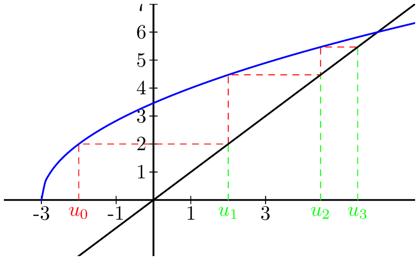

## Application à l'étude des suites

::: {.bloc .def}
Définition :  

Soit une suite $(u_n)$ définie à partir d'un certain rang $p \in \N$. On dit que $(u_n)$ est :

* **majorée** à partir du rang $k \geqslant p$, lorsqu'il existe un réel $M$ tel que pour tout entier naturel $n \geqslant k$, $u_n \leqslant M$.
* **minorée** à partir du rang $k \geqslant p$, lorsqu'il existe un réel $m$ tel que pour tout entier naturel $n \geqslant k$, $u_n \geqslant m$.
* **bornée** à partir du rang $k \geqslant p$, lorsqu'elle est majorée et minorée à partir du rang $k$.
:::

::: {.bloc .rem}
Remarque :  

Majorant et minorant ne sont pas uniques : si une suite $(u_n)$ est majorée par $3$, alors elle est majorée par $4$.
:::

::: {.bloc .ex}
Exemple :  

On considère la suite $(v_n)$ définie pour tout $n \in \N^*$ par $v_n = 3 - \frac{1}{n}$.  
Montrons que la suite est bornée.

Afficher la correction :

Pour tout $n \geqslant 1$, la fonction inverse étant décroissante, on a $0 < \frac{1}{n} \leqslant 1$.  
Or,
$$0 < \frac{1}{n} \leqslant 1 \Longrightarrow -1 \leqslant -\frac{1}{n} < 0 \Longrightarrow 2 \leqslant v_n < 3.$$
On déduit alors que, pour tout $n \in \N^*$, $v_n \in [2, 3[$.
Ainsi, la suite est bornée : minorée par $2$ et majorée par $3$.

:::

::: {.bloc .ex}
Exemple :  

On considère la suite $(u_n)$ définie par récurrence sur $\N$ par $u_0 = -2$ et $u_{n+1} = 2 \sqrt{u_n + 3}$.

1. Construire graphiquement les premiers termes de la suite.

Afficher la correction :

  

2. Étudier les variations de la fonction associée et déterminer l'image de l'intervalle $[-2\,;\,6]$.

Afficher la correction :

Soit la fonction $f$ définie sur $[-3\,;\,+\infty[$ par $f(x) = 2 \sqrt{x+3}$, de sorte que $u_{n+1}=f(u_n)$.

Pour tous réels $x, y \in [-3\,;\,+\infty[$,
$$x < y \Longrightarrow x+3 < y+3 \Longrightarrow \sqrt{x+3} < \sqrt{y+3} \Longrightarrow f(x) < f(y)$$
car la fonction racine carrée est strictement croissante sur $[0\,;\,+\infty[$.

Donc, par définition, la fonction $f$ est strictement croissante sur son ensemble de définition.

De plus, $f(-2) = 2$ et $f(6) = 6$. Ainsi, pour tout $x \in [-2\,;\,6]$, $f(-2) \leqslant f(x) \leqslant f(6)$, c'est-à-dire :
$$f([-2\,;\,6]) = [2\,;\,6] \subset [-2\,;\,6].$$

**On dit alors que l'intervalle $[-2\,;\,6]$ est stable par la fonction $f$** : pour tout réel $x \in [-2\,;\,6]$, on a $f(x) \in [-2\,;\,6]$.

3. Démontrer que la suite est bornée.  
   *On pourra utiliser la calculatrice ou le tableau des variations de la fonction pour conjecturer les bornes.*

Afficher la correction :

Pour tout entier naturel $n$, on pose $Q_n : u_n \in [-2\,;\,6]$.

* **Initialisation :**  
  Pour $n=0$, on a $u_0 = -2$, donc $u_0 \in [-2\,;\,6]$. Ainsi $Q_0$ est vraie.
* **Hérédité :**  
  On suppose que pour un entier $n$ arbitrairement fixé, la propriété $Q_n$ est vraie, c'est-à-dire que $u_n \in [-2\,;\,6]$.  
  Démontrons que $Q_{n+1}$ est vraie.  
  D'après la question précédente (stabilité), $u_{n+1} = f(u_n) \in [2\,;\,6] \subset [-2\,;\,6]$.  
  On déduit alors que $Q_{n+1}$ est vraie.
* **Conclusion :** La propriété est initialisée et héréditaire. Par récurrence, pour tout $n \in \N$, $u_n \in [-2\,;\,6]$ : la suite $(u_n)$ est bornée.

:::

::: {.bloc .rem}
Remarque :  

* Soit $I$ un intervalle. L'ensemble $f(I)$ des images des éléments de $I$ est appelé image de $I$ par $f$. Lorsque $f$ est continue sur $I$ (voir le chapitre sur la continuité), $f(I)$ est un intervalle ; si de plus $I=[a\,;\,b]$, en notant $M$ le maximum et $m$ le minimum de $f$ sur $I$, on a $f(I) = [m\,;\,M]$.
* Dans l'exemple précédent, la fonction étant croissante sur $[-2\,;\,6]$, son maximum sur cet intervalle est $f(6)$ et son minimum $f(-2)$, ainsi $f([-2\,;\,6]) = [2\,;\,6]$.
:::

## Inégalité de Bernoulli

::: {.bloc .thm}
Théorème : Inégalité de Bernoulli   
Pour tout réel $\alpha \geqslant -1$ et tout entier naturel $n$, on a  

$$
(1+\alpha)^n \geqslant 1 + n \alpha.
$$
:::

Démonstration :

On propose de démontrer cette inégalité par récurrence (il existe d'autres démonstrations, par exemple en étudiant la fonction $x \longmapsto (1+x)^n$).

Pour tout $n \in \N$, on considère $P_n : (1+\alpha)^n \geqslant 1 + n \alpha$.

- *Initialisation :*  
On a $(1+\alpha)^0 = 1$ et $1+0 \times \alpha = 1$.  
Donc $(1+\alpha)^0 \geqslant 1 + 0 \times \alpha$.  
Ainsi, $P_0$ est vraie.

- *Hérédité :*  
On suppose que pour un entier $n \geqslant 0$ arbitrairement fixé, la propriété $P_n$ est vraie, c'est-à-dire que  

$$
(1+\alpha)^n \geqslant 1 + n \alpha.
$$

Démontrons que $(P_n \Rightarrow P_{n+1})$ est vraie.  
On a $(1+\alpha)^{n+1} = (1+\alpha)^n (1+\alpha)$.  

Or $1+\alpha \geqslant 0$, donc, d'après l'hypothèse de récurrence,  

$$
(1 + \alpha)^{n+1} \geqslant (1+n \alpha)(1+\alpha) = 1 + (n+1) \alpha + n \alpha^2 \geqslant 1 + (n+1) \alpha
$$

car $n\alpha^2 \geqslant 0$.

Ainsi $P_{n+1}$ est vraie : la propriété est héréditaire.

- *Conclusion :*  
On a $P_0$ et $\forall \, k \in \N, \, (P_k \Rightarrow P_{k+1})$.  
On déduit que $\forall \, n \in \N, \, P_n$.

::: {.bloc .rem}
Remarque :   
Pour un taux $\alpha > 0$, cette inégalité traduit qu'un capital placé à intérêts composés pendant $n$ années rapporte au moins autant qu'à intérêts simples : il est donc plus avantageux d'emprunter à intérêts simples qu'à intérêts composés.
:::
