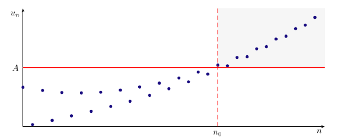

## Définition
::: {.bloc .def}
Définition :  

Soit $(u_n)$ une suite réelle. On dit que $(u_n)$ tend vers $+\infty$ (respectivement $-\infty$) si :
$$\forall A \in \R, \, \exists n_0 \in \N, \, \forall n \in \N, \, (n \geqslant n_0 \Rightarrow u_n \geqslant A)$$
$$\left(\text{respectivement } \forall A \in \R, \, \exists n_0 \in \N, \, \forall n \in \N, \, (n \geqslant n_0 \Rightarrow u_n \leqslant A)\right).$$

Autrement dit, tout intervalle $[A\,;\,+\infty[$ (respectivement $]-\infty\,;\,A]$) contient tous les termes de la suite à partir d'un certain rang.

On note alors :
$$\lim_{n \to +\infty} u_n = +\infty \quad \text{(respectivement } \lim_{n \to +\infty} u_n = -\infty).$$
:::

::: {.bloc .rem}
Illustration graphique :  
On a représenté ci-dessous une suite $\left(u_n\right)$ ayant une limite égale à $+\infty$.

   

  

 

:::

::: {.bloc .ex}
Exemple :  

Soit $(u_n)$ définie par $u_n = n^2 + 1$. Déterminons la limite de la suite $(u_n)$.

Afficher la correction :

Soit $A > 1$ (il suffit de traiter ce cas car si la propriété est vraie pour $A$, elle l'est pour tout réel plus petit), alors :
$$n^2 + 1 > A \Longleftrightarrow n^2 > A - 1 \Longleftrightarrow n > \sqrt{A - 1}.$$
On peut toujours trouver un entier $n_0$ tel que, pour tout $n \geqslant n_0$, $u_n > A$  
(par exemple $n_0 = \left\lfloor\sqrt{A - 1}\right\rfloor + 1$, où $\lfloor x \rfloor$ désigne la partie entière de $x$).

D'après la définition, la suite $(u_n)$ tend vers $+\infty$ :
$$\lim_{n \to +\infty} u_n = +\infty.$$

:::

::: {.bloc .thm}
Théorème :  

1. Toute suite croissante non majorée diverge vers $+\infty$.
2. Toute suite décroissante non minorée diverge vers $-\infty$.
:::

Démonstration :

Soit une suite $(u_n)$ non majorée et croissante, et $A$ un réel arbitraire.

Comme la suite est non majorée, il existe au moins un terme $u_p$ de la suite tel que $u_p > A$.

Or, la suite étant croissante, pour tout $n \geqslant p$, on a $u_n \geqslant u_p > A$.

Donc, on a prouvé qu'à partir du rang $p$, tous les termes de la suite sont supérieurs à $A$ : la suite tend vers $+\infty$.  
Le deuxième point se démontre de la même façon (ou en appliquant le premier à la suite $(-u_n)$).

::: {.bloc .thm}
Propriété (admise) :  

Soit $p \in \N^*$, alors  

$$
\lim_{n \to +\infty} n^p = +\infty \quad \et \quad \lim_{n \to +\infty} \sqrt{n} = +\infty.
$$
:::

### Limites par comparaison

::: {.bloc .thm}
Théorème :  

Soit $(u_n)$ et $(v_n)$ deux suites. Supposons qu'il existe $n_0 \in \N$ tel que pour tout $n \geqslant n_0$, $u_n \leqslant v_n$.

* Si $\lim_{n \to +\infty} u_n = +\infty$, alors $\lim_{n \to +\infty} v_n = +\infty$.
* Si $\lim_{n \to +\infty} v_n = -\infty$, alors $\lim_{n \to +\infty} u_n = -\infty$.
:::

Démonstration :

Soit $I$ un intervalle de la forme $]A, +\infty[$ avec $A$ un réel. Puisque $\lim_{n \to +\infty} u_n = +\infty$, alors par définition, $I$ contient tous les termes $u_n$ à partir d'un certain rang. On note ce rang $n_1$.

De plus, à partir du rang $n_0$, $u_n \leqslant v_n$.

On pose $N = \max(n_0\,;\,n_1)$, ainsi pour tout entier $n \geqslant N$, on a $u_n \in I$, c'est-à-dire que $A < u_n$ et $u_n \leqslant v_n$. Donc $A < v_n$.

On en déduit que $I$ contient tous les termes $v_n$ à partir du rang $N$. Donc $\lim_{n \to +\infty} v_n = +\infty$.  
Le deuxième point se démontre de la même façon.

::: {.bloc .ex}
Exemple :  

Soit $(u_n)$ une suite définie par $u_n = -2n^4 + \sin(n)$. Déterminons sa limite.

Afficher la correction :

Pour tout $n \in \N$, $\sin(n) \leqslant 1$, donc $-2n^4 + \sin(n) \leqslant -2n^4 + 1$.  
Or, $\lim_{n \to +\infty} n^4 = +\infty$, donc $\lim_{n \to +\infty} (-2n^4 + 1) = -\infty$ (voir les opérations sur les limites).  
Par comparaison, on en déduit que :
$$\lim_{n \to +\infty} u_n = -\infty.$$

:::
